# DST 组件总表（components/）

> **数据来源**: 原版 DST 脚本副本 —— 本工程内是 `<工程根>/dstsrc/scripts`（= `02-注释源码/scripts` 的 ASCII 联接）
> （提取当时写的是临时工作区路径 `C:/Users/35916/.qwenworkcn/...`，迁移后已作废）
> > - **来源文件**: `components/*.lua`
> **生成时间**: 2026-10-11 08:19:35 UTC
> **生成方式**: `node <工程根>/tools/extract-data.mjs`（可重复运行，幂等覆盖输出）
> **提取方法**: 正则 + 启发式。周期更新 / PushEvent / replica 同步目标 均为**直接正则匹配**；组件依赖为**启发式**（从 `.components.xxx` 访问与 AddComponent 调用推断）。
> **准确性说明**: **重要修正**: DST 的 Lua 组件**不使用 `net_` 前缀网络变量**。该机制由 C++ 引擎的 replica 组件实现：服务端写 `self.inst.replica.<comp>:SetXxx()`，客户端读副本。 因此本表的「网络同步」列基于 `replica.X:SetY()` 调用提取，`net_` 列仅保留字面匹配结果（全库仅 `fishschool.lua` 有 `SetNettedPrefab` 等误报，已剔除）。 **依赖组件**: 启发式，反映代码中的实际访问关系，不含隐式依赖。 **对外方法**: 正则匹配 `function Name:Method(` 的 Method 部分，可能包含私有方法。

---
## 使用说明

共 **821** 条组件记录（其中副本组件 19 个），**可用 grep 检索**。

```bash
# 找出所有周期更新的组件
grep "| 是 |" 组件总表.md

# 按组件名查找
grep "^| `hunger` |" 组件总表.md

# 找出某事件的全部发起者
grep "onhunger" 组件总表.md
```

**统计概览**

| 指标 | 数量 |
|---|---|
| 组件总数 | 821 |
| 副本组件(*_replica) | 19 |
| 含周期更新(DoPeriodicTask 等) | 365 |
| 含网络同步(replica.*:Set*) | 23 |
| 定义了 PushEvent 的组件 | 297 |

---

## 1. 组件明细表

| 组件名 | 行数 | 周期更新 | 网络同步 | 副本 | 依赖组件数 | 依赖组件 | 事件数 | 事件列表 | 分类 |
|---|---|---|---|---|---|---|---|---|---|
| `abysspillargroup` | 147 | 否 | 否 | 否 | 0 | — | 0 | — | 事件驱动, 存档 |
| `acidbatwavemanager` | 417 | 是 | 否 | 否 | 3 | inventory, stackable, talker | 1 | fly_back | 事件驱动, 存档 |
| `acidinfusible` | 222 | 是 | 否 | 否 | 3 | combat, locomotor, rainimmunity | 0 | — | 事件驱动 |
| `acidlevel` | 303 | 是 | 否 | 否 | 9 | armor, fueled, health, inventory, inventoryitem +4 | 1 | acidleveldelta | 周期更新, 事件驱动, 存档 |
| `activatable` | 75 | 否 | 否 | 否 | 0 | — | 1 | onactivated | — |
| `age` | 115 | 是 | 否 | 否 | 0 | — | 0 | — | 周期更新, 事件驱动, 存档 |
| `ambientlighting` | 365 | 是 | 否 | 否 | 1 | playervision | 0 | — | 事件驱动 |
| `ambientsound` | 499 | 是 | 否 | 否 | 1 | lunarhailbirdsoundmanager | 0 | — | 事件驱动 |
| `amorphous` | 111 | 否 | 否 | 否 | 2 | container, health | 0 | — | 事件驱动, 存档 |
| `amphibiouscreature` | 113 | 是 | 否 | 否 | 0 | — | 0 | — | 事件驱动 |
| `anchor` | 277 | 是 | 否 | 否 | 2 | boatphysics, expertsailor | 5 | raising_anchor, lowering_anchor, stopraisinganchor, anchor_raised, anchor_lowered | 事件驱动, 存档 |
| `aoecharging` | 235 | 是 | 否 | 否 | 2 | chargingreticule, playercontroller | 0 | — | 事件驱动 |
| `aoediminishingreturns` | 12 | 否 | 否 | 否 | 0 | — | 0 | — | — |
| `aoespell` | 70 | 否 | 否 | 否 | 5 | aoetargeting, fueled, inventoryitem, rider, spellbook | 1 | oncastaoespell | — |
| `aoetargeting` | 147 | 否 | 否 | 否 | 2 | playercontroller, reticule | 0 | — | 事件驱动 |
| `aoeweapon_base` | 189 | 否 | 否 | 否 | 7 | childspawner, combat, inventoryitem, mine, pickable +2 | 0 | — | — |
| `aoeweapon_leap` | 96 | 否 | 否 | 否 | 4 | aoeweapon_base, combat, health, weapon | 0 | — | — |
| `aoeweapon_lunge` | 235 | 否 | 否 | 否 | 4 | aoeweapon_base, combat, health, weapon | 0 | — | — |
| `appraisable` | 21 | 否 | 否 | 否 | 0 | — | 0 | — | — |
| `archivemanager` | 80 | 否 | 否 | 否 | 0 | — | 2 | arhivepoweron, arhivepoweroff | 事件驱动 |
| `area_trigger` | 34 | 否 | 否 | 否 | 0 | — | 0 | — | 事件驱动 |
| `area_unlock` | 29 | 否 | 否 | 否 | 0 | — | 0 | — | 事件驱动 |
| `areaaware` | 128 | 是 | 否 | 否 | 0 | — | 2 | changearea, on_ | 周期更新, 事件驱动 |
| `armor` | 177 | 否 | 否 | 否 | 2 | forgerepairable, inventoryitem | 3 | armorbroke, percentusedchange, armordamaged | 事件驱动, 存档 |
| `attackdodger` | 57 | 是 | 否 | 否 | 0 | — | 0 | — | — |
| `attunable` | 182 | 否 | 否 | 否 | 1 | attuner | 1 | attuned | 事件驱动, 存档 |
| `attuner` | 98 | 否 | 否 | 否 | 1 | attunable | 2 | gotnewattunement, attunementlost | — |
| `aura` | 67 | 是 | 否 | 否 | 1 | combat | 1 | stopaura | 周期更新 |
| `autosaver` | 224 | 是 | 否 | 否 | 0 | — | 1 | master_autosaverupdate | 事件驱动, 存档 |
| `autoterraformer` | 136 | 是 | 否 | 否 | 5 | container, finiteuses, inventory, inventoryitem, undertile | 2 | onterraform, collapsesoil | — |
| `avengingghost` | 189 | 是 | 否 | 否 | 4 | aura, combat, skilltreeupdater, timer | 1 | clientavengetimedirty | 事件驱动, 存档 |
| `bait` | 46 | 否 | 否 | 否 | 1 | inventory | 0 | — | 事件驱动 |
| `balloonmaker` | 17 | 否 | 否 | 否 | 1 | timer | 0 | — | — |
| `bathbomb` | 11 | 否 | 否 | 否 | 0 | — | 0 | — | — |
| `bathbombable` | 49 | 否 | 否 | 否 | 0 | — | 0 | — | — |
| `bathingpool` | 215 | 否 | 否 | 否 | 0 | — | 0 | — | 事件驱动 |
| `batspawner` | 56 | 是 | 否 | 否 | 0 | — | 0 | — | 事件驱动 |
| `battery` | 49 | 否 | 否 | 否 | 0 | — | 0 | — | — |
| `batteryuser` | 50 | 否 | 否 | 否 | 1 | battery | 0 | — | — |
| `battleborn` | 133 | 否 | 否 | 否 | 6 | armor, combat, health, inventory, sanity +1 | 0 | — | 事件驱动 |
| `beard` | 292 | 否 | 否 | 否 | 4 | container, inventory, sanity, skilltreeupdater | 1 | shaved | 事件驱动, 存档 |
| `beargerspawner` | 445 | 是 | 否 | 否 | 3 | areaaware, talker, worldsettingstimer | 0 | — | 事件驱动, 存档 |
| `beaverness` | 106 | 是 | 否 | 否 | 2 | health, hunger | 3 | beavernessdelta, startstarving, stopstarving | 周期更新, 存档 |
| `bedazzlement` | 97 | 是 | 否 | 否 | 1 | growable | 0 | — | 周期更新, 存档 |
| `bedazzler` | 31 | 否 | 否 | 否 | 4 | bedazzlement, burnable, finiteuses, freezable | 0 | — | — |
| `beefalometrics` | 175 | 否 | 否 | 否 | 4 | domesticatable, edible, rideable, uniqueid | 9 | beefalo.domestication.start, beefalo.domestication.feed, beefalo.domestication.brushed, beefalo.domestication.domesticated, beefalo.domestication.feral +4 | 事件驱动, 存档 |
| `birdattractor` | 15 | 否 | 否 | 否 | 0 | — | 0 | — | — |
| `birdspawner` | 629 | 是 | 否 | 否 | 10 | bait, birdattractor, eater, floater, inventoryitem +5 | 0 | — | 事件驱动 |
| `blinkstaff` | 97 | 是 | 否 | 否 | 1 | health | 0 | — | — |
| `bloomer` | 159 | 否 | 否 | 否 | 0 | — | 0 | — | 事件驱动 |
| `bloomness` | 139 | 是 | 否 | 否 | 0 | — | 0 | — | 存档 |
| `blowinwind` | 155 | 是 | 否 | 否 | 1 | locomotor | 0 | — | — |
| `boatai` | 25 | 是 | 否 | 否 | 2 | hull, mast | 0 | — | — |
| `boatcannon` | 122 | 否 | 否 | 否 | 3 | boatcannonuser, boatphysics, complexprojectile | 0 | — | 事件驱动, 存档 |
| `boatcannonuser` | 186 | 是 | 否 | 否 | 2 | boatcannon, reticule | 0 | — | 事件驱动 |
| `boatcrew` | 317 | 是 | 否 | 否 | 5 | boatphysics, crewmember, inventory, piratespawner, stackable | 1 | cheer | 周期更新, 事件驱动, 存档 |
| `boatdrag` | 18 | 否 | 否 | 否 | 0 | — | 0 | — | — |
| `boatdrifter` | 89 | 是 | 否 | 否 | 0 | — | 0 | — | — |
| `boatleak` | 339 | 是 | 否 | 否 | 5 | boatpatch, hullhealth, repairable, repairer, stackable | 0 | — | 事件驱动, 存档 |
| `boatmagnet` | 341 | 是 | 否 | 否 | 4 | boatmagnetbeacon, boatphysics, hull, locomotor | 2 | boatmagnet_pull_stop, boatmagnet_pull_start | 事件驱动, 存档 |
| `boatmagnetbeacon` | 225 | 是 | 否 | 否 | 2 | boatmagnet, inventoryitem | 2 | onturnon, onturnoff | 事件驱动, 存档 |
| `boatpatch` | 16 | 否 | 否 | 否 | 0 | — | 0 | — | — |
| `boatphysics` | 689 | 是 | 否 | 否 | 7 | boatdrag, boatdrifter, boatmagnetbeacon, health, physicsmodifiedexternally +2 | 5 | on_collide, hit_boat, stopturning, boat_stop_moving, boat_start_moving | 事件驱动, 存档 |
| `boatrace_proximitybeacon` | 40 | 否 | 否 | 否 | 0 | — | 0 | — | 事件驱动 |
| `boatrace_proximitychecker` | 83 | 是 | 否 | 否 | 0 | — | 1 | found_by_boatrace_checker | 周期更新 |
| `boatracecrew` | 168 | 是 | 否 | 否 | 1 | crewmember | 0 | — | 周期更新, 事件驱动, 存档 |
| `boatring` | 127 | 是 | 否 | 否 | 1 | boatringdata | 0 | — | 事件驱动, 存档 |
| `boatringdata` | 42 | 否 | 否 | 否 | 0 | — | 0 | — | — |
| `boatrotator` | 75 | 是 | 否 | 否 | 1 | boatring | 1 | rotationdirchanged | 事件驱动 |
| `boattrail` | 70 | 是 | 否 | 否 | 1 | boattrailmover | 0 | — | 事件驱动 |
| `boattrailmover` | 32 | 是 | 否 | 否 | 0 | — | 0 | — | — |
| `book` | 82 | 否 | 否 | 否 | 4 | finiteuses, reader, rider, sanity | 0 | — | — |
| `bosstargeter` | 0 | 否 | 否 | 否 | 0 | — | 0 | — | — |
| `bottler` | 17 | 否 | 否 | 否 | 0 | — | 0 | — | — |
| `brightmarespawner` | 222 | 是 | 否 | 否 | 3 | health, sanity, shard_wagbossinfo | 0 | — | 事件驱动 |
| `brush` | 5 | 否 | 否 | 否 | 0 | — | 0 | — | — |
| `brushable` | 80 | 否 | 否 | 否 | 1 | inventory | 1 | brushed | 存档 |
| `builder` | 1185 | 是 | 是 | 否 | 18 | container, craftingstation, equippable, giftreceiver, health +13 | 10 | unlockrecipe, techtreechange, consumehealthcost, consumeingredients, makerecipe +5 | 网络同步, 存档 |
| `builder_replica` | 454 | 否 | 否 | 是 | 3 | builder, playercontroller, skilltreeupdater | 0 | — | 副本组件, 事件驱动 |
| `bundlemaker` | 28 | 否 | 否 | 否 | 0 | — | 0 | — | — |
| `bundler` | 194 | 否 | 否 | 否 | 5 | bundlemaker, container, inventory, inventoryitem, unwrappable | 0 | — | 存档 |
| `burnable` | 606 | 是 | 否 | 否 | 12 | combat, diseaseable, explosive, finiteuses, firefx +7 | 5 | onburnt, plantkilled, onignite, burnt, onextinguish | 周期更新, 事件驱动 |
| `butterflyspawner` | 230 | 是 | 否 | 否 | 2 | homeseeker, pollinator | 0 | — | 事件驱动 |
| `camerafade` | 141 | 否 | 否 | 否 | 0 | — | 0 | — | — |
| `canopylightrays` | 65 | 是 | 否 | 否 | 0 | — | 0 | — | — |
| `canopyshadows` | 108 | 是 | 否 | 否 | 0 | — | 0 | — | — |
| `carefulwalker` | 103 | 是 | 否 | 否 | 1 | locomotor | 1 | carefulwalking | 事件驱动 |
| `carnivaldecor` | 46 | 是 | 否 | 否 | 1 | carnivaldecorranker | 0 | — | — |
| `carnivaldecorranker` | 62 | 是 | 否 | 否 | 1 | carnivaldecor | 0 | — | — |
| `carnivalevent` | 156 | 否 | 否 | 否 | 2 | knownlocations, playerspawner | 2 | ms_carnivalplazabuilt, ms_carnivalplazadestroyed | 事件驱动, 存档 |
| `carnivalgamefeedable` | 28 | 否 | 否 | 否 | 0 | — | 0 | — | — |
| `carnivalgameitem` | 6 | 否 | 否 | 否 | 0 | — | 0 | — | — |
| `carnivalgameshooter` | 61 | 否 | 否 | 否 | 1 | complexprojectile | 0 | — | — |
| `carnivalhostsummon` | 16 | 否 | 否 | 否 | 0 | — | 0 | — | — |
| `catcher` | 95 | 是 | 否 | 否 | 1 | projectile | 3 | cancelcatch, catch, caught | — |
| `cattoy` | 29 | 否 | 否 | 否 | 0 | — | 0 | — | — |
| `caveins` | 205 | 是 | 否 | 否 | 1 | talker | 1 | ms_miniquake | 事件驱动, 存档 |
| `caveweather` | 786 | 是 | 否 | 否 | 4 | acidlevel, areaaware, raindomewatcher, riftspawner | 4 | weathertick, moistureceilchanged, precipitationchanged, wetchanged | 事件驱动, 存档 |
| `centipedebody` | 340 | 是 | 否 | 否 | 1 | locomotor | 1 | grow_segment | 事件驱动, 存档 |
| `channelable` | 222 | 是 | 否 | 否 | 0 | — | 0 | — | 事件驱动 |
| `channelcastable` | 77 | 否 | 否 | 否 | 1 | channelcaster | 0 | — | 事件驱动 |
| `channelcaster` | 108 | 否 | 否 | 否 | 2 | channelcastable, locomotor | 2 | startchannelcast, stopchannelcast | 事件驱动 |
| `chargingreticule` | 114 | 否 | 否 | 否 | 0 | — | 0 | — | — |
| `charliecutscene` | 400 | 是 | 否 | 否 | 6 | colourtweener, entitytracker, focalpoint, pickable, trader +1 | 3 | charliecutscene, ms_locknightmarephase, shadowrift_opened | 事件驱动, 存档 |
| `chessunlocks` | 137 | 否 | 否 | 否 | 0 | — | 0 | — | 事件驱动, 存档 |
| `childspawner` | 823 | 是 | 否 | 否 | 5 | combat, health, homeseeker, inventoryitem, knownlocations | 2 | childgoinghome, goinghome | 周期更新, 事件驱动, 存档 |
| `circler` | 114 | 是 | 否 | 否 | 0 | — | 0 | — | — |
| `circuitnode` | 112 | 否 | 否 | 否 | 0 | — | 0 | — | — |
| `clientpickupsoundsuppressor` | 37 | 否 | 否 | 否 | 0 | — | 0 | — | 事件驱动 |
| `clock` | 539 | 是 | 否 | 否 | 0 | — | 9 | ms_cyclecomplete, clocksegschanged, cycleschanged, phasechanged, moonphasechanged +4 | 事件驱动, 存档 |
| `clockworktracker` | 175 | 否 | 否 | 否 | 1 | follower | 0 | — | 事件驱动 |
| `closeinspector` | 36 | 否 | 否 | 否 | 0 | — | 0 | — | — |
| `coach` | 96 | 是 | 否 | 否 | 3 | leader, sanity, talker | 2 | cheer, coach | — |
| `colouradder` | 130 | 否 | 否 | 否 | 1 | colouraddersync | 0 | — | 事件驱动 |
| `colouraddersync` | 51 | 否 | 否 | 否 | 0 | — | 0 | — | 事件驱动 |
| `colourcube` | 545 | 是 | 否 | 否 | 1 | playervision | 0 | — | 事件驱动 |
| `colourtweener` | 108 | 是 | 否 | 否 | 0 | — | 2 | colourtweener_end, colourtweener_start | — |
| `combat` | 1349 | 是 | 是 | 否 | 21 | attackdodger, burnable, complexprojectile, damagereflect, damagetypebonus +16 | 14 | losttarget, droppedtarget, newcombattarget, giveuptarget, killed +9 | 周期更新, 网络同步, 事件驱动 |
| `combat_replica` | 495 | 否 | 否 | 是 | 1 | combat | 0 | — | 副本组件, 事件驱动 |
| `commander` | 176 | 是 | 否 | 否 | 4 | combat, freezable, health, sleeper | 3 | soldierschanged, gotcommander, lostcommander | 周期更新, 事件驱动 |
| `complexprojectile` | 202 | 是 | 否 | 否 | 1 | projectile | 0 | — | — |
| `compostingbin` | 187 | 否 | 否 | 否 | 2 | stackable, timer | 0 | — | 事件驱动, 存档 |
| `constructionbuilder` | 181 | 否 | 否 | 否 | 4 | constructionbuilderuidata, constructionsite, container, inventory | 1 | stopconstruction | 事件驱动, 存档 |
| `constructionbuilderuidata` | 46 | 否 | 否 | 否 | 0 | — | 0 | — | — |
| `constructionplans` | 44 | 否 | 否 | 否 | 1 | constructionsite | 1 | onstartconstruction | — |
| `constructionsite` | 257 | 否 | 是 | 否 | 4 | constructionbuilder, inventory, inventoryitem, stackable | 0 | — | 网络同步, 存档 |
| `constructionsite_replica` | 102 | 否 | 否 | 是 | 1 | constructionsite | 0 | — | 副本组件, 事件驱动 |
| `container` | 1651 | 是 | 是 | 否 | 8 | constructionbuilderuidata, equippable, inventory, inventoryitem, playeractionpicker +3 | 9 | player_despawn, dropitem, container_got_item_while_closed, gotnewitem, itemget +4 | 网络同步, 事件驱动, 存档 |
| `container_proxy` | 185 | 是 | 否 | 否 | 2 | container, inventory | 2 | onopenother, oncloseother | 事件驱动 |
| `container_replica` | 647 | 是 | 是 | 是 | 2 | container, inventoryitem | 1 | refreshcrafting | 网络同步, 副本组件, 事件驱动 |
| `container_transform` | 38 | 否 | 否 | 否 | 1 | playercontroller | 0 | — | — |
| `containerinstallableitem` | 127 | 否 | 否 | 否 | 1 | inventoryitem | 2 | containerinstalleditem, containeruninstalleditem | 事件驱动 |
| `cookable` | 40 | 否 | 否 | 否 | 1 | perishable | 0 | — | — |
| `cookbookupdater` | 42 | 否 | 否 | 否 | 0 | — | 0 | — | 事件驱动 |
| `cooker` | 52 | 否 | 否 | 否 | 5 | burnable, cookable, fueled, inventoryitem, projectile | 0 | — | — |
| `cookiecutterdrill` | 56 | 是 | 否 | 否 | 3 | eater, health, hullhealth | 1 | spawnnewboatleak | — |
| `cooldown` | 95 | 是 | 否 | 否 | 0 | — | 0 | — | 存档 |
| `corpsepersistmanager` | 144 | 是 | 否 | 否 | 0 | — | 0 | — | 事件驱动 |
| `counter` | 105 | 否 | 否 | 否 | 0 | — | 0 | — | 存档 |
| `crabkingspawner` | 37 | 否 | 否 | 否 | 2 | childspawner, worldsettingstimer | 0 | — | — |
| `craftingstation` | 106 | 否 | 否 | 否 | 1 | builder | 0 | — | 存档 |
| `crewmember` | 171 | 否 | 否 | 否 | 3 | boatcrew, boatphysics, boatracecrew | 1 | rowed | 事件驱动 |
| `crittertraits` | 257 | 是 | 否 | 否 | 3 | edible, follower, timer | 1 | crittertraitchanged | 事件驱动, 存档 |
| `crop` | 290 | 是 | 否 | 否 | 9 | burnable, cookable, fertilizer, grower, halloweenmoonmutable +4 | 0 | — | 周期更新, 存档 |
| `cursable` | 156 | 否 | 否 | 否 | 6 | curseditem, debuffable, health, inventory, inventoryitem +1 | 0 | — | 存档 |
| `curseditem` | 185 | 是 | 否 | 否 | 8 | cursable, debuffable, floater, health, inventory +3 | 0 | — | 周期更新, 事件驱动 |
| `custombuildmanager` | 58 | 否 | 否 | 否 | 0 | — | 0 | — | 存档 |
| `cyclable` | 79 | 否 | 否 | 否 | 0 | — | 0 | — | 存档 |
| `damagereflect` | 26 | 否 | 否 | 否 | 0 | — | 0 | — | — |
| `damagetracker` | 37 | 否 | 否 | 否 | 0 | — | 0 | — | 事件驱动 |
| `damagetypebonus` | 67 | 否 | 否 | 否 | 0 | — | 0 | — | — |
| `damagetyperesist` | 52 | 否 | 否 | 否 | 0 | — | 0 | — | — |
| `dataanalyzer` | 79 | 是 | 否 | 否 | 0 | — | 0 | — | 周期更新, 存档 |
| `daywalkerspawner` | 278 | 否 | 否 | 否 | 2 | shard_daywalkerspawner, workable | 0 | — | 事件驱动, 存档 |
| `deathloothandler` | 40 | 否 | 否 | 否 | 0 | — | 0 | — | 存档 |
| `debuff` | 66 | 否 | 否 | 否 | 0 | — | 0 | — | — |
| `debuffable` | 174 | 否 | 否 | 否 | 1 | debuff | 0 | — | 事件驱动, 存档 |
| `debugger` | 83 | 是 | 否 | 否 | 0 | — | 0 | — | — |
| `decay` | 63 | 否 | 否 | 否 | 0 | — | 2 | spentfuel, addfuel | — |
| `deciduoustreeupdater` | 326 | 是 | 否 | 否 | 2 | burnable, combat | 2 | givetarget, sway | 周期更新 |
| `deckcontainer` | 131 | 否 | 否 | 否 | 0 | — | 0 | — | 存档 |
| `decoratedgrave_ghostmanager` | 228 | 是 | 否 | 否 | 2 | health, skilltreeupdater | 0 | — | 事件驱动 |
| `deerclopsspawner` | 457 | 是 | 否 | 否 | 4 | areaaware, knownlocations, talker, worldsettingstimer | 0 | — | 事件驱动, 存档 |
| `deerherding` | 334 | 是 | 否 | 否 | 5 | combat, deerherdspawner, hauntable, health, knownlocations | 0 | — | 存档 |
| `deerherdspawner` | 341 | 是 | 否 | 否 | 2 | deerherding, knownlocations | 2 | queuegrowantler, deerherdmigration | 事件驱动, 存档 |
| `deployable` | 149 | 否 | 否 | 否 | 3 | complexprojectile, inventory, rider | 2 | deployitem, itemplanted | — |
| `deployhelper` | 89 | 否 | 否 | 否 | 0 | — | 0 | — | — |
| `desolationspawner` | 307 | 是 | 否 | 否 | 0 | — | 0 | — | 周期更新, 存档 |
| `despawnfader` | 62 | 是 | 否 | 否 | 0 | — | 0 | — | 事件驱动 |
| `digester` | 41 | 是 | 否 | 否 | 1 | inventory | 0 | — | 周期更新, 事件驱动 |
| `disappears` | 87 | 是 | 否 | 否 | 1 | inventoryitem | 0 | — | 事件驱动 |
| `discoverable` | 55 | 否 | 否 | 否 | 0 | — | 0 | — | 事件驱动, 存档 |
| `diseaseable` | 239 | 是 | 否 | 否 | 0 | — | 0 | — | 存档 |
| `distancefade` | 50 | 否 | 否 | 否 | 0 | — | 0 | — | — |
| `distancetracker` | 22 | 是 | 否 | 否 | 0 | — | 0 | — | — |
| `dockmanager` | 468 | 是 | 否 | 否 | 4 | amphibiouscreature, drownable, inventoryitem, undertile | 3 | onsink, abandon_ship, onpresink | 事件驱动, 存档 |
| `domesticatable` | 264 | 是 | 否 | 否 | 3 | hunger, rideable, skilltreeupdater | 4 | goneferal, domesticated, obediencedelta, domesticationdelta | 周期更新, 存档 |
| `dpstracker` | 95 | 否 | 否 | 否 | 1 | health | 0 | — | 事件驱动 |
| `drawable` | 98 | 否 | 否 | 否 | 0 | — | 0 | — | 存档 |
| `drawingtool` | 52 | 否 | 否 | 否 | 2 | drawable, inventoryitem | 0 | — | — |
| `driedsalticon` | 75 | 否 | 否 | 否 | 1 | inventoryitem | 1 | imagechange | 事件驱动 |
| `drownable` | 423 | 是 | 否 | 否 | 8 | equippable, flotationdevice, health, hunger, inventory +3 | 4 | onsink, onfallinvoid, on_washed_ashore, on_void_arrive | 事件驱动 |
| `dryable` | 48 | 否 | 否 | 否 | 0 | — | 0 | — | — |
| `dryer` | 456 | 是 | 否 | 否 | 6 | dryable, edible, inventory, inventoryitem, perishable +1 | 0 | — | 事件驱动, 存档 |
| `dryingrack` | 529 | 是 | 否 | 否 | 8 | container, dryable, inventoryitem, moisture, perishable +3 | 0 | — | 事件驱动, 存档 |
| `dryingracksaltcollector` | 71 | 否 | 否 | 否 | 0 | — | 0 | — | 存档 |
| `dsp` | 338 | 否 | 否 | 否 | 1 | playerhearing | 0 | — | 事件驱动 |
| `dumbbelllifter` | 43 | 否 | 否 | 否 | 1 | mightydumbbell | 0 | — | — |
| `dynamicmusic` | 893 | 是 | 否 | 否 | 1 | areaaware | 0 | — | 周期更新, 事件驱动 |
| `eater` | 371 | 否 | 否 | 否 | 11 | container, edible, foodaffinity, foodmemory, health +6 | 3 | feedincontainer, feedmount, oneat | 存档 |
| `edible` | 261 | 否 | 否 | 否 | 5 | eater, foodaffinity, perishable, stackable, temperature | 1 | oneaten | 存档 |
| `efficientuser` | 48 | 否 | 否 | 否 | 0 | — | 0 | — | — |
| `electricattacks` | 19 | 否 | 否 | 否 | 0 | — | 0 | — | — |
| `electricconnector` | 150 | 否 | 否 | 否 | 0 | — | 4 | start_linking, end_linking, disconnect_links, linked_to | 存档 |
| `embarker` | 146 | 是 | 否 | 否 | 2 | locomotor, walkableplatform | 2 | done_embark_movement, start_embark_movement | — |
| `emitter` | 78 | 否 | 否 | 否 | 0 | — | 0 | — | — |
| `entitytracker` | 66 | 否 | 否 | 否 | 0 | — | 0 | — | 事件驱动, 存档 |
| `epicscare` | 28 | 否 | 否 | 否 | 1 | health | 1 | epicscare | — |
| `equippable` | 218 | 否 | 是 | 否 | 3 | burnable, inventoryitem, linkeditem | 2 | equipped, unequipped | 网络同步, 事件驱动 |
| `equippable_replica` | 58 | 否 | 否 | 是 | 2 | equippable, linkeditem | 0 | — | 副本组件 |
| `erasablepaper` | 68 | 否 | 否 | 否 | 3 | inventory, inventoryitem, stackable | 0 | — | — |
| `experiencecollector` | 65 | 是 | 否 | 否 | 1 | skilltreeupdater | 0 | — | 周期更新, 存档 |
| `expertsailor` | 39 | 否 | 否 | 否 | 0 | — | 0 | — | — |
| `explosive` | 136 | 否 | 否 | 否 | 11 | burnable, combat, damagetypebonus, dockmanager, explosiveresist +6 | 3 | explosion, entity_death, death | — |
| `explosiveresist` | 59 | 是 | 否 | 否 | 0 | — | 0 | — | 存档 |
| `fader` | 60 | 是 | 否 | 否 | 0 | — | 0 | — | — |
| `fan` | 54 | 否 | 否 | 否 | 0 | — | 0 | — | — |
| `farming_manager` | 621 | 是 | 否 | 否 | 3 | farmsoildrinker, undertile, worldsettingstimer | 3 | ms_fruitflytimerfinished, onsoilmoisturestatechange, on_planted | 周期更新, 事件驱动, 存档 |
| `farmplantable` | 32 | 否 | 否 | 否 | 0 | — | 2 | on_planted, itemplanted | — |
| `farmplantstress` | 149 | 否 | 否 | 否 | 1 | burnable | 0 | — | 存档 |
| `farmplanttendable` | 43 | 否 | 否 | 否 | 0 | — | 0 | — | 存档 |
| `farmsoildrinker` | 73 | 是 | 否 | 否 | 1 | farming_manager | 2 | ms_registersoildrinker, ms_unregistersoildrinker | 存档 |
| `farmtiller` | 18 | 否 | 否 | 否 | 0 | — | 1 | tilling | — |
| `feasts` | 322 | 是 | 否 | 否 | 3 | inventory, talker, wintersfeasttable | 2 | ruffle, feasterfinished | 周期更新, 事件驱动 |
| `fencerotator` | 22 | 否 | 否 | 否 | 0 | — | 1 | fencerotated | — |
| `fertilizable` | 12 | 否 | 否 | 否 | 0 | — | 0 | — | — |
| `fertilizer` | 54 | 否 | 否 | 否 | 2 | finiteuses, stackable | 0 | — | — |
| `fertilizerresearchable` | 24 | 否 | 否 | 否 | 0 | — | 1 | learnfertilizer | — |
| `fillable` | 64 | 否 | 否 | 否 | 5 | container, inventory, inventoryitem, stackable, watersource | 0 | — | — |
| `finiteuses` | 132 | 否 | 否 | 否 | 3 | efficientuser, forgerepairable, repairable | 1 | percentusedchange | 存档 |
| `firebug` | 44 | 是 | 否 | 否 | 2 | sanity, talker | 0 | — | — |
| `firedetector` | 414 | 是 | 否 | 否 | 2 | burnable, witherable | 0 | — | 周期更新, 事件驱动 |
| `firefx` | 174 | 是 | 否 | 否 | 0 | — | 0 | — | 事件驱动 |
| `fishable` | 148 | 是 | 否 | 否 | 1 | weighable | 0 | — | 存档 |
| `fishingnet` | 14 | 否 | 否 | 否 | 1 | fishingnetvisualizer | 0 | — | — |
| `fishingnetvisualizer` | 211 | 是 | 否 | 否 | 1 | inventoryitem | 6 | begin_opening, play_throw_pst, on_pre_net, on_release_from_net, begin_retrieving +1 | — |
| `fishingrod` | 203 | 是 | 是 | 否 | 3 | equippable, finiteuses, fishable | 6 | fishingnibble, fishingloserod, fishingcancel, fishingstrain, fishingcatch +1 | 网络同步 |
| `fishingrod_replica` | 33 | 否 | 否 | 是 | 0 | — | 0 | — | 副本组件 |
| `fishschool` | 58 | 是 | 否 | 否 | 0 | — | 1 | on_caught_in_net | 周期更新, 事件驱动 |
| `floater` | 238 | 否 | 否 | 否 | 1 | inventoryitem | 2 | floater_startfloating, floater_stopfloating | 事件驱动 |
| `flotationdevice` | 19 | 否 | 否 | 否 | 0 | — | 0 | — | — |
| `flotsamgenerator` | 435 | 是 | 否 | 否 | 2 | boatphysics, timer | 0 | — | 事件驱动, 存档 |
| `focalpoint` | 167 | 否 | 否 | 否 | 0 | — | 0 | — | 事件驱动 |
| `follower` | 532 | 是 | 是 | 否 | 7 | combat, followermemory, hitchable, inventoryitem, leader +2 | 5 | startleashing, stopleashing, leaderchanged, gainloyalty, loseloyalty | 网络同步, 事件驱动, 存档 |
| `follower_replica` | 20 | 否 | 否 | 是 | 0 | — | 0 | — | 副本组件 |
| `followerherder` | 44 | 否 | 否 | 否 | 2 | finiteuses, leader | 0 | — | — |
| `followermemory` | 222 | 是 | 否 | 否 | 1 | follower | 0 | — | 周期更新, 事件驱动, 存档 |
| `foodaffinity` | 101 | 否 | 否 | 否 | 1 | edible | 0 | — | — |
| `foodmemory` | 87 | 是 | 否 | 否 | 0 | — | 0 | — | 存档 |
| `forcecompostable` | 7 | 否 | 否 | 否 | 0 | — | 0 | — | — |
| `forestdaywalkerspawner` | 158 | 否 | 否 | 否 | 2 | shard_daywalkerspawner, wagpunk_manager | 0 | — | 事件驱动, 存档 |
| `forestpetrification` | 316 | 是 | 否 | 否 | 1 | petrifiable | 0 | — | 事件驱动, 存档 |
| `forestresourcespawner` | 180 | 是 | 否 | 否 | 0 | — | 0 | — | 事件驱动 |
| `forgerepair` | 63 | 否 | 否 | 否 | 4 | armor, finiteuses, fueled, stackable | 0 | — | — |
| `forgerepairable` | 75 | 否 | 否 | 否 | 3 | armor, forgerepair, fueled | 0 | — | — |
| `formationfollower` | 102 | 是 | 否 | 否 | 2 | formationleader, inventoryitem | 0 | — | — |
| `formationleader` | 256 | 是 | 否 | 否 | 4 | combat, follower, formationfollower, health | 0 | — | 事件驱动 |
| `freezable` | 334 | 是 | 否 | 否 | 5 | colouradder, combat, health, locomotor, shatterfx | 3 | freeze, unfreeze, onthaw | 周期更新, 事件驱动, 存档 |
| `freezefx` | 127 | 是 | 否 | 否 | 0 | — | 0 | — | — |
| `friendlevels` | 122 | 否 | 否 | 否 | 0 | — | 2 | friend_level_changed, friend_task_complete | 存档 |
| `frograin` | 260 | 是 | 否 | 否 | 1 | riftspawner | 0 | — | 事件驱动, 存档 |
| `frostybreather` | 132 | 否 | 否 | 否 | 0 | — | 0 | — | 事件驱动 |
| `fuel` | 38 | 否 | 否 | 否 | 0 | — | 1 | fueltaken | — |
| `fueled` | 353 | 是 | 否 | 否 | 4 | forgerepairable, fuel, fueler, fuelmaster | 3 | takefuel, onfueldsectionchanged, percentusedchange | 周期更新, 存档 |
| `fueler` | 38 | 否 | 否 | 否 | 0 | — | 1 | fueltaken | — |
| `fuelmaster` | 19 | 否 | 否 | 否 | 0 | — | 0 | — | — |
| `fumarolelocaltemperature` | 240 | 是 | 否 | 否 | 1 | temperatureoverrider | 0 | — | 事件驱动, 存档 |
| `fumaroletool` | 172 | 否 | 否 | 否 | 6 | aoediminishingreturns, heater, inventoryitem, inventoryitemtemperature, moisture +1 | 0 | — | 事件驱动, 存档 |
| `furnituredecor` | 50 | 否 | 否 | 否 | 0 | — | 0 | — | — |
| `furnituredecortaker` | 147 | 否 | 否 | 否 | 3 | furnituredecor, inventoryitem, stackable | 0 | — | 事件驱动, 存档 |
| `gelblobspawner` | 319 | 是 | 否 | 否 | 3 | health, riftspawner, shadowparasitemanager | 0 | — | 事件驱动, 存档 |
| `gestaltcage` | 60 | 否 | 否 | 否 | 2 | gestaltcapturable, inventoryitem | 0 | — | — |
| `gestaltcapturable` | 109 | 否 | 否 | 否 | 0 | — | 3 | gestaltcapturable_targeted, gestaltcapturable_untargeted, gestaltcaptured | 事件驱动 |
| `ghostbabysitter` | 82 | 是 | 否 | 否 | 0 | — | 1 | set_babysitter | 存档 |
| `ghostgestalter` | 49 | 否 | 否 | 否 | 0 | — | 0 | — | — |
| `ghostlybond` | 239 | 是 | 否 | 否 | 1 | pethealthbar | 3 | ghostlybond_level_change, ghostlybond_summoncomplete, ghostlybond_recallcomplete | 事件驱动, 存档 |
| `ghostlyelixir` | 35 | 否 | 否 | 否 | 3 | ghostlyelixirable, inventoryitem, stackable | 0 | — | — |
| `ghostlyelixirable` | 20 | 否 | 否 | 否 | 0 | — | 0 | — | — |
| `giftreceiver` | 108 | 是 | 否 | 否 | 0 | — | 5 | ms_addgiftreceiver, ms_removegiftreceiver, ms_opengift, ms_giftopened, ms_doneopengift | 事件驱动 |
| `gingerbreadhunter` | 240 | 是 | 否 | 否 | 1 | health | 0 | — | 事件驱动, 存档 |
| `globaltrackingicon` | 73 | 否 | 否 | 否 | 1 | maprevealable | 0 | — | — |
| `golfable` | 97 | 否 | 否 | 否 | 0 | — | 0 | — | 事件驱动 |
| `golfballspinner` | 107 | 是 | 否 | 否 | 1 | golfable | 0 | — | — |
| `golfclub` | 89 | 否 | 否 | 否 | 2 | golfable, golfclub_reticule | 1 | golfclub_onswinghit | — |
| `golfclub_reticule` | 377 | 是 | 否 | 否 | 3 | inventoryitem, playercontroller, reticule | 0 | — | 事件驱动 |
| `golfpropitem` | 79 | 是 | 否 | 否 | 1 | inventoryitem | 0 | — | — |
| `grabbable` | 30 | 否 | 否 | 否 | 0 | — | 0 | — | — |
| `gravediggable` | 44 | 否 | 否 | 否 | 0 | — | 0 | — | 存档 |
| `gravedigger` | 13 | 否 | 否 | 否 | 0 | — | 0 | — | — |
| `grogginess` | 312 | 是 | 否 | 否 | 3 | burnable, health, locomotor | 2 | knockedout, cometo | — |
| `groomer` | 277 | 是 | 否 | 否 | 2 | burnable, talker | 0 | — | 事件驱动 |
| `grottowarmanager` | 385 | 是 | 否 | 否 | 4 | areaaware, combat, knownlocations, locomotor | 1 | ms_setnightmarephase | 周期更新, 事件驱动, 存档 |
| `grottowaterfallsoundcontroller` | 222 | 是 | 否 | 否 | 1 | fader | 0 | — | 周期更新, 事件驱动 |
| `groundcreep` | 48 | 否 | 否 | 否 | 0 | — | 0 | — | 事件驱动, 存档 |
| `groundpounder` | 434 | 是 | 否 | 否 | 7 | boatphysics, burnable, combat, fueled, health +2 | 0 | — | — |
| `groundshadowhandler` | 55 | 是 | 否 | 否 | 0 | — | 0 | — | — |
| `grouptargeter` | 146 | 否 | 否 | 否 | 0 | — | 0 | — | 事件驱动 |
| `growable` | 369 | 是 | 否 | 否 | 0 | — | 0 | — | 存档 |
| `grower` | 204 | 否 | 否 | 否 | 4 | cookable, crop, fertilizer, plantable | 1 | itemplanted | 事件驱动, 存档 |
| `grue` | 225 | 是 | 否 | 否 | 4 | combat, health, playervision, sanity | 2 | attackedbygrue, resistedgrue | 事件驱动 |
| `guardian` | 174 | 是 | 否 | 否 | 0 | — | 1 | summonsdelta | 事件驱动, 存档 |
| `gym` | 148 | 是 | 否 | 否 | 2 | perishable, timer | 4 | rest, starttraining, endtraining, endrest | 周期更新, 事件驱动, 存档 |
| `halloweenmoonmutable` | 85 | 否 | 否 | 否 | 3 | health, inventoryitem, stackable | 2 | onhalloweenmoonmutate, attacked | — |
| `halloweenpotionmoon` | 32 | 否 | 否 | 否 | 3 | halloweenmoonmutable, inventoryitem, stackable | 0 | — | — |
| `hallucinations` | 250 | 是 | 否 | 否 | 0 | — | 0 | — | 事件驱动 |
| `harvestable` | 218 | 是 | 否 | 否 | 2 | inventory, inventoryitem | 1 | harvestsomething | 存档 |
| `hatchable` | 224 | 是 | 否 | 否 | 1 | heater | 0 | — | 周期更新, 存档 |
| `hauntable` | 187 | 是 | 否 | 否 | 1 | itemmimic | 2 | respawnfromghost, haunted | — |
| `healer` | 55 | 否 | 否 | 否 | 3 | efficientuser, health, stackable | 0 | — | — |
| `health` | 665 | 是 | 是 | 否 | 3 | burnable, combat, repairable | 12 | stoplunarburn, invincibletoggle, startfiredamage, changefiredamage, firedamage +7 | 周期更新, 网络同步, 事件驱动 +1 |
| `health_replica` | 216 | 否 | 否 | 是 | 1 | health | 0 | — | 副本组件, 事件驱动 |
| `healthbar` | 138 | 是 | 否 | 否 | 1 | health | 0 | — | 事件驱动 |
| `healthsyncer` | 125 | 是 | 否 | 否 | 3 | health, hunger, inventory | 2 | clienthealthstatusdirty, clienthealthdirty | 事件驱动 |
| `healthtrigger` | 41 | 否 | 否 | 否 | 0 | — | 0 | — | 事件驱动 |
| `heater` | 89 | 否 | 否 | 否 | 0 | — | 0 | — | — |
| `heavyobstaclephysics` | 307 | 是 | 否 | 否 | 1 | inventoryitem | 0 | — | 周期更新, 事件驱动, 存档 |
| `heavyobstacleusetarget` | 27 | 否 | 否 | 否 | 0 | — | 0 | — | — |
| `herd` | 268 | 是 | 否 | 否 | 4 | combat, health, herdmember, knownlocations | 0 | — | 周期更新, 事件驱动, 存档 |
| `herdmember` | 86 | 是 | 否 | 否 | 2 | health, herd | 0 | — | — |
| `hermitcrab_relocation_manager` | 490 | 是 | 否 | 否 | 1 | locomotor | 3 | teleported, ms_hermitcrab_relocated, teleport_move | 事件驱动, 存档 |
| `hideandseeker` | 57 | 是 | 否 | 否 | 2 | hideandseekgame, talker | 0 | — | 周期更新 |
| `hideandseekgame` | 180 | 是 | 否 | 否 | 2 | hideandseeker, hideandseekhidingspot | 0 | — | 周期更新, 事件驱动, 存档 |
| `hideandseekhider` | 132 | 是 | 否 | 否 | 1 | hideandseekhidingspot | 0 | — | 存档 |
| `hideandseekhidingspot` | 122 | 否 | 否 | 否 | 1 | hideandseekhider | 1 | onhidingspotremoved | 事件驱动, 存档 |
| `hideout` | 253 | 是 | 否 | 否 | 2 | combat, health | 0 | — | 周期更新, 存档 |
| `highlight` | 143 | 是 | 否 | 否 | 0 | — | 0 | — | — |
| `highlightchild` | 57 | 否 | 否 | 否 | 0 | — | 0 | — | 事件驱动 |
| `hitchable` | 54 | 否 | 否 | 否 | 1 | hitcher | 0 | — | 事件驱动, 存档 |
| `hitcher` | 73 | 否 | 否 | 否 | 1 | hitchable | 1 | unhitched | 存档 |
| `homeseeker` | 68 | 否 | 否 | 否 | 2 | burnable, locomotor | 0 | — | 事件驱动 |
| `hounded` | 1152 | 是 | 否 | 否 | 5 | age, combat, houndedtarget, spawnfader, talker | 2 | houndwarning, ms_miniquake | 事件驱动, 存档 |
| `houndedtarget` | 20 | 否 | 否 | 否 | 0 | — | 0 | — | — |
| `hudindicatable` | 35 | 是 | 否 | 否 | 1 | hudindicatablemanager | 1 | unregister_hudindicatable | 事件驱动 |
| `hudindicatablemanager` | 82 | 否 | 否 | 否 | 0 | — | 0 | — | 存档 |
| `hudindicatorwatcher` | 107 | 是 | 否 | 否 | 2 | hudindicatable, hudindicatablemanager | 0 | — | 事件驱动 |
| `hull` | 90 | 是 | 否 | 否 | 1 | walkableplatform | 0 | — | 事件驱动, 存档 |
| `hullhealth` | 290 | 是 | 否 | 否 | 5 | boatleak, boatphysics, boatring, health, walkableplatform | 2 | boatcollision, on_standing_on_new_leak | 周期更新, 事件驱动, 存档 |
| `hunger` | 210 | 是 | 是 | 否 | 1 | health | 3 | hungerdelta, startstarving, stopstarving | 周期更新, 网络同步, 存档 |
| `hunger_replica` | 92 | 否 | 否 | 是 | 1 | hunger | 0 | — | 副本组件, 事件驱动 |
| `hunter` | 627 | 是 | 否 | 否 | 3 | areaaware, lunarriftmutationsmanager, riftspawner | 7 | fly_back, huntlosttrail, huntwrongfork, huntbeastnearby, huntsuccessfulfork +2 | 周期更新, 事件驱动 |
| `incinerator` | 65 | 否 | 否 | 否 | 5 | combat, container, health, murderable, stackable | 3 | onincinerated, murdered, killed | — |
| `incrementalproducer` | 57 | 否 | 否 | 否 | 0 | — | 0 | — | — |
| `inkable` | 36 | 是 | 否 | 否 | 0 | — | 1 | deinked | — |
| `inspectable` | 87 | 否 | 否 | 否 | 9 | burnable, container, diseaseable, health, inventoryitem +4 | 0 | — | — |
| `inspectaclesparticipant` | 524 | 是 | 否 | 否 | 2 | inventory, skilltreeupdater | 1 | inspectaclesping | 事件驱动, 存档 |
| `instrument` | 53 | 否 | 否 | 否 | 0 | — | 0 | — | — |
| `insulator` | 31 | 否 | 否 | 否 | 0 | — | 0 | — | — |
| `inventory` | 2755 | 否 | 是 | 否 | 23 | armor, constructionbuilderuidata, container, container_proxy, curseditem +18 | 10 | player_despawn, itemlose, dropitem, itemget, gotnewitem +5 | 网络同步, 事件驱动, 存档 |
| `inventory_replica` | 610 | 否 | 否 | 是 | 3 | inventory, playeractionpicker, revivablecorpse | 2 | newactiveitem, inventoryclosed | 副本组件, 事件驱动 |
| `inventoryitem` | 571 | 是 | 是 | 否 | 9 | burnable, container, health, inventory, inventoryitemmoisture +4 | 11 | stacksizechange, onputininventory, onownerputininventory, ondropped, onownerdropped +6 | 网络同步, 事件驱动 |
| `inventoryitem_replica` | 526 | 否 | 否 | 是 | 13 | armor, container, deployable, equippable, finiteuses +8 | 4 | imagechange, rechargetimechange, wetnesschange, acidsizzlingchange | 副本组件, 事件驱动 |
| `inventoryitemholder` | 256 | 否 | 否 | 否 | 4 | container, inventory, inventoryitem, stackable | 0 | — | 事件驱动, 存档 |
| `inventoryitemmoisture` | 265 | 是 | 否 | 否 | 8 | container, floater, inventory, inventoryitem, moisture +3 | 0 | — | 周期更新, 存档 |
| `inventoryitemtemperature` | 352 | 是 | 否 | 否 | 4 | floater, heater, inventoryitem, stackable | 1 | temperaturedelta | 周期更新, 存档 |
| `itemaffinity` | 53 | 否 | 否 | 否 | 2 | inventory, sanity | 0 | — | 事件驱动 |
| `itemmimic` | 296 | 是 | 否 | 否 | 6 | container, equippable, inventory, inventoryitem, sanity +1 | 2 | jump, startled | 事件驱动, 存档 |
| `itemstore` | 74 | 否 | 否 | 否 | 0 | — | 1 | itemstore_changedcount | 存档 |
| `itemweigher` | 34 | 否 | 否 | 否 | 0 | — | 0 | — | — |
| `joustsource` | 132 | 否 | 否 | 否 | 2 | combat, health | 1 | knockback | — |
| `joustuser` | 60 | 否 | 否 | 否 | 0 | — | 0 | — | — |
| `key` | 47 | 否 | 否 | 否 | 0 | — | 0 | — | — |
| `kitcoon` | 10 | 否 | 否 | 否 | 0 | — | 0 | — | — |
| `kitcoonden` | 53 | 否 | 否 | 否 | 0 | — | 0 | — | 事件驱动 |
| `klaussackkey` | 45 | 是 | 否 | 否 | 0 | — | 1 | ms_restoreklaussackkey | — |
| `klaussacklock` | 38 | 否 | 否 | 否 | 1 | stackable | 0 | — | — |
| `klaussackloot` | 159 | 否 | 否 | 否 | 0 | — | 0 | — | 存档 |
| `klaussackspawner` | 272 | 否 | 否 | 否 | 2 | workable, worldsettingstimer | 0 | — | 事件驱动, 存档 |
| `knowndynamiclocations` | 120 | 否 | 否 | 否 | 0 | — | 0 | — | 事件驱动, 存档 |
| `knownlocations` | 79 | 否 | 否 | 否 | 1 | debugger | 0 | — | 存档 |
| `kramped` | 224 | 是 | 否 | 否 | 2 | combat, werebeast | 0 | — | 事件驱动 |
| `lavaarenaeventstate` | 94 | 否 | 否 | 否 | 0 | — | 1 | endofmatch | 事件驱动 |
| `lavaarenamobtracker` | 90 | 否 | 否 | 否 | 0 | — | 0 | — | 事件驱动 |
| `lavaarenamusic` | 87 | 否 | 否 | 否 | 0 | — | 0 | — | 事件驱动 |
| `leader` | 312 | 否 | 否 | 否 | 6 | combat, follower, inventory, leaderrollcall, minigame_participator +1 | 2 | stopfollowing, startfollowing | 事件驱动, 存档 |
| `leaderrollcall` | 170 | 是 | 否 | 否 | 4 | farmplanttendable, follower, inventoryitem, leader | 0 | — | — |
| `lighter` | 28 | 否 | 否 | 否 | 1 | burnable | 1 | onlighterlight | — |
| `lightningblocker` | 39 | 否 | 否 | 否 | 0 | — | 0 | — | — |
| `lightpostpartner` | 146 | 否 | 否 | 否 | 0 | — | 0 | — | 事件驱动, 存档 |
| `lighttweener` | 139 | 是 | 否 | 否 | 0 | — | 0 | — | — |
| `linkeditem` | 154 | 否 | 否 | 否 | 0 | — | 2 | ms_unregisterlinkeditem, ms_registerlinkeditem | 事件驱动, 存档 |
| `linkeditemmanager` | 129 | 否 | 否 | 否 | 1 | linkeditem | 0 | — | 事件驱动 |
| `lock` | 175 | 否 | 否 | 否 | 4 | inventory, inventoryitem, key, stackable | 0 | — | 存档 |
| `locomotor` | 1865 | 是 | 否 | 否 | 15 | amphibiouscreature, boatringdata, drownable, embarker, equippable +10 | 10 | creepactivate, walkoncreep, walkoffcreep, startstrafing, stopstrafing +5 | 事件驱动 |
| `lootdropper` | 460 | 否 | 否 | 否 | 8 | burnable, finiteuses, fueled, hauntable, health +3 | 4 | ifnotchanceloot, on_loot_dropped, loot_prefab_spawned, entity_droploot | — |
| `lordfruitflytrigger` | 81 | 是 | 否 | 否 | 1 | farming_manager | 0 | — | 事件驱动 |
| `luckitem` | 101 | 否 | 否 | 否 | 3 | equippable, inventoryitem, luckuser | 0 | — | 事件驱动 |
| `luckuser` | 56 | 否 | 否 | 否 | 1 | houndedtarget | 0 | — | — |
| `lunaralterguardianspawner` | 128 | 是 | 否 | 否 | 0 | — | 0 | — | 事件驱动, 存档 |
| `lunarfissureburning` | 114 | 是 | 否 | 否 | 5 | colouradder, combat, grogginess, health, rider | 0 | — | — |
| `lunarhailbirdsoundmanager` | 75 | 否 | 否 | 否 | 0 | — | 1 | updateambientsoundparams | 事件驱动 |
| `lunarhailbuildup` | 252 | 是 | 否 | 否 | 1 | rainimmunity | 4 | workinglunarhailbuildup, lunarhailbuildupworked, lunarhailbuildupworkablestatechanged, lunarhailbuildupdelta | 周期更新, 事件驱动, 存档 |
| `lunarhailmanager` | 438 | 是 | 否 | 否 | 8 | combat, farmplantstress, farmplanttendable, growable, inventory +3 | 2 | stopfalling, startfalling | 周期更新, 事件驱动 |
| `lunarplant_tentacle_weapon` | 84 | 否 | 否 | 否 | 2 | combat, skilltreeupdater | 0 | — | 事件驱动 |
| `lunarriftmutationsmanager` | 170 | 否 | 否 | 否 | 2 | health, wagboss_tracker | 1 | ms_lunarriftmutationsmanager_taskcompleted | 存档 |
| `lunarsupernovablocker` | 108 | 是 | 否 | 否 | 1 | colouradder | 0 | — | — |
| `lunarsupernovaburning` | 155 | 是 | 否 | 否 | 5 | colouradder, combat, grogginess, health, rider | 0 | — | — |
| `lunarthrall_plantspawner` | 535 | 是 | 否 | 否 | 5 | herd, herdmember, riftspawner, timer, witherable | 1 | finish_rift | 事件驱动, 存档 |
| `lureplantspawner` | 291 | 是 | 否 | 否 | 0 | — | 0 | — | 周期更新, 事件驱动 |
| `machine` | 125 | 是 | 否 | 否 | 0 | — | 2 | machineturnedon, machineturnedoff | 存档 |
| `madsciencelab` | 81 | 是 | 否 | 否 | 0 | — | 0 | — | 存档 |
| `magician` | 140 | 否 | 否 | 否 | 6 | container, equippable, inventory, inventoryitem, magiciantool +1 | 1 | magicianstopped | 存档 |
| `magiciantool` | 64 | 否 | 否 | 否 | 1 | magician | 0 | — | — |
| `malbatrossspawner` | 292 | 是 | 否 | 否 | 3 | entitytracker, knownlocations, worldsettingstimer | 0 | — | 事件驱动, 存档 |
| `map` | 1570 | 是 | 否 | 否 | 8 | moonstorms, pickable, placer, riftspawner, sharkboimanagerhelper +3 | 1 | onterraform | 周期更新 |
| `mapdeliverable` | 213 | 是 | 否 | 否 | 0 | — | 0 | — | 事件驱动, 存档 |
| `maprecorder` | 150 | 否 | 否 | 否 | 0 | — | 0 | — | 存档 |
| `maprevealable` | 273 | 是 | 否 | 否 | 1 | maprevealer | 0 | — | 周期更新, 事件驱动 |
| `maprevealer` | 119 | 是 | 否 | 否 | 0 | — | 0 | — | — |
| `mapspotrevealer` | 71 | 否 | 否 | 否 | 0 | — | 2 | on_reveal_map_spot_pre, on_reveal_map_spot_pst | — |
| `markable` | 107 | 否 | 否 | 否 | 0 | — | 0 | — | 存档 |
| `markable_proxy` | 39 | 否 | 否 | 否 | 1 | markable | 0 | — | — |
| `mast` | 261 | 是 | 否 | 否 | 1 | boatphysics | 1 | stopfurling | 事件驱动 |
| `maxhealer` | 24 | 否 | 否 | 否 | 2 | health, stackable | 0 | — | — |
| `maxlightspawner` | 69 | 否 | 否 | 否 | 0 | — | 0 | — | 存档 |
| `maxwelltalker` | 215 | 是 | 否 | 否 | 2 | playercontroller, talker | 0 | — | 事件驱动 |
| `mermcandidate` | 39 | 否 | 否 | 否 | 1 | edible | 0 | — | 存档 |
| `mermkingmanager` | 419 | 否 | 否 | 否 | 6 | burnable, health, inspectable, inventory, mermcandidate +1 | 4 | onmermkingdestroyed, getup, oncreated, onmermkingcreated | 事件驱动, 存档 |
| `messagebottlemanager` | 287 | 否 | 否 | 否 | 1 | treasuremarked | 0 | — | 事件驱动, 存档 |
| `meteorshower` | 332 | 是 | 否 | 否 | 1 | worldmeteorshower | 0 | — | 周期更新, 存档 |
| `miasmamanager` | 391 | 是 | 否 | 否 | 1 | riftspawner | 1 | miasma_setactive | 事件驱动, 存档 |
| `miasmawatcher` | 115 | 否 | 否 | 否 | 3 | locomotor, playervision, rider | 0 | — | 事件驱动 |
| `mightiness` | 405 | 是 | 否 | 否 | 14 | coach, combat, efficientuser, expertsailor, health +9 | 2 | mightinessdelta, mightiness_statechange | 周期更新, 事件驱动, 存档 |
| `mightydumbbell` | 110 | 否 | 否 | 否 | 2 | finiteuses, mightiness | 0 | — | — |
| `mightygym` | 477 | 是 | 否 | 否 | 14 | burnable, freezable, grogginess, health, hunger +9 | 0 | — | 事件驱动 |
| `migrationmanager` | 614 | 是 | 否 | 否 | 0 | — | 0 | — | 事件驱动, 存档 |
| `migrationpetowner` | 37 | 否 | 否 | 否 | 0 | — | 0 | — | — |
| `migrationpetsoverrider` | 21 | 否 | 否 | 否 | 0 | — | 0 | — | — |
| `mine` | 230 | 是 | 否 | 否 | 2 | combat, health | 0 | — | 周期更新, 事件驱动, 存档 |
| `minigame` | 151 | 是 | 否 | 否 | 3 | follower, minigame_participator, minigame_spectator | 1 | ms_minigamedeactivated | 周期更新 |
| `minigame_participator` | 79 | 是 | 否 | 否 | 4 | combat, follower, leader, minigame | 0 | — | 周期更新, 事件驱动 |
| `minigame_spectator` | 39 | 否 | 否 | 否 | 1 | combat | 0 | — | 事件驱动 |
| `minionspawner` | 386 | 是 | 否 | 否 | 1 | health | 2 | attacked, minionchange | 事件驱动, 存档 |
| `moisture` | 397 | 是 | 是 | 否 | 7 | inventory, moistureabsorberuser, rainimmunity, sheltered, sleepingbag +2 | 1 | moisturedelta | 网络同步, 事件驱动, 存档 |
| `moisture_replica` | 15 | 否 | 否 | 是 | 0 | — | 0 | — | 副本组件 |
| `moistureabsorbersource` | 53 | 否 | 否 | 否 | 2 | moisture, moistureabsorberuser | 0 | — | — |
| `moistureabsorberuser` | 46 | 否 | 否 | 否 | 2 | inventory, moistureabsorbersource | 0 | — | — |
| `moistureimmunity` | 57 | 否 | 否 | 否 | 1 | moisture | 0 | — | 事件驱动 |
| `mood` | 177 | 否 | 否 | 否 | 0 | — | 0 | — | 存档 |
| `moonaltarlink` | 49 | 否 | 否 | 否 | 1 | moonaltarlinktarget | 0 | — | — |
| `moonaltarlinktarget` | 71 | 否 | 否 | 否 | 2 | moonaltarlink, moonstormmanager | 0 | — | 事件驱动 |
| `moonbeastspawner` | 221 | 是 | 否 | 否 | 7 | combat, entitytracker, freezable, health, sleeper +2 | 3 | detachchild, moontransformed, moonpetrify | 周期更新, 事件驱动 |
| `moonrelic` | 5 | 否 | 否 | 否 | 0 | — | 0 | — | — |
| `moonsparkchargeable` | 25 | 否 | 否 | 否 | 1 | fueled | 0 | — | — |
| `moonstormlightningmanager` | 82 | 是 | 否 | 否 | 1 | moonstorms | 0 | — | 事件驱动 |
| `moonstormmanager` | 1034 | 是 | 否 | 否 | 6 | entitytracker, health, moonstorms, talker, timer +1 | 12 | ms_setmoonphasestyle, ms_lockmoonphase, ms_setclocksegs, ms_setmoonphase, talk +7 | 周期更新, 事件驱动, 存档 |
| `moonstorms` | 165 | 否 | 否 | 否 | 1 | areaaware | 3 | moonstorm_nodes_dirty_relay, ms_stormchanged, ms_moonstormwindowover | 事件驱动 |
| `moonstormstaticcapturable` | 89 | 否 | 否 | 否 | 0 | — | 3 | moonstormstaticcapturable_targeted, moonstormstaticcapturable_untargeted, moonstormstatic_caught | 事件驱动 |
| `moonstormstaticcatcher` | 52 | 否 | 否 | 否 | 1 | moonstormstaticcapturable | 0 | — | — |
| `moonstormwatcher` | 108 | 否 | 否 | 否 | 5 | locomotor, moonstorms, playervision, rider, stormwatcher | 1 | moonstormlevel | 事件驱动 |
| `moontrader` | 41 | 否 | 否 | 否 | 2 | inventoryitem, stackable | 0 | — | — |
| `moosespawner` | 108 | 否 | 否 | 否 | 2 | entitytracker, timer | 0 | — | — |
| `murderable` | 13 | 否 | 否 | 否 | 0 | — | 0 | — | — |
| `mutatedbirdmanager` | 8 | 否 | 否 | 否 | 0 | — | 0 | — | — |
| `mutatedbuzzardcircler` | 344 | 是 | 否 | 否 | 3 | corpsepersistmanager, migrationmanager, mutatedbuzzardmanager | 0 | — | 事件驱动 |
| `mutatedbuzzardmanager` | 589 | 是 | 否 | 否 | 4 | corpsepersistmanager, migrationmanager, mutatedbuzzardcircler, riftspawner | 0 | — | 事件驱动, 存档 |
| `nabbag` | 135 | 否 | 否 | 否 | 3 | finiteuses, inventory, stackable | 0 | — | — |
| `named` | 53 | 否 | 是 | 否 | 0 | — | 0 | — | 网络同步, 存档 |
| `named_replica` | 30 | 否 | 否 | 是 | 0 | — | 0 | — | 副本组件, 事件驱动 |
| `nightlightmanager` | 120 | 否 | 否 | 否 | 0 | — | 0 | — | 事件驱动 |
| `nightmareclock` | 329 | 是 | 否 | 否 | 1 | areaaware | 2 | nightmarephasechanged, nightmareclocktick | 事件驱动, 存档 |
| `nis` | 84 | 否 | 否 | 否 | 0 | — | 0 | — | — |
| `nonslipgritpool` | 33 | 否 | 否 | 否 | 0 | — | 0 | — | — |
| `nonslipgritsource` | 37 | 否 | 否 | 否 | 2 | nonslipgrituser, slipperyfeet | 0 | — | — |
| `nonslipgrituser` | 34 | 否 | 否 | 否 | 2 | inventory, nonslipgritsource | 0 | — | — |
| `npc_talker` | 128 | 否 | 否 | 否 | 1 | talker | 0 | — | 事件驱动 |
| `nutrients_visual_manager` | 80 | 否 | 否 | 否 | 0 | — | 0 | — | 事件驱动 |
| `oar` | 53 | 否 | 否 | 否 | 4 | boatphysics, expertsailor, leader, playercontroller | 3 | rowing, rowed, leader_failed_row | — |
| `oasis` | 24 | 否 | 否 | 否 | 0 | — | 0 | — | — |
| `objectspawner` | 43 | 否 | 否 | 否 | 0 | — | 0 | — | 存档 |
| `occupiable` | 136 | 否 | 否 | 否 | 2 | inventoryitem, occupier | 0 | — | 事件驱动, 存档 |
| `occupier` | 15 | 否 | 否 | 否 | 0 | — | 0 | — | — |
| `ocean` | 28 | 否 | 否 | 否 | 0 | — | 0 | — | — |
| `oceancolor` | 88 | 是 | 否 | 否 | 0 | — | 0 | — | 事件驱动 |
| `oceanfishable` | 209 | 是 | 否 | 否 | 3 | inventoryitem, locomotor, oceanfishingrod | 0 | — | 事件驱动 |
| `oceanfishinghook` | 109 | 是 | 否 | 否 | 1 | perishable | 0 | — | — |
| `oceanfishingrod` | 417 | 是 | 是 | 否 | 8 | complexprojectile, container, equippable, locomotor, oceanfishable +3 | 3 | newfishingtarget, fishcaught, oceanfishing_stoppedfishing | 网络同步, 事件驱动 |
| `oceanfishingrod_replica` | 48 | 否 | 否 | 是 | 0 | — | 0 | — | 副本组件 |
| `oceanfishingtackle` | 33 | 否 | 否 | 否 | 0 | — | 0 | — | — |
| `oceanicemanager` | 546 | 是 | 否 | 否 | 12 | amphibiouscreature, boatphysics, complexprojectile, drownable, floater +7 | 6 | on_landed, on_no_longer_landed, icefloebreak, onsink, abandon_ship +1 | 事件驱动, 存档 |
| `oceanthrowable` | 21 | 否 | 否 | 否 | 1 | complexprojectile | 0 | — | — |
| `oceantrawler` | 425 | 是 | 否 | 否 | 5 | container, edible, health, homeseeker, schoolspawner | 3 | ms_registerfishshoal, ms_unregisterfishshoal, ms_shoalfishhooked | 周期更新, 事件驱动, 存档 |
| `oceanwhirlportalphysics` | 270 | 是 | 否 | 否 | 5 | health, inventoryitem, physicsmodifiedexternally, winchtarget, workable | 3 | flyaway, teleported, on_salvaged | 事件驱动 |
| `oldager` | 145 | 是 | 否 | 否 | 1 | health | 0 | — | — |
| `papereraser` | 18 | 否 | 否 | 否 | 1 | erasablepaper | 0 | — | — |
| `parryweapon` | 69 | 否 | 否 | 否 | 1 | locomotor | 1 | combat_parry | — |
| `pearldecorationscore` | 693 | 是 | 否 | 否 | 12 | burnable, childspawner, container, dryingrack, furnituredecor +7 | 4 | pearldecorationscore_updatestatus, ms_updatepearldecorationscore_tiles, pearldecorationscore_evaluatescores, pearldecorationscore_updatescore | 事件驱动, 存档 |
| `penguinspawner` | 560 | 是 | 否 | 否 | 1 | knownlocations | 0 | — | 事件驱动, 存档 |
| `periodicspawner` | 254 | 是 | 否 | 否 | 1 | flotsamgenerator | 0 | — | 存档 |
| `perishable` | 353 | 是 | 否 | 否 | 9 | container, edible, inventory, inventoryitem, moisture +4 | 3 | forceperishchange, perishchange, perished | 周期更新, 存档 |
| `pethealthbar` | 348 | 是 | 否 | 否 | 3 | health, hunger, inventory | 8 | clientpethealthsymboldirty, clientpethealthstatusdirty, clientpethealthpulsedirty, clientpetmaxhealthdirty, clientpethealthdirty +3 | 事件驱动 |
| `petleash` | 322 | 否 | 否 | 否 | 1 | leader | 0 | — | 事件驱动, 存档 |
| `petrifiable` | 139 | 是 | 否 | 否 | 0 | — | 2 | ms_registerpetrifiable, ms_unregisterpetrifiable | 事件驱动, 存档 |
| `physicsmodifiedexternally` | 84 | 否 | 否 | 否 | 2 | boatphysics, locomotor | 2 | gainphysicsmodifiedexternally, losephysicsmodifiedexternally | 事件驱动 |
| `pickable` | 603 | 是 | 否 | 否 | 7 | burnable, fertilizer, inventory, inventoryitem, lootdropper +2 | 2 | picksomething, picked | 存档 |
| `pinnable` | 177 | 是 | 否 | 否 | 3 | combat, health, locomotor | 2 | pinned, onunpin | 事件驱动 |
| `piratespawner` | 865 | 是 | 否 | 否 | 10 | age, boatcrew, container, crewmember, health +5 | 1 | victory | 事件驱动, 存档 |
| `placer` | 588 | 否 | 否 | 否 | 1 | deployhelper | 2 | onplacerhidden, onplacershown | 事件驱动 |
| `planardamage` | 56 | 否 | 否 | 否 | 0 | — | 0 | — | — |
| `planardefense` | 56 | 否 | 否 | 否 | 0 | — | 0 | — | — |
| `planarentity` | 42 | 否 | 否 | 否 | 0 | — | 0 | — | — |
| `plantable` | 7 | 否 | 否 | 否 | 0 | — | 0 | — | — |
| `plantregistryupdater` | 64 | 否 | 否 | 否 | 0 | — | 0 | — | 事件驱动 |
| `plantregrowth` | 271 | 是 | 否 | 否 | 0 | — | 0 | — | 周期更新, 存档 |
| `plantresearchable` | 29 | 否 | 否 | 否 | 0 | — | 1 | learnplantstage | — |
| `platformhopdelay` | 18 | 否 | 否 | 否 | 0 | — | 0 | — | — |
| `playbill` | 27 | 否 | 否 | 否 | 0 | — | 0 | — | 存档 |
| `playbill_lecturn` | 112 | 是 | 否 | 否 | 5 | inventory, lootdropper, playbill, stageactingprop, writeable | 1 | text_changed | 存档 |
| `playeractionpicker` | 582 | 否 | 否 | 否 | 4 | aoetargeting, boatcannonuser, golfclub_reticule, playercontroller | 0 | — | 事件驱动 |
| `playeravatardata` | 236 | 否 | 否 | 否 | 0 | — | 0 | — | 存档 |
| `playercontroller` | 5940 | 是 | 否 | 否 | 18 | aoecharging, aoetargeting, attuner, boatcannonuser, combat +13 | 5 | endsteeringreticule, starsteeringreticule, continuefrompause, locomote, quagmire_shoptab | 事件驱动 |
| `playerfloater` | 85 | 否 | 否 | 否 | 3 | container, equippable, inventory | 0 | — | 存档 |
| `playerhearing` | 78 | 是 | 否 | 否 | 0 | — | 2 | pushdsp, popdsp | 事件驱动 |
| `playerinspectable` | 30 | 否 | 否 | 否 | 1 | skilltreeupdater | 0 | — | 事件驱动 |
| `playerlightningtarget` | 40 | 否 | 否 | 否 | 2 | health, inventory | 2 | lightningdamageavoided, playerlightningtargeted | — |
| `playermetrics` | 23 | 否 | 否 | 否 | 0 | — | 1 | character.prototyped | 事件驱动 |
| `playerprox` | 246 | 是 | 否 | 否 | 0 | — | 0 | — | 周期更新, 事件驱动 |
| `playerspawner` | 327 | 否 | 否 | 否 | 6 | areaaware, colourtweener, locomotor, migrationpetsoverrider, playercontroller +1 | 1 | ms_newplayercharacterspawned | 事件驱动, 存档 |
| `playerspeedmult` | 219 | 否 | 否 | 否 | 1 | locomotor | 0 | — | 事件驱动 |
| `playertargetindicator` | 89 | 是 | 否 | 否 | 2 | hudindicatable, hudindicatablemanager | 0 | — | 事件驱动 |
| `playervision` | 338 | 是 | 否 | 否 | 0 | — | 11 | nightvision, gogglevision, nutrientsvision, scrapmonolevision, inspectaclesvision +6 | 事件驱动 |
| `playervoter` | 122 | 是 | 否 | 否 | 0 | — | 1 | playervotechanged | 事件驱动 |
| `playingcard` | 72 | 否 | 否 | 否 | 0 | — | 0 | — | 存档 |
| `playingcardsmanager` | 181 | 否 | 否 | 否 | 2 | deckcontainer, playingcard | 0 | — | 事件驱动, 存档 |
| `pocketwatch` | 34 | 否 | 否 | 否 | 0 | — | 0 | — | — |
| `pocketwatch_dismantler` | 44 | 否 | 否 | 否 | 6 | container, inventory, inventoryitem, itemmimic, lootdropper +1 | 0 | — | — |
| `pointofinterest` | 283 | 是 | 否 | 否 | 0 | — | 0 | — | — |
| `pollinator` | 53 | 否 | 否 | 否 | 0 | — | 0 | — | — |
| `poppable` | 19 | 否 | 否 | 否 | 0 | — | 0 | — | — |
| `portablestructure` | 16 | 否 | 否 | 否 | 0 | — | 0 | — | — |
| `positionalwarp` | 193 | 是 | 否 | 否 | 0 | — | 0 | — | 周期更新, 事件驱动, 存档 |
| `possessedaxe` | 234 | 是 | 否 | 否 | 4 | equippable, finiteuses, inventory, inventoryitem | 4 | axerejectedowner, axerejectedotheraxe, axepossessedbyplayer, possessedaxe | 事件驱动, 存档 |
| `powerload` | 20 | 否 | 否 | 否 | 0 | — | 0 | — | — |
| `preservative` | 9 | 否 | 否 | 否 | 0 | — | 0 | — | — |
| `preserver` | 44 | 否 | 否 | 否 | 0 | — | 0 | — | — |
| `projectedeffects` | 105 | 是 | 否 | 否 | 0 | — | 0 | — | — |
| `projectile` | 518 | 是 | 否 | 否 | 5 | catcher, combat, complexprojectile, inventoryitem, weapon | 2 | onthrown, hostileprojectile | 事件驱动 |
| `propagator` | 255 | 是 | 否 | 否 | 4 | burnable, freezable, health, heater | 2 | stopfiremelt, firemelt | 周期更新 |
| `prophider` | 161 | 是 | 否 | 否 | 0 | — | 1 | propreveal | 存档 |
| `prototyper` | 89 | 否 | 否 | 否 | 1 | craftingstation | 0 | — | 事件驱动 |
| `pumpkincarvable` | 491 | 是 | 否 | 否 | 3 | burnable, inventory, updatelooper | 0 | — | 事件驱动, 存档 |
| `pumpkincarver` | 7 | 否 | 否 | 否 | 0 | — | 0 | — | — |
| `pumpkinhatcarvable` | 194 | 是 | 否 | 否 | 5 | burnable, equippable, floater, inventory, inventoryitem | 0 | — | 事件驱动 |
| `pushable` | 97 | 是 | 否 | 否 | 0 | — | 2 | startpushing, stoppushing | — |
| `quagmire_hangriness` | 268 | 是 | 否 | 否 | 0 | — | 2 | quagmirehangrinessrumbled, quagmirehangrinessmatched | 事件驱动 |
| `quagmire_map` | 12 | 否 | 否 | 否 | 0 | — | 0 | — | — |
| `quagmire_music` | 98 | 否 | 否 | 否 | 0 | — | 0 | — | 事件驱动 |
| `quagmire_recipebook` | 208 | 是 | 否 | 否 | 0 | — | 1 | quagmire_recipediscovered | 事件驱动 |
| `quagmire_recipeprices` | 198 | 是 | 否 | 否 | 0 | — | 1 | quagmire_recipeappraised | 事件驱动 |
| `quaker` | 831 | 是 | 否 | 否 | 8 | childspawner, combat, inventoryitem, rabbitkingmanager, riftspawner +3 | 6 | detachchild, stopfalling, startfalling, endquake, startquake +1 | 周期更新, 事件驱动, 存档 |
| `questowner` | 111 | 否 | 否 | 否 | 0 | — | 0 | — | 存档 |
| `rabbitkingmanager` | 603 | 是 | 否 | 否 | 5 | combat, homeseeker, inventoryitem, knownlocations, talker | 5 | burrowarrive, burrowto, becameaggressive, dropkickarrive, burrowaway | 事件驱动, 存档 |
| `raindome` | 218 | 是 | 否 | 否 | 1 | rainimmunity | 0 | — | 事件驱动 |
| `raindomewatcher` | 26 | 是 | 否 | 否 | 0 | — | 3 | enterraindome, underraindomes, exitraindome | — |
| `rainimmunity` | 50 | 否 | 否 | 否 | 0 | — | 2 | gainrainimmunity, loserainimmunity | 事件驱动 |
| `rampingspawner` | 192 | 是 | 否 | 否 | 0 | — | 2 | rampingspawner_death, rampingspawner_spawn | 事件驱动, 存档 |
| `reader` | 62 | 否 | 否 | 否 | 1 | book | 0 | — | — |
| `recallmark` | 66 | 否 | 否 | 否 | 0 | — | 0 | — | 存档 |
| `rechargeable` | 187 | 是 | 是 | 否 | 0 | — | 1 | rechargechange | 网络同步, 存档 |
| `recipescanner` | 47 | 否 | 否 | 否 | 1 | builder | 1 | onrecipescanned | — |
| `recipestockpile` | 165 | 是 | 否 | 否 | 0 | — | 0 | — | 事件驱动, 存档 |
| `regrowthmanager` | 332 | 是 | 否 | 否 | 0 | — | 0 | — | 周期更新, 事件驱动, 存档 |
| `reloaditem` | 6 | 否 | 否 | 否 | 0 | — | 0 | — | — |
| `remoteteleporter` | 151 | 否 | 否 | 否 | 2 | inventoryitem, winonateleportpadmanager | 2 | teleported, remoteteleportreceived | — |
| `repairable` | 185 | 否 | 否 | 否 | 6 | finiteuses, health, perishable, repairer, stackable +1 | 0 | — | — |
| `repairer` | 62 | 否 | 否 | 否 | 0 | — | 0 | — | — |
| `repellent` | 108 | 否 | 否 | 否 | 4 | combat, finiteuses, follower, leader | 0 | — | — |
| `replayproxy` | 23 | 否 | 否 | 否 | 0 | — | 0 | — | — |
| `researchpointconverter` | 33 | 否 | 否 | 否 | 0 | — | 0 | — | — |
| `resistance` | 57 | 否 | 否 | 否 | 0 | — | 1 | damageresisted | — |
| `reticule` | 365 | 是 | 否 | 否 | 1 | aoetargeting | 0 | — | 事件驱动 |
| `retrofitcavemap_anr` | 1114 | 是 | 否 | 否 | 5 | heavyobstaclephysics, objectspawner, teleporter, undertile, vaultroommanager | 1 | ms_save | 存档 |
| `retrofitforestmap_anr` | 1977 | 是 | 否 | 否 | 12 | craftingstation, friendlevels, fueled, heavyobstaclephysics, inventory +7 | 2 | ms_unlockchesspiece, ms_save | 存档 |
| `revivablecorpse` | 93 | 否 | 否 | 否 | 0 | — | 1 | respawnfromcorpse | — |
| `rideable` | 239 | 是 | 否 | 否 | 7 | combat, domesticatable, lootdropper, rider, saddler +2 | 7 | beingridden, riderdoattackother, unequipped, saddlechanged, equipped +2 | 周期更新, 事件驱动, 存档 |
| `rider` | 263 | 是 | 是 | 否 | 9 | combat, complexprojectile, health, pinnable, projectile +4 | 6 | mountwounded, refusedmount, refusedrider, mounted, dismount +1 | 网络同步, 事件驱动, 存档 |
| `rider_replica` | 273 | 否 | 是 | 是 | 7 | equippable, health, inventoryitem, locomotor, playeractionpicker +2 | 0 | — | 网络同步, 副本组件, 事件驱动 |
| `riftspawner` | 483 | 否 | 否 | 否 | 3 | riftthralltype, wagpunk_manager, worldsettingstimer | 2 | ms_riftremovedfrompool, ms_riftaddedtopool | 事件驱动, 存档 |
| `riftthralltype` | 37 | 否 | 否 | 否 | 0 | — | 0 | — | 存档 |
| `rooted` | 69 | 否 | 否 | 否 | 1 | locomotor | 2 | rooted, unrooted | 事件驱动 |
| `ropebridgemanager` | 381 | 是 | 否 | 否 | 1 | undertile | 0 | — | 事件驱动, 存档 |
| `roseinspectable` | 63 | 否 | 否 | 否 | 0 | — | 0 | — | — |
| `roseinspectableuser` | 270 | 是 | 否 | 否 | 2 | roseinspectable, talker | 1 | silentcloseinspect | 事件驱动, 存档 |
| `ruinsshadelingspawner` | 67 | 是 | 否 | 否 | 1 | sittable | 0 | — | 事件驱动 |
| `saddler` | 92 | 否 | 是 | 否 | 2 | damagetyperesist, spdamageutil | 0 | — | 网络同步 |
| `saltlicker` | 176 | 是 | 否 | 否 | 4 | finiteuses, freezable, sleeper, timer | 1 | saltchange | 周期更新, 事件驱动, 存档 |
| `sandstorms` | 157 | 否 | 否 | 否 | 2 | areaaware, oasis | 1 | ms_stormchanged | 事件驱动 |
| `sandstormwatcher` | 107 | 否 | 否 | 否 | 5 | locomotor, playervision, rider, sandstorms, stormwatcher | 1 | sandstormlevel | 事件驱动 |
| `sanity` | 619 | 是 | 是 | 否 | 7 | equippable, health, inventory, moisture, rider +2 | 7 | sanitymodechanged, inducedinsanity, inducedlunacy, sanitydelta, gosane +2 | 网络同步, 存档 |
| `sanity_replica` | 240 | 否 | 否 | 是 | 1 | sanity | 2 | sanitymodechanged, sanitydirty | 副本组件, 事件驱动 |
| `sanityaura` | 35 | 否 | 否 | 否 | 0 | — | 0 | — | — |
| `sanityauraadjuster` | 30 | 是 | 否 | 否 | 0 | — | 0 | — | 周期更新 |
| `savedrotation` | 28 | 是 | 否 | 否 | 0 | — | 0 | — | 存档 |
| `savedscale` | 21 | 否 | 否 | 否 | 0 | — | 0 | — | 存档 |
| `scaler` | 33 | 否 | 否 | 否 | 0 | — | 0 | — | 存档 |
| `scenariorunner` | 64 | 否 | 否 | 否 | 0 | — | 0 | — | 存档 |
| `schoolspawner` | 303 | 是 | 否 | 否 | 4 | amphibiouscreature, herd, herdmember, oceantrawler | 1 | schoolspawned | 事件驱动, 存档 |
| `scrapbookable` | 17 | 否 | 否 | 否 | 0 | — | 0 | — | — |
| `seamlessplayerswapper` | 134 | 否 | 否 | 否 | 5 | curseditem, health, inventory, skinner, talker | 2 | ms_playerreroll, ms_playerseamlessswaped | 存档 |
| `searchable` | 92 | 否 | 否 | 否 | 0 | — | 1 | searched | 存档 |
| `seasons` | 553 | 否 | 否 | 否 | 0 | — | 4 | ms_setclocksegs, master_seasonsupdate, seasontick, seasonlengthschanged | 事件驱动, 存档 |
| `selfstacker` | 75 | 是 | 否 | 否 | 4 | bait, burnable, inventoryitem, stackable | 0 | — | — |
| `sentientaxe` | 212 | 是 | 否 | 否 | 3 | equippable, health, inventoryitem | 0 | — | 事件驱动 |
| `setbonus` | 108 | 否 | 否 | 否 | 2 | inventory, inventoryitem | 0 | — | — |
| `sewing` | 29 | 否 | 否 | 否 | 3 | finiteuses, fueled, stackable | 0 | — | — |
| `shadowcreaturespawner` | 365 | 是 | 否 | 否 | 3 | areaaware, sanity, walkableplatform | 0 | — | 事件驱动 |
| `shadowdominance` | 59 | 否 | 否 | 否 | 3 | equippable, inventory, inventoryitem | 0 | — | 事件驱动 |
| `shadowhandspawner` | 311 | 是 | 否 | 否 | 9 | age, anchor, burnable, entitytracker, fueled +4 | 0 | — | 事件驱动 |
| `shadowlevel` | 26 | 否 | 否 | 否 | 0 | — | 0 | — | — |
| `shadowparasitemanager` | 472 | 是 | 否 | 否 | 7 | combat, follower, herdmember, inventory, riftspawner +2 | 1 | intro | 周期更新, 事件驱动, 存档 |
| `shadowsubmissive` | 58 | 是 | 否 | 否 | 1 | inventory | 0 | — | 事件驱动 |
| `shadowthrall_mimics` | 235 | 是 | 否 | 否 | 2 | itemmimic, riftspawner | 0 | — | 周期更新, 事件驱动 |
| `shadowthrallmanager` | 649 | 是 | 否 | 否 | 9 | areaaware, combat, entitytracker, health, knownlocations +4 | 0 | — | 周期更新, 事件驱动, 存档 |
| `shard_autosaver` | 54 | 否 | 否 | 否 | 0 | — | 1 | secondary_autosaverupdate | 事件驱动 |
| `shard_clock` | 117 | 否 | 否 | 否 | 0 | — | 1 | secondary_clockupdate | 事件驱动 |
| `shard_daywalkerspawner` | 96 | 否 | 否 | 否 | 0 | — | 0 | — | 事件驱动, 存档 |
| `shard_mermkingwatcher` | 256 | 是 | 否 | 否 | 1 | mermkingmanager | 8 | onmermkingcreated_anywhere, onmermkingdestroyed_anywhere, onmermkingtridentadded_anywhere, onmermkingtridentremoved_anywhere, onmermkingcrownadded_anywhere +3 | 事件驱动 |
| `shard_players` | 149 | 是 | 否 | 否 | 0 | — | 1 | ms_playercounts | 事件驱动 |
| `shard_seasons` | 112 | 否 | 否 | 否 | 0 | — | 1 | secondary_seasonsupdate | 事件驱动 |
| `shard_sinkholes` | 96 | 否 | 否 | 否 | 0 | — | 1 | secondary_sinkholesupdate | 事件驱动 |
| `shard_wagbossinfo` | 53 | 否 | 否 | 否 | 1 | wagboss_tracker | 0 | — | 事件驱动 |
| `shard_worldreset` | 51 | 否 | 否 | 否 | 0 | — | 1 | secondary_worldresetupdate | 事件驱动 |
| `shard_worldvoter` | 158 | 否 | 否 | 否 | 0 | — | 3 | secondary_worldvoterenabled, secondary_worldvoterupdate, secondary_worldvotersquelchedupdate | 事件驱动 |
| `shardstate` | 61 | 否 | 否 | 否 | 0 | — | 0 | — | 事件驱动 |
| `shardtransactionsteps` | 237 | 是 | 否 | 否 | 1 | itemstore | 0 | — | 存档 |
| `sharkboimanager` | 914 | 是 | 否 | 否 | 9 | combat, follower, health, inventory, oceanfishable +4 | 4 | ms_cleanupticksharkboiarena, ms_cleanedupsharkboiarena, knockback, ms_spawnedsharkboiarena | 周期更新, 事件驱动, 存档 |
| `sharkboimanagerhelper` | 31 | 否 | 否 | 否 | 0 | — | 0 | — | — |
| `sharklistener` | 137 | 是 | 否 | 否 | 0 | — | 0 | — | 周期更新, 事件驱动 |
| `shatterfx` | 20 | 否 | 否 | 否 | 0 | — | 0 | — | — |
| `shaveable` | 82 | 否 | 否 | 否 | 2 | inventory, inventoryitem | 0 | — | 存档 |
| `shaver` | 7 | 否 | 否 | 否 | 0 | — | 0 | — | — |
| `shedder` | 49 | 是 | 否 | 否 | 0 | — | 0 | — | 周期更新 |
| `shelf` | 77 | 否 | 否 | 否 | 1 | inventory | 0 | — | — |
| `sheltered` | 88 | 是 | 否 | 否 | 2 | rainimmunity, talker | 1 | sheltered | — |
| `sheltered_replica` | 80 | 是 | 否 | 是 | 0 | — | 0 | — | 副本组件, 事件驱动 |
| `shop` | 40 | 否 | 否 | 否 | 0 | — | 0 | — | — |
| `simplebook` | 24 | 否 | 否 | 否 | 0 | — | 0 | — | — |
| `simplemagicgrower` | 29 | 是 | 否 | 否 | 1 | growable | 0 | — | — |
| `singable` | 27 | 否 | 否 | 否 | 2 | finiteuses, singinginspiration | 0 | — | — |
| `singinginspiration` | 438 | 是 | 否 | 否 | 7 | combat, health, inventory, leader, rechargeable +2 | 2 | inspirationdelta, inspirationsongchanged | 周期更新, 事件驱动, 存档 |
| `singingshellmanager` | 96 | 否 | 否 | 否 | 1 | singingshelltrigger | 0 | — | 事件驱动 |
| `singingshelltrigger` | 77 | 是 | 否 | 否 | 1 | singingshellmanager | 0 | — | 事件驱动 |
| `sinkholespawner` | 306 | 是 | 否 | 否 | 1 | talker | 4 | onsinkholesstarted, onsinkholesfinished, startcollapse, master_sinkholesupdate | 存档 |
| `sisturnregistry` | 120 | 是 | 否 | 否 | 0 | — | 1 | onsisturnstatechanged | 事件驱动 |
| `sittable` | 69 | 否 | 否 | 否 | 1 | burnable | 3 | becomesittable, sittableonfire, becomeunsittable | 事件驱动 |
| `sizetweener` | 63 | 是 | 否 | 否 | 0 | — | 2 | sizetweener_end, sizetweener_start | — |
| `skeletonsweeper` | 110 | 否 | 否 | 否 | 0 | — | 0 | — | 事件驱动 |
| `skilltreeupdater` | 285 | 否 | 否 | 否 | 0 | — | 8 | onactivateskill_client, onactivateskill_server, ondeactivateskill_client, ondeactivateskill_server, onaddskillxp_client +3 | 事件驱动, 存档 |
| `skinner` | 866 | 否 | 否 | 否 | 1 | beard | 2 | unequipskinneditem, equipskinneditem | 存档 |
| `skinner_beefalo` | 183 | 否 | 否 | 否 | 0 | — | 1 | onclothingchanged | 存档 |
| `sleeper` | 350 | 是 | 否 | 否 | 7 | burnable, combat, freezable, health, homeseeker +2 | 2 | gotosleep, onwakeup | 周期更新, 事件驱动, 存档 |
| `sleepingbag` | 95 | 否 | 否 | 否 | 1 | sleepingbaguser | 0 | — | — |
| `sleepingbaguser` | 110 | 是 | 否 | 否 | 5 | health, hunger, inventory, sanity, sleepingbag | 0 | — | 周期更新 |
| `slingshotmodder` | 19 | 否 | 否 | 否 | 2 | linkeditem, slingshotmods | 0 | — | — |
| `slingshotmods` | 223 | 是 | 否 | 否 | 5 | container, containerinstallableitem, equippable, inventoryitem, skilltreeupdater | 1 | ms_slingshotmodsclosed | 事件驱动, 存档 |
| `slipperyfeet` | 276 | 是 | 否 | 否 | 3 | nonslipgritpool, nonslipgrituser, slipperyfeettarget | 1 | feetslipped | 事件驱动, 存档 |
| `slipperyfeettarget` | 46 | 否 | 否 | 否 | 0 | — | 0 | — | — |
| `smotherer` | 6 | 否 | 否 | 否 | 0 | — | 0 | — | — |
| `snowballmanager` | 228 | 是 | 否 | 否 | 1 | snowballmelting | 0 | — | 事件驱动, 存档 |
| `snowballmelting` | 133 | 是 | 否 | 否 | 0 | — | 0 | — | — |
| `snowmandecor` | 7 | 否 | 否 | 否 | 0 | — | 0 | — | — |
| `snowmandecoratable` | 853 | 是 | 否 | 否 | 7 | equippable, heavyobstaclephysics, inventory, inventoryitem, pushable +2 | 0 | — | 事件驱动, 存档 |
| `socket_shadow_harvester` | 290 | 是 | 否 | 否 | 9 | container, inventory, linkeditem, locomotor, petleash +4 | 2 | braincommon_pickup_failed, braincommon_pickup_success | 周期更新, 事件驱动 |
| `socket_shadow_heart` | 21 | 否 | 否 | 否 | 0 | — | 0 | — | 事件驱动 |
| `socket_shadow_mimicry` | 38 | 否 | 否 | 否 | 2 | container, inventory | 1 | itemmimic_refreshpausestates | 事件驱动 |
| `socketable` | 32 | 否 | 否 | 否 | 0 | — | 0 | — | — |
| `socketholder` | 436 | 否 | 否 | 否 | 3 | inventoryitem, socketable, stackable | 2 | onsocketeditem, onunsocketeditem | 事件驱动, 存档 |
| `soul` | 10 | 否 | 否 | 否 | 0 | — | 0 | — | — |
| `souleater` | 32 | 否 | 否 | 否 | 2 | soul, stackable | 1 | oneatsoul | — |
| `spawner` | 334 | 是 | 否 | 否 | 5 | burnable, health, homeseeker, knownlocations, locomotor | 1 | gohomefailed | 事件驱动, 存档 |
| `spawnfader` | 114 | 是 | 否 | 否 | 0 | — | 2 | spawnfaderout, spawnfaderin | 事件驱动 |
| `spdamageutil` | 122 | 否 | 否 | 否 | 2 | planardamage, planardefense | 0 | — | — |
| `specialeventsetup` | 349 | 否 | 否 | 否 | 3 | hideandseekhider, hideandseekhidingspot, playerspawner | 3 | ms_collectallkitcoons, ms_setupspecialevent, ms_shutdownspecialevent | 存档 |
| `spectatorcorpse` | 120 | 是 | 否 | 否 | 1 | focalpoint | 0 | — | 事件驱动 |
| `spell` | 146 | 是 | 否 | 否 | 0 | — | 0 | — | 存档 |
| `spellbook` | 154 | 否 | 否 | 否 | 1 | playercontroller | 0 | — | 事件驱动 |
| `spellbookcooldowns` | 87 | 否 | 否 | 否 | 0 | — | 0 | — | 事件驱动 |
| `spellcaster` | 202 | 否 | 否 | 否 | 4 | combat, health, locomotor, workable | 0 | — | — |
| `spidermutator` | 43 | 否 | 否 | 否 | 4 | follower, inventory, inventoryitem, stackable | 1 | mutate | — |
| `spooked` | 120 | 是 | 否 | 否 | 3 | age, growable, workable | 1 | spooked | — |
| `squadmember` | 73 | 否 | 否 | 否 | 0 | — | 2 | ms_joinsquad_, ms_leavesquad_ | 事件驱动 |
| `squidspawner` | 190 | 是 | 否 | 否 | 2 | herd, oceantrawler | 1 | spawn | 事件驱动 |
| `stackable` | 214 | 否 | 是 | 否 | 5 | curseditem, edible, inventoryitem, perishable, rechargeable | 1 | stacksizechange | 网络同步, 存档 |
| `stackable_replica` | 152 | 否 | 否 | 是 | 1 | stackable | 1 | inventoryitem_stacksizedirty | 副本组件, 事件驱动 |
| `staffsanity` | 15 | 否 | 否 | 否 | 1 | sanity | 0 | — | — |
| `stageactingprop` | 453 | 是 | 否 | 否 | 6 | entitytracker, inventory, locomotor, playbill_lecturn, stageactor +1 | 6 | play_ended, stopstageacting, startstageacting, play_begun, perform_do_next_line +1 | 事件驱动, 存档 |
| `stageactor` | 187 | 是 | 否 | 否 | 1 | talker | 1 | play_performed | 周期更新, 事件驱动, 存档 |
| `steeringwheel` | 58 | 否 | 否 | 否 | 1 | steeringwheeluser | 0 | — | 事件驱动 |
| `steeringwheeluser` | 122 | 是 | 否 | 否 | 2 | boatphysics, steeringwheel | 3 | stop_steering_boat, playerstopturning, set_heading | 事件驱动 |
| `stewer` | 360 | 是 | 否 | 否 | 4 | container, inventory, perishable, stackable | 1 | learncookbookrecipe | 事件驱动, 存档 |
| `stormwatcher` | 140 | 是 | 否 | 否 | 5 | locomotor, moonstorms, moonstormwatcher, sandstorms, sandstormwatcher | 0 | — | 事件驱动 |
| `storyteller` | 119 | 是 | 否 | 否 | 1 | talker | 0 | — | 周期更新, 事件驱动 |
| `storytellingprop` | 12 | 否 | 否 | 否 | 0 | — | 0 | — | — |
| `strafer` | 85 | 是 | 否 | 否 | 2 | locomotor, playercontroller | 0 | — | 事件驱动 |
| `stretcher` | 54 | 是 | 否 | 否 | 0 | — | 0 | — | — |
| `strongman` | 18 | 否 | 否 | 否 | 1 | mightiness | 0 | — | — |
| `stuckdetection` | 44 | 否 | 否 | 否 | 0 | — | 0 | — | — |
| `stunnable` | 53 | 是 | 否 | 否 | 0 | — | 2 | stunned, stun_finished | 事件驱动 |
| `submersible` | 208 | 否 | 否 | 否 | 2 | inventory, inventoryitem | 1 | on_submerge | 事件驱动, 存档 |
| `summoningitem` | 6 | 否 | 否 | 否 | 0 | — | 0 | — | — |
| `symbolswapdata` | 15 | 否 | 否 | 否 | 0 | — | 0 | — | — |
| `tackler` | 165 | 否 | 否 | 否 | 3 | combat, health, workable | 0 | — | — |
| `tacklesketch` | 20 | 否 | 否 | 否 | 1 | craftingstation | 1 | onlearnednewtacklesketch | — |
| `talkable` | 7 | 否 | 否 | 否 | 0 | — | 0 | — | — |
| `talker` | 315 | 是 | 否 | 否 | 3 | health, revivablecorpse, sleeper | 2 | ontalk, donetalking | 事件驱动 |
| `targettracker` | 187 | 是 | 否 | 否 | 1 | health | 2 | targettracker_starttrack, targettracker_stoptrack | 事件驱动 |
| `teacher` | 30 | 否 | 否 | 否 | 1 | builder | 0 | — | — |
| `teamattacker` | 116 | 是 | 否 | 否 | 5 | combat, health, knownlocations, locomotor, teamleader | 0 | — | — |
| `teamleader` | 352 | 是 | 否 | 否 | 4 | burnable, combat, health, teamattacker | 0 | — | 事件驱动 |
| `teleportedoverride` | 24 | 否 | 否 | 否 | 0 | — | 0 | — | — |
| `teleporter` | 423 | 是 | 否 | 否 | 8 | amphibiouscreature, container, drownable, follower, inventory +3 | 2 | ms_playerdespawnandmigrate, doneteleporting | 事件驱动, 存档 |
| `temperature` | 539 | 是 | 否 | 否 | 9 | beard, health, heater, insulator, inventory +4 | 1 | temperaturedelta | 事件驱动, 存档 |
| `temperatureoverrider` | 141 | 否 | 否 | 否 | 1 | fumarolelocaltemperature | 0 | — | 事件驱动 |
| `terraformer` | 50 | 否 | 否 | 否 | 1 | undertile | 2 | collapsesoil, onterraform | — |
| `terraformerremoveable` | 24 | 否 | 否 | 否 | 0 | — | 0 | — | — |
| `thief` | 60 | 否 | 否 | 否 | 5 | combat, container, equippable, inventory, inventoryitem | 1 | onitemstolen | — |
| `timer` | 159 | 是 | 否 | 否 | 0 | — | 1 | timerdone | 存档 |
| `toadstoolspawner` | 195 | 否 | 否 | 否 | 1 | worldsettingstimer | 3 | ms_spawntoadstool, toadstoolstatechanged, toadstoolkilled | 事件驱动, 存档 |
| `toggleableitem` | 28 | 否 | 否 | 否 | 0 | — | 0 | — | — |
| `tool` | 51 | 否 | 否 | 否 | 2 | inventoryitem, rechargeable | 1 | toolbroke | 事件驱动 |
| `touchstonetracker` | 90 | 否 | 否 | 否 | 0 | — | 0 | — | 事件驱动, 存档 |
| `townportalregistry` | 202 | 是 | 否 | 否 | 2 | channelable, inventoryitem | 1 | linktownportals | 事件驱动 |
| `tradable` | 9 | 否 | 否 | 否 | 0 | — | 0 | — | — |
| `trader` | 170 | 否 | 否 | 否 | 7 | health, inventory, inventoryitem, itemmimic, playercontroller +2 | 1 | trade | — |
| `transformer` | 331 | 是 | 否 | 否 | 0 | — | 0 | — | 事件驱动, 存档 |
| `transparentondrones` | 177 | 是 | 否 | 否 | 1 | linkeditem | 0 | — | — |
| `transparentonsanity` | 95 | 是 | 否 | 否 | 0 | — | 0 | — | — |
| `trap` | 492 | 是 | 否 | 否 | 9 | bait, eater, finiteuses, health, inventory +4 | 7 | springtrap, trapped, safelydisarmedtrap, harvesttrap, starvedtrapsouls +2 | 周期更新, 事件驱动, 存档 |
| `trapfumaroleburning` | 153 | 是 | 否 | 否 | 8 | burnable, colouradder, combat, cookable, health +3 | 0 | — | — |
| `treasuremarked` | 37 | 否 | 否 | 否 | 0 | — | 0 | — | 存档 |
| `treegrowthsolution` | 34 | 否 | 否 | 否 | 2 | growable, stackable | 0 | — | — |
| `tributable` | 84 | 是 | 否 | 否 | 0 | — | 2 | onaccepttribute, onrefusetribute | 存档 |
| `trophyscale` | 162 | 否 | 否 | 否 | 3 | inventory, stackable, weighable | 1 | onnewtrophy | 存档 |
| `uianim` | 235 | 否 | 否 | 否 | 0 | — | 0 | — | — |
| `undertile` | 77 | 否 | 否 | 否 | 0 | — | 0 | — | 事件驱动, 存档 |
| `unevenground` | 66 | 是 | 否 | 否 | 0 | — | 1 | unevengrounddetected | 周期更新 |
| `uniqueid` | 36 | 是 | 否 | 否 | 1 | uniqueprefabids | 0 | — | 存档 |
| `uniqueprefabids` | 37 | 否 | 否 | 否 | 0 | — | 0 | — | 存档 |
| `unsaddler` | 5 | 否 | 否 | 否 | 0 | — | 0 | — | — |
| `unwrappable` | 201 | 是 | 否 | 否 | 3 | container, inventory, inventoryitem | 3 | wrappeditem, unwrappeditem, unwrapped | 存档 |
| `updatelooper` | 194 | 是 | 否 | 否 | 0 | — | 0 | — | 周期更新 |
| `upgradeable` | 133 | 否 | 否 | 否 | 2 | stackable, upgrader | 0 | — | 存档 |
| `upgrademodule` | 68 | 否 | 否 | 否 | 0 | — | 0 | — | — |
| `upgrademoduleowner` | 474 | 否 | 否 | 否 | 2 | inventoryitem, upgrademodule | 1 | energylevelupdate | 存档 |
| `upgrademoduleremover` | 7 | 否 | 否 | 否 | 0 | — | 0 | — | — |
| `upgrader` | 31 | 否 | 否 | 否 | 1 | upgradeable | 0 | — | — |
| `useableequippeditem` | 61 | 否 | 否 | 否 | 0 | — | 0 | — | — |
| `useableitem` | 56 | 否 | 否 | 否 | 0 | — | 0 | — | — |
| `useabletargeteditem` | 139 | 否 | 否 | 否 | 0 | — | 0 | — | — |
| `vanish_on_sleep` | 34 | 是 | 否 | 否 | 0 | — | 0 | — | — |
| `vase` | 265 | 是 | 否 | 否 | 3 | inventoryitem, perishable, stackable | 0 | — | 周期更新, 事件驱动, 存档 |
| `vasedecoration` | 4 | 否 | 否 | 否 | 0 | — | 0 | — | — |
| `vault_floor_helper` | 89 | 否 | 否 | 否 | 0 | — | 0 | — | 事件驱动 |
| `vault_teleporter` | 77 | 否 | 否 | 否 | 0 | — | 1 | newvaultteleporterroomid | — |
| `vaultmusiclistener` | 101 | 是 | 否 | 否 | 0 | — | 1 | triggeredevent | 事件驱动 |
| `vaultorbteleportdestination` | 31 | 否 | 否 | 否 | 0 | — | 0 | — | 事件驱动 |
| `vaultorbteleporter` | 82 | 否 | 否 | 否 | 1 | vaultorbteleportdestination | 0 | — | 事件驱动 |
| `vaultroom` | 251 | 否 | 否 | 否 | 7 | container, follower, formationleader, inventory, inventoryitem +2 | 0 | — | 存档 |
| `vaultroommanager` | 1324 | 是 | 否 | 否 | 9 | archivemanager, channelable, drownable, follower, inventory +4 | 4 | vault_teleporter_does_nothing, grueimmunearea, ms_vaultroom_vault_playerleft, ms_vaultroom_vault_playerentered | 事件驱动, 存档 |
| `vaulttorchgrid` | 234 | 否 | 否 | 否 | 1 | machine | 0 | — | 存档 |
| `vinebridgemanager` | 322 | 是 | 否 | 否 | 2 | floater, undertile | 2 | on_landed, on_no_longer_landed | 事件驱动, 存档 |
| `wagboss_tracker` | 31 | 否 | 否 | 否 | 0 | — | 1 | master_wagbossinfoupdate | 事件驱动, 存档 |
| `wagpunk_arena_manager` | 2034 | 是 | 否 | 否 | 16 | constructionsite, craftingstation, friendlevels, health, hermitcrab_relocation_manager +11 | 7 | activate, doreset, ms_wagpunk_barrier_playerleft, ms_wagpunk_barrier_playerentered, ms_wagpunk_barrier_isactive +2 | 事件驱动, 存档 |
| `wagpunk_floor_helper` | 111 | 否 | 否 | 否 | 0 | — | 0 | — | 事件驱动 |
| `wagpunk_manager` | 661 | 是 | 否 | 否 | 5 | forestdaywalkerspawner, knownlocations, shard_daywalkerspawner, timer, wagboss_tracker | 0 | — | 事件驱动, 存档 |
| `walkableplatform` | 238 | 是 | 否 | 否 | 7 | amphibiouscreature, boatdrifter, boatphysics, drownable, health +2 | 1 | onsink | 事件驱动, 存档 |
| `walkableplatformmanager` | 91 | 否 | 否 | 否 | 2 | walkableplatform, walkableplatformplayer | 0 | — | 存档 |
| `walkableplatformplayer` | 286 | 是 | 否 | 否 | 2 | focalpoint, walkableplatform | 4 | playboatmusic, zoomcamera, got_on_platform, got_off_platform | 周期更新, 事件驱动 |
| `walkingplank` | 50 | 否 | 否 | 否 | 1 | walkingplankuser | 0 | — | — |
| `walkingplankuser` | 33 | 否 | 否 | 否 | 1 | walkingplank | 0 | — | 事件驱动 |
| `wanderingroutefollower` | 171 | 否 | 否 | 否 | 0 | — | 0 | — | 存档 |
| `wanderingtraderspawner` | 108 | 是 | 否 | 否 | 0 | — | 0 | — | 事件驱动, 存档 |
| `wardrobe` | 330 | 是 | 否 | 否 | 3 | burnable, skinner, talker | 2 | onskinschanged, dressedup | 事件驱动 |
| `waterphysics` | 7 | 否 | 否 | 否 | 0 | — | 0 | — | — |
| `waterproofer` | 30 | 否 | 否 | 否 | 1 | inventoryitem | 0 | — | — |
| `watersource` | 39 | 否 | 否 | 否 | 0 | — | 0 | — | — |
| `wateryprotection` | 63 | 否 | 否 | 否 | 4 | burnable, farming_manager, freezable, witherable | 0 | — | — |
| `wavemanager` | 202 | 是 | 否 | 否 | 0 | — | 0 | — | — |
| `wax` | 27 | 否 | 否 | 否 | 0 | — | 0 | — | — |
| `waxable` | 69 | 否 | 否 | 否 | 3 | finiteuses, stackable, wax | 0 | — | — |
| `weapon` | 166 | 否 | 是 | 否 | 6 | complexprojectile, damagetypebonus, efficientuser, finiteuses, projectile +1 | 1 | weapononattack | 网络同步 |
| `weather` | 1225 | 是 | 否 | 否 | 7 | health, lightningblocker, moonstorms, playerlightningtarget, raindomewatcher +2 | 7 | weathertick, lightningstrike, moistureceilchanged, precipitationchanged, snowcoveredchanged +2 | 事件驱动, 存档 |
| `weighable` | 96 | 否 | 否 | 否 | 0 | — | 0 | — | 存档 |
| `werebeast` | 171 | 是 | 否 | 否 | 0 | — | 2 | transformwere, transformnormal | 事件驱动, 存档 |
| `wereeater` | 108 | 是 | 否 | 否 | 0 | — | 1 | wereeaterchanged | 事件驱动, 存档 |
| `wereness` | 111 | 是 | 否 | 否 | 0 | — | 1 | werenessdelta | 存档 |
| `wildfires` | 218 | 是 | 否 | 否 | 7 | burnable, crop, growable, pickable, sandstorms +2 | 0 | — | 事件驱动 |
| `winch` | 225 | 是 | 否 | 否 | 0 | — | 4 | start_raising_winch, start_lowering_winch, winch_fully_raised, winch_fully_lowered | 存档 |
| `winchtarget` | 36 | 否 | 否 | 否 | 2 | inventory, submersible | 0 | — | — |
| `winonateleportpadmanager` | 51 | 否 | 否 | 否 | 0 | — | 0 | — | 事件驱动 |
| `winter_treeseed` | 10 | 否 | 否 | 否 | 0 | — | 0 | — | — |
| `wintersfeasttable` | 83 | 否 | 否 | 否 | 3 | finiteuses, inventory, shelf | 1 | feastinterrupted | — |
| `wintersurprisespawner` | 324 | 否 | 否 | 否 | 7 | container, growable, hounded, klaussackspawner, stackable +2 | 0 | — | 事件驱动, 存档 |
| `wintertreegiftable` | 30 | 否 | 否 | 否 | 0 | — | 0 | — | 存档 |
| `wisecracker` | 545 | 是 | 否 | 否 | 11 | burnable, cookable, eater, edible, foodaffinity +6 | 0 | — | 事件驱动 |
| `witherable` | 349 | 是 | 否 | 否 | 3 | crop, pickable, rainimmunity | 0 | — | 存档 |
| `wobycourier` | 87 | 否 | 否 | 否 | 1 | undertile | 1 | updatewobycourierchesticon | 存档 |
| `wobyrack` | 14 | 否 | 否 | 否 | 2 | container, dryingrack | 0 | — | — |
| `workable` | 208 | 否 | 否 | 否 | 4 | diseaseable, inventory, repairable, tool | 5 | working, worked, workfinished, finishedwork, plantkilled | 存档 |
| `worker` | 18 | 否 | 否 | 否 | 0 | — | 0 | — | — |
| `workmultiplier` | 35 | 否 | 否 | 否 | 0 | — | 0 | — | — |
| `worldcharacterselectlobby` | 398 | 是 | 否 | 否 | 0 | — | 1 | lobbyplayerspawndelay | 事件驱动, 存档 |
| `worlddeciduoustreeupdater` | 9 | 否 | 否 | 否 | 0 | — | 0 | — | — |
| `worldmeteorshower` | 70 | 否 | 否 | 否 | 0 | — | 0 | — | 存档 |
| `worldmigrator` | 264 | 是 | 否 | 否 | 4 | container, inventory, inventoryitem, migrationpetowner | 7 | ms_registermigrationportal, migration_unavailable, migration_available, migration_full, migration_activate +2 | 存档 |
| `worldoverseer` | 466 | 是 | 否 | 否 | 3 | age, inventory, skinner | 0 | — | 周期更新, 事件驱动 |
| `worldreset` | 302 | 是 | 否 | 否 | 1 | shard_players | 4 | worldresettick, showworldreset, hideworldreset, master_worldresetupdate | 事件驱动 |
| `worldroutefollower` | 402 | 是 | 否 | 否 | 3 | locomotor, stuckdetection, worldroutes | 0 | — | 存档 |
| `worldroutes` | 54 | 否 | 否 | 否 | 0 | — | 0 | — | 存档 |
| `worldsettings` | 24 | 否 | 否 | 否 | 0 | — | 0 | — | 事件驱动 |
| `worldsettingstimer` | 236 | 是 | 否 | 否 | 0 | — | 1 | timerdone | 存档 |
| `worldstate` | 366 | 否 | 否 | 否 | 0 | — | 0 | — | 事件驱动, 存档 |
| `worldtemperature` | 282 | 是 | 否 | 否 | 0 | — | 2 | overridecolourmodifier, temperaturetick | 事件驱动, 存档 |
| `worldvoter` | 569 | 是 | 否 | 否 | 1 | playervoter | 7 | worldvotertick, votecountschanged, showvotedialog, hidevotedialog, master_worldvoterupdate +2 | 事件驱动 |
| `worldwind` | 56 | 是 | 否 | 否 | 0 | — | 1 | windchange | — |
| `writeable` | 271 | 是 | 是 | 否 | 2 | inspectable, rider | 0 | — | 网络同步, 事件驱动, 存档 |
| `writeable_replica` | 130 | 是 | 否 | 是 | 1 | writeable | 0 | — | 副本组件, 事件驱动 |
| `wx78_abilitycooldowns` | 89 | 否 | 否 | 否 | 0 | — | 1 | wx78_abilitycooldowns_update | 事件驱动 |
| `wx78_dronescouttracker` | 93 | 否 | 否 | 否 | 0 | — | 3 | ms_dronescout_despawn, ms_dronescout_tracked, ms_dronescout_untracked | 事件驱动, 存档 |
| `wx78_shield` | 236 | 是 | 否 | 否 | 2 | combat, health | 2 | wx_canshieldcharge, wxshielddelta | 存档 |
| `wx78_taserbuildup` | 245 | 是 | 否 | 否 | 2 | inventory, talker | 0 | — | 事件驱动, 存档 |
| `yotb_sewer` | 239 | 是 | 否 | 否 | 1 | container | 0 | — | 事件驱动, 存档 |
| `yotb_skinunlocker` | 13 | 否 | 否 | 否 | 0 | — | 0 | — | — |
| `yotb_stagemanager` | 211 | 是 | 否 | 否 | 1 | yotb_stager | 3 | yotb_contestenabled, yotb_conteststarted, yotb_contestfinished | 事件驱动, 存档 |
| `yotb_stager` | 1331 | 是 | 否 | 否 | 15 | clock, combat, follower, hitchable, hitcher +10 | 13 | yotb_onabortcontest, yotb_contest_abort, contestenabled, contestdisabled, trader_leaves +8 | 事件驱动 |
| `yotc_racecompetitor` | 329 | 是 | 否 | 否 | 2 | unwrappable, yotc_raceprizemanager | 3 | carrat_error_direction, yotc_racer_at_checkpoint, yotc_racer_exhausted | 事件驱动 |
| `yotc_raceprizemanager` | 287 | 是 | 否 | 否 | 2 | entitytracker, yotc_racecompetitor | 3 | yotc_ratraceprizechange, yotc_racebegun, yotc_race_over | 周期更新, 存档 |
| `yotc_racestart` | 38 | 否 | 否 | 否 | 0 | — | 0 | — | — |
| `yotc_racestats` | 270 | 否 | 否 | 否 | 0 | — | 0 | — | 存档 |
| `yotd_raceprizemanager` | 124 | 是 | 否 | 否 | 0 | — | 1 | yotd_ratraceprizechange | 存档 |
| `yoth_hecklermanager` | 228 | 是 | 否 | 否 | 5 | burnable, prototyper, talker, timer, yoth_knightmanager | 0 | — | 事件驱动, 存档 |
| `yoth_knightmanager` | 219 | 是 | 否 | 否 | 1 | petleash | 2 | yoth_oncooldown, yoth_oncooldown_cancel | 事件驱动 |

---

## 2. 网络同步明细（replica.*:Set* 调用）

共 23 个组件含网络同步调用。

| 组件名 | 同步目标组件 | 同步方法数 | 同步方法 |
|---|---|---|---|
| `builder` | builder | 8 | SetIngredientMod, SetIsFreeBuildMode, SetCurrentPrototyper, SetTechBonus, SetTempTechBonus, SetTechTrees, SetIsBuildBuffered, SetRecipeCraftingLimit |
| `combat` | combat | 6 | SetAttackRange, SetMinAttackPeriod, SetCanAttack, SetTarget, SetIsPanic, SetLastTarget |
| `constructionsite` | constructionsite | 3 | SetBuilder, SetEnabled, SetSlotCount |
| `container` | container | 3 | SetCanBeOpened, SetSkipOpenSnd, SetSkipCloseSnd |
| `container_replica` | inventoryitem | 1 | SetOwner |
| `equippable` | equippable, inventoryitem | 4 | SetEquipSlot, SetWalkSpeedMult, SetEquipRestrictedTag, SetPreventUnequipping |
| `fishingrod` | fishingrod | 3 | SetTarget, SetHookedFish, SetCaughtFish |
| `follower` | follower | 2 | SetLeader, SetItemOwner |
| `health` | health | 9 | SetMax, SetCurrent, SetIsDead, SetIsTakingFireDamage, SetIsTakingFireDamageLow, SetLunarBurnFlags, SetPenalty, SetCanMurder, SetCanHeal |
| `hunger` | hunger | 2 | SetMax, SetCurrent |
| `inventory` | inventory | 2 | SetHeavyLifting, SetFloaterHeld |
| `inventoryitem` | inventoryitem | 10 | SetAtlas, SetImage, SetOwner, SetCanBePickedUp, SetCanGoInContainer, SetCanOnlyGoInPocket, SetCanOnlyGoInPocketOrPocketContainers, SetIsLockedInSlot, SetIsAcidSizzling, SetGrabbableOverrideTag |
| `moisture` | moisture | 1 | SetIsWet |
| `named` | named | 1 | SetName |
| `oceanfishingrod` | oceanfishingrod | 1 | SetClientMaxCastDistance |
| `rechargeable` | inventoryitem | 1 | SetChargeTime |
| `rider` | rider | 3 | SetRiding, SetMount, SetSaddle |
| `rider_replica` | inventoryitem | 1 | SetOwner |
| `saddler` | inventoryitem | 1 | SetWalkSpeedMult |
| `sanity` | sanity | 2 | SetRateScale, SetGhostDrainMult |
| `stackable` | stackable | 3 | SetStackSize, SetMaxSize, SetIgnoreMaxSize |
| `weapon` | inventoryitem | 1 | SetAttackRange |
| `writeable` | writeable | 1 | SetWriter |

### 2.1 字面 net_ 变量匹配结果

| 组件名 | 匹配到的 net_ 变量 | 说明 |
|---|---|---|
| `fishschool` | net_x | 疑似误报（DST 无此模式），请人工确认 |

---

## 3. 网络事件索引（PushEvent）

共 684 种事件。

| 事件名 | 发起组件数 | 发起组件 |
|---|---|---|
| `onsink` | 4 | dockmanager, drownable, oceanicemanager, walkableplatform |
| `teleported` | 4 | hermitcrab_relocation_manager, oceanwhirlportalphysics, remoteteleporter, wagpunk_arena_manager |
| `attacked` | 3 | combat, halloweenmoonmutable, minionspawner |
| `imagechange` | 3 | driedsalticon, inventoryitem, inventoryitem_replica |
| `itemplanted` | 3 | deployable, farmplantable, grower |
| `on_landed` | 3 | inventoryitem, oceanicemanager, vinebridgemanager |
| `on_no_longer_landed` | 3 | inventoryitem, oceanicemanager, vinebridgemanager |
| `onterraform` | 3 | autoterraformer, map, terraformer |
| `percentusedchange` | 3 | armor, finiteuses, fueled |
| `refreshcrafting` | 3 | builder, container, container_replica |
| `abandon_ship` | 2 | dockmanager, oceanicemanager |
| `burnt` | 2 | burnable, inventoryitem |
| `cheer` | 2 | boatcrew, coach |
| `collapsesoil` | 2 | autoterraformer, terraformer |
| `death` | 2 | explosive, health |
| `detachchild` | 2 | moonbeastspawner, quaker |
| `dropitem` | 2 | container, inventory |
| `entity_death` | 2 | explosive, health |
| `equipped` | 2 | equippable, rideable |
| `fly_back` | 2 | acidbatwavemanager, hunter |
| `fueltaken` | 2 | fuel, fueler |
| `gotnewitem` | 2 | container, inventory |
| `itemget` | 2 | container, inventory |
| `itemlose` | 2 | container, inventory |
| `killed` | 2 | combat, incinerator |
| `knockback` | 2 | joustsource, sharkboimanager |
| `locomote` | 2 | locomotor, playercontroller |
| `moistureceilchanged` | 2 | caveweather, weather |
| `ms_miniquake` | 2 | caveins, hounded |
| `ms_moonstormwindowover` | 2 | moonstormmanager, moonstorms |
| `ms_playerdespawnandmigrate` | 2 | teleporter, worldmigrator |
| `ms_save` | 2 | retrofitcavemap_anr, retrofitforestmap_anr |
| `ms_setclocksegs` | 2 | moonstormmanager, seasons |
| `ms_stormchanged` | 2 | moonstorms, sandstorms |
| `newactiveitem` | 2 | inventory, inventory_replica |
| `on_planted` | 2 | farming_manager, farmplantable |
| `on_salvaged` | 2 | oceanwhirlportalphysics, wagpunk_arena_manager |
| `onpresink` | 2 | dockmanager, oceanicemanager |
| `plantkilled` | 2 | burnable, workable |
| `play_performed` | 2 | stageactingprop, stageactor |
| `player_despawn` | 2 | container, inventory |
| `precipitationchanged` | 2 | caveweather, weather |
| `rowed` | 2 | crewmember, oar |
| `sanitymodechanged` | 2 | sanity, sanity_replica |
| `stacksizechange` | 2 | inventoryitem, stackable |
| `startfalling` | 2 | lunarhailmanager, quaker |
| `startstarving` | 2 | beaverness, hunger |
| `stopfalling` | 2 | lunarhailmanager, quaker |
| `stopstarving` | 2 | beaverness, hunger |
| `temperaturedelta` | 2 | inventoryitemtemperature, temperature |
| `timerdone` | 2 | timer, worldsettingstimer |
| `unequipped` | 2 | equippable, rideable |
| `weathertick` | 2 | caveweather, weather |
| `wetchanged` | 2 | caveweather, weather |
| `acidleveldelta` | 1 | acidlevel |
| `acidsizzlingchange` | 1 | inventoryitem_replica |
| `actionfailed` | 1 | locomotor |
| `activate` | 1 | wagpunk_arena_manager |
| `addfuel` | 1 | decay |
| `anchor_lowered` | 1 | anchor |
| `anchor_raised` | 1 | anchor |
| `arhivepoweroff` | 1 | archivemanager |
| `arhivepoweron` | 1 | archivemanager |
| `armorbroke` | 1 | armor |
| `armordamaged` | 1 | armor |
| `arrive` | 1 | moonstormmanager |
| `attackedbygrue` | 1 | grue |
| `attuned` | 1 | attunable |
| `attunementlost` | 1 | attuner |
| `axepossessedbyplayer` | 1 | possessedaxe |
| `axerejectedotheraxe` | 1 | possessedaxe |
| `axerejectedowner` | 1 | possessedaxe |
| `beavernessdelta` | 1 | beaverness |
| `becameaggressive` | 1 | rabbitkingmanager |
| `becomesittable` | 1 | sittable |
| `becomeunsittable` | 1 | sittable |
| `beefalo.domestication.brushed` | 1 | beefalometrics |
| `beefalo.domestication.death` | 1 | beefalometrics |
| `beefalo.domestication.domesticated` | 1 | beefalometrics |
| `beefalo.domestication.feed` | 1 | beefalometrics |
| `beefalo.domestication.feral` | 1 | beefalometrics |
| `beefalo.domestication.mountedattack` | 1 | beefalometrics |
| `beefalo.domestication.mountedattacked` | 1 | beefalometrics |
| `beefalo.domestication.ride` | 1 | beefalometrics |
| `beefalo.domestication.start` | 1 | beefalometrics |
| `begin_final_pickup` | 1 | fishingnetvisualizer |
| `begin_opening` | 1 | fishingnetvisualizer |
| `begin_retrieving` | 1 | fishingnetvisualizer |
| `beingridden` | 1 | rideable |
| `blocked` | 1 | combat |
| `boat_start_moving` | 1 | boatphysics |
| `boat_stop_moving` | 1 | boatphysics |
| `boatcollision` | 1 | hullhealth |
| `boatmagnet_pull_start` | 1 | boatmagnet |
| `boatmagnet_pull_stop` | 1 | boatmagnet |
| `braincommon_pickup_failed` | 1 | socket_shadow_harvester |
| `braincommon_pickup_success` | 1 | socket_shadow_harvester |
| `brushed` | 1 | brushable |
| `bucked` | 1 | rideable |
| `bufferedcastaoe` | 1 | locomotor |
| `builditem` | 1 | builder |
| `buildstructure` | 1 | builder |
| `burrowarrive` | 1 | rabbitkingmanager |
| `burrowaway` | 1 | rabbitkingmanager |
| `burrowto` | 1 | rabbitkingmanager |
| `cancelcatch` | 1 | catcher |
| `carefulwalking` | 1 | carefulwalker |
| `carrat_error_direction` | 1 | yotc_racecompetitor |
| `catch` | 1 | catcher |
| `caught` | 1 | catcher |
| `ccoverrides` | 1 | playervision |
| `ccphasefn` | 1 | playervision |
| `changearea` | 1 | areaaware |
| `changefiredamage` | 1 | health |
| `character.prototyped` | 1 | playermetrics |
| `charliecutscene` | 1 | charliecutscene |
| `childgoinghome` | 1 | childspawner |
| `clientavengetimedirty` | 1 | avengingghost |
| `clienthealthdirty` | 1 | healthsyncer |
| `clienthealthstatusdirty` | 1 | healthsyncer |
| `clientpetbonusdirty` | 1 | pethealthbar |
| `clientpethealthdirty` | 1 | pethealthbar |
| `clientpethealthpulsedirty` | 1 | pethealthbar |
| `clientpethealthstatusdirty` | 1 | pethealthbar |
| `clientpethealthsymboldirty` | 1 | pethealthbar |
| `clientpetmaxbonusdirty` | 1 | pethealthbar |
| `clientpetmaxhealthdirty` | 1 | pethealthbar |
| `clientpetskindirty` | 1 | pethealthbar |
| `clocksegschanged` | 1 | clock |
| `clocktick` | 1 | clock |
| `coach` | 1 | coach |
| `colourtweener_end` | 1 | colourtweener |
| `colourtweener_start` | 1 | colourtweener |
| `combat_parry` | 1 | parryweapon |
| `cometo` | 1 | grogginess |
| `consumehealthcost` | 1 | builder |
| `consumeingredients` | 1 | builder |
| `container_got_item_while_closed` | 1 | container |
| `containerinstalleditem` | 1 | containerinstallableitem |
| `containeruninstalleditem` | 1 | containerinstallableitem |
| `contestdisabled` | 1 | yotb_stager |
| `contestenabled` | 1 | yotb_stager |
| `conteststarted` | 1 | yotb_stager |
| `continuefrompause` | 1 | playercontroller |
| `creepactivate` | 1 | locomotor |
| `crittertraitchanged` | 1 | crittertraits |
| `cycleschanged` | 1 | clock |
| `damageresisted` | 1 | resistance |
| `deerherdmigration` | 1 | deerherdspawner |
| `deinked` | 1 | inkable |
| `deployitem` | 1 | deployable |
| `disconnect_links` | 1 | electricconnector |
| `dismount` | 1 | rider |
| `dismounted` | 1 | rider |
| `doattack` | 1 | combat |
| `doexperiment` | 1 | moonstormmanager |
| `domesticated` | 1 | domesticatable |
| `domesticationdelta` | 1 | domesticatable |
| `done_embark_movement` | 1 | embarker |
| `doneexperiment` | 1 | moonstormmanager |
| `donetalking` | 1 | talker |
| `doneteleporting` | 1 | teleporter |
| `doreset` | 1 | wagpunk_arena_manager |
| `dressedup` | 1 | wardrobe |
| `dropkickarrive` | 1 | rabbitkingmanager |
| `droppedtarget` | 1 | combat |
| `end_linking` | 1 | electricconnector |
| `endofmatch` | 1 | lavaarenaeventstate |
| `endquake` | 1 | quaker |
| `endrest` | 1 | gym |
| `endsteeringreticule` | 1 | playercontroller |
| `endtraining` | 1 | gym |
| `energylevelupdate` | 1 | upgrademoduleowner |
| `enterraindome` | 1 | raindomewatcher |
| `entity_droploot` | 1 | lootdropper |
| `epicscare` | 1 | epicscare |
| `equip` | 1 | inventory |
| `equipskinneditem` | 1 | skinner |
| `exitraindome` | 1 | raindomewatcher |
| `explosion` | 1 | explosive |
| `feasterfinished` | 1 | feasts |
| `feastinterrupted` | 1 | wintersfeasttable |
| `feedincontainer` | 1 | eater |
| `feedmount` | 1 | eater |
| `feetslipped` | 1 | slipperyfeet |
| `fencerotated` | 1 | fencerotator |
| `finish_rift` | 1 | lunarthrall_plantspawner |
| `finishedwork` | 1 | workable |
| `firedamage` | 1 | health |
| `firemelt` | 1 | propagator |
| `fishcaught` | 1 | oceanfishingrod |
| `fishingcancel` | 1 | fishingrod |
| `fishingcatch` | 1 | fishingrod |
| `fishingcollect` | 1 | fishingrod |
| `fishingloserod` | 1 | fishingrod |
| `fishingnibble` | 1 | fishingrod |
| `fishingstrain` | 1 | fishingrod |
| `floater_startfloating` | 1 | floater |
| `floater_stopfloating` | 1 | floater |
| `flyaway` | 1 | oceanwhirlportalphysics |
| `forceperishchange` | 1 | perishable |
| `forgetinventoryitem` | 1 | inventoryitem |
| `found_by_boatrace_checker` | 1 | boatrace_proximitychecker |
| `freeze` | 1 | freezable |
| `friend_level_changed` | 1 | friendlevels |
| `friend_task_complete` | 1 | friendlevels |
| `gainloyalty` | 1 | follower |
| `gainphysicsmodifiedexternally` | 1 | physicsmodifiedexternally |
| `gainrainimmunity` | 1 | rainimmunity |
| `gestaltcapturable_targeted` | 1 | gestaltcapturable |
| `gestaltcapturable_untargeted` | 1 | gestaltcapturable |
| `gestaltcaptured` | 1 | gestaltcapturable |
| `getup` | 1 | mermkingmanager |
| `ghostlybond_level_change` | 1 | ghostlybond |
| `ghostlybond_recallcomplete` | 1 | ghostlybond |
| `ghostlybond_summoncomplete` | 1 | ghostlybond |
| `ghostvision` | 1 | playervision |
| `givetarget` | 1 | deciduoustreeupdater |
| `giveuptarget` | 1 | combat |
| `goenlightened` | 1 | sanity |
| `gogglevision` | 1 | playervision |
| `gohomefailed` | 1 | spawner |
| `goinghome` | 1 | childspawner |
| `goinsane` | 1 | sanity |
| `golfclub_onswinghit` | 1 | golfclub |
| `goneferal` | 1 | domesticatable |
| `gosane` | 1 | sanity |
| `got_off_platform` | 1 | walkableplatformplayer |
| `got_on_platform` | 1 | walkableplatformplayer |
| `gotcommander` | 1 | commander |
| `gotnewattunement` | 1 | attuner |
| `gotosleep` | 1 | sleeper |
| `grow_segment` | 1 | centipedebody |
| `grueimmunearea` | 1 | vaultroommanager |
| `harvestsomething` | 1 | harvestable |
| `harvesttrap` | 1 | trap |
| `harvesttrapsouls` | 1 | trap |
| `haunted` | 1 | hauntable |
| `healthdelta` | 1 | health |
| `hidevotedialog` | 1 | worldvoter |
| `hideworldreset` | 1 | worldreset |
| `hit_boat` | 1 | boatphysics |
| `hostileprojectile` | 1 | projectile |
| `houndwarning` | 1 | hounded |
| `hungerdelta` | 1 | hunger |
| `hungrybuild` | 1 | builder |
| `huntbeastnearby` | 1 | hunter |
| `huntlosttrail` | 1 | hunter |
| `huntstartfork` | 1 | hunter |
| `huntsuccessfulfork` | 1 | hunter |
| `huntwrongfork` | 1 | hunter |
| `icefloebreak` | 1 | oceanicemanager |
| `ifnotchanceloot` | 1 | lootdropper |
| `inducedinsanity` | 1 | sanity |
| `inducedlunacy` | 1 | sanity |
| `inspectaclesping` | 1 | inspectaclesparticipant |
| `inspectaclesvision` | 1 | playervision |
| `inspirationdelta` | 1 | singinginspiration |
| `inspirationsongchanged` | 1 | singinginspiration |
| `intro` | 1 | shadowparasitemanager |
| `inventoryclosed` | 1 | inventory_replica |
| `inventoryfull` | 1 | inventory |
| `inventoryitem_stacksizedirty` | 1 | stackable_replica |
| `invincibletoggle` | 1 | health |
| `itemmimic_refreshpausestates` | 1 | socket_shadow_mimicry |
| `itemstore_changedcount` | 1 | itemstore |
| `jump` | 1 | itemmimic |
| `knockbackdropped` | 1 | yotb_stager |
| `knockedout` | 1 | grogginess |
| `leader_failed_row` | 1 | oar |
| `leaderchanged` | 1 | follower |
| `learncookbookrecipe` | 1 | stewer |
| `learnfertilizer` | 1 | fertilizerresearchable |
| `learnplantstage` | 1 | plantresearchable |
| `lightningdamageavoided` | 1 | playerlightningtarget |
| `lightningstrike` | 1 | weather |
| `linked_to` | 1 | electricconnector |
| `linktownportals` | 1 | townportalregistry |
| `lobbyplayerspawndelay` | 1 | worldcharacterselectlobby |
| `loot_prefab_spawned` | 1 | lootdropper |
| `loseloyalty` | 1 | follower |
| `losephysicsmodifiedexternally` | 1 | physicsmodifiedexternally |
| `loserainimmunity` | 1 | rainimmunity |
| `lostcommander` | 1 | commander |
| `losttarget` | 1 | combat |
| `lowering_anchor` | 1 | anchor |
| `lunarhailbuildupdelta` | 1 | lunarhailbuildup |
| `lunarhailbuildupworkablestatechanged` | 1 | lunarhailbuildup |
| `lunarhailbuildupworked` | 1 | lunarhailbuildup |
| `machineturnedoff` | 1 | machine |
| `machineturnedon` | 1 | machine |
| `magicianstopped` | 1 | magician |
| `makerecipe` | 1 | builder |
| `master_autosaverupdate` | 1 | autosaver |
| `master_clockupdate` | 1 | clock |
| `master_seasonsupdate` | 1 | seasons |
| `master_sinkholesupdate` | 1 | sinkholespawner |
| `master_wagbossinfoupdate` | 1 | wagboss_tracker |
| `master_worldresetupdate` | 1 | worldreset |
| `master_worldvoterenabled` | 1 | worldvoter |
| `master_worldvotersquelchedupdate` | 1 | worldvoter |
| `master_worldvoterupdate` | 1 | worldvoter |
| `miasma_setactive` | 1 | miasmamanager |
| `mightiness_statechange` | 1 | mightiness |
| `mightinessdelta` | 1 | mightiness |
| `migration_activate` | 1 | worldmigrator |
| `migration_activate_other` | 1 | worldmigrator |
| `migration_available` | 1 | worldmigrator |
| `migration_full` | 1 | worldmigrator |
| `migration_unavailable` | 1 | worldmigrator |
| `minhealth` | 1 | health |
| `minionchange` | 1 | minionspawner |
| `moisturedelta` | 1 | moisture |
| `moonpetrify` | 1 | moonbeastspawner |
| `moonphasechanged` | 1 | clock |
| `moonphasechanged2` | 1 | clock |
| `moonphasestylechanged` | 1 | clock |
| `moonstorm_nodes_dirty_relay` | 1 | moonstorms |
| `moonstormlevel` | 1 | moonstormwatcher |
| `moonstormstatic_caught` | 1 | moonstormstaticcapturable |
| `moonstormstaticcapturable_targeted` | 1 | moonstormstaticcapturable |
| `moonstormstaticcapturable_untargeted` | 1 | moonstormstaticcapturable |
| `moontransformed` | 1 | moonbeastspawner |
| `mounted` | 1 | rider |
| `mountwounded` | 1 | rider |
| `ms_addgiftreceiver` | 1 | giftreceiver |
| `ms_carnivalplazabuilt` | 1 | carnivalevent |
| `ms_carnivalplazadestroyed` | 1 | carnivalevent |
| `ms_cleanedupsharkboiarena` | 1 | sharkboimanager |
| `ms_cleanupticksharkboiarena` | 1 | sharkboimanager |
| `ms_collectallkitcoons` | 1 | specialeventsetup |
| `ms_cyclecomplete` | 1 | clock |
| `ms_doneopengift` | 1 | giftreceiver |
| `ms_dronescout_despawn` | 1 | wx78_dronescouttracker |
| `ms_dronescout_tracked` | 1 | wx78_dronescouttracker |
| `ms_dronescout_untracked` | 1 | wx78_dronescouttracker |
| `ms_fruitflytimerfinished` | 1 | farming_manager |
| `ms_giftopened` | 1 | giftreceiver |
| `ms_hermitcrab_relocated` | 1 | hermitcrab_relocation_manager |
| `ms_joinsquad_` | 1 | squadmember |
| `ms_leavesquad_` | 1 | squadmember |
| `ms_lockmoonphase` | 1 | moonstormmanager |
| `ms_locknightmarephase` | 1 | charliecutscene |
| `ms_lunarriftmutationsmanager_taskcompleted` | 1 | lunarriftmutationsmanager |
| `ms_minigamedeactivated` | 1 | minigame |
| `ms_moonboss_was_defeated` | 1 | moonstormmanager |
| `ms_newplayercharacterspawned` | 1 | playerspawner |
| `ms_opengift` | 1 | giftreceiver |
| `ms_playercounts` | 1 | shard_players |
| `ms_playerreroll` | 1 | seamlessplayerswapper |
| `ms_playerseamlessswaped` | 1 | seamlessplayerswapper |
| `ms_registerfishshoal` | 1 | oceantrawler |
| `ms_registerlinkeditem` | 1 | linkeditem |
| `ms_registermigrationportal` | 1 | worldmigrator |
| `ms_registerpetrifiable` | 1 | petrifiable |
| `ms_registersoildrinker` | 1 | farmsoildrinker |
| `ms_removegiftreceiver` | 1 | giftreceiver |
| `ms_restoreklaussackkey` | 1 | klaussackkey |
| `ms_riftaddedtopool` | 1 | riftspawner |
| `ms_riftremovedfrompool` | 1 | riftspawner |
| `ms_sendlightningstrike` | 1 | weather |
| `ms_setmoonphase` | 1 | moonstormmanager |
| `ms_setmoonphasestyle` | 1 | moonstormmanager |
| `ms_setnightmarephase` | 1 | grottowarmanager |
| `ms_setupspecialevent` | 1 | specialeventsetup |
| `ms_shoalfishhooked` | 1 | oceantrawler |
| `ms_shutdownspecialevent` | 1 | specialeventsetup |
| `ms_slingshotmodsclosed` | 1 | slingshotmods |
| `ms_spawnedsharkboiarena` | 1 | sharkboimanager |
| `ms_spawntoadstool` | 1 | toadstoolspawner |
| `ms_unlockchesspiece` | 1 | retrofitforestmap_anr |
| `ms_unregisterfishshoal` | 1 | oceantrawler |
| `ms_unregisterlinkeditem` | 1 | linkeditem |
| `ms_unregisterpetrifiable` | 1 | petrifiable |
| `ms_unregistersoildrinker` | 1 | farmsoildrinker |
| `ms_updatepearldecorationscore_tiles` | 1 | pearldecorationscore |
| `ms_vaultroom_vault_playerentered` | 1 | vaultroommanager |
| `ms_vaultroom_vault_playerleft` | 1 | vaultroommanager |
| `ms_wagpunk_barrier_isactive` | 1 | wagpunk_arena_manager |
| `ms_wagpunk_barrier_playerentered` | 1 | wagpunk_arena_manager |
| `ms_wagpunk_barrier_playerleft` | 1 | wagpunk_arena_manager |
| `murdered` | 1 | incinerator |
| `mutate` | 1 | spidermutator |
| `need_tool` | 1 | moonstormmanager |
| `need_tool_over` | 1 | moonstormmanager |
| `newcombattarget` | 1 | combat |
| `newfishingtarget` | 1 | oceanfishingrod |
| `newskillpointupdated` | 1 | skilltreeupdater |
| `newvaultteleporterroomid` | 1 | vault_teleporter |
| `nightmareclocktick` | 1 | nightmareclock |
| `nightmarephasechanged` | 1 | nightmareclock |
| `nightmarevision` | 1 | playervision |
| `nightvision` | 1 | playervision |
| `nightvisionambientoverrides` | 1 | playervision |
| `nutrientsvision` | 1 | playervision |
| `obediencedelta` | 1 | domesticatable |
| `oceanfishing_stoppedfishing` | 1 | oceanfishingrod |
| `on_` | 1 | areaaware |
| `on_caught_in_net` | 1 | fishschool |
| `on_collide` | 1 | boatphysics |
| `on_loot_dropped` | 1 | lootdropper |
| `on_pre_net` | 1 | fishingnetvisualizer |
| `on_release_from_net` | 1 | fishingnetvisualizer |
| `on_reveal_map_spot_pre` | 1 | mapspotrevealer |
| `on_reveal_map_spot_pst` | 1 | mapspotrevealer |
| `on_standing_on_new_leak` | 1 | hullhealth |
| `on_submerge` | 1 | submersible |
| `on_void_arrive` | 1 | drownable |
| `on_washed_ashore` | 1 | drownable |
| `onaccepttribute` | 1 | tributable |
| `onactivated` | 1 | activatable |
| `onactivateskill_client` | 1 | skilltreeupdater |
| `onactivateskill_server` | 1 | skilltreeupdater |
| `onaddskillxp_client` | 1 | skilltreeupdater |
| `onaddskillxp_server` | 1 | skilltreeupdater |
| `onareaattackother` | 1 | combat |
| `onattackother` | 1 | combat |
| `onbuilt` | 1 | builder |
| `onburnt` | 1 | burnable |
| `oncastaoespell` | 1 | aoespell |
| `onclose` | 1 | container |
| `oncloseother` | 1 | container_proxy |
| `onclothingchanged` | 1 | skinner_beefalo |
| `oncreated` | 1 | mermkingmanager |
| `ondeactivateskill_client` | 1 | skilltreeupdater |
| `ondeactivateskill_server` | 1 | skilltreeupdater |
| `ondropped` | 1 | inventoryitem |
| `oneat` | 1 | eater |
| `oneaten` | 1 | edible |
| `oneatsoul` | 1 | souleater |
| `onextinguish` | 1 | burnable |
| `onfallinvoid` | 1 | drownable |
| `onflourishend` | 1 | yotb_stager |
| `onflourishstart` | 1 | yotb_stager |
| `onfueldsectionchanged` | 1 | fueled |
| `onhalloweenmoonmutate` | 1 | halloweenmoonmutable |
| `onhidingspotremoved` | 1 | hideandseekhidingspot |
| `onhitother` | 1 | combat |
| `onhop` | 1 | locomotor |
| `onignite` | 1 | burnable |
| `onincinerated` | 1 | incinerator |
| `onitemstolen` | 1 | thief |
| `onlearnednewtacklesketch` | 1 | tacklesketch |
| `onlighterlight` | 1 | lighter |
| `onmermkingcreated` | 1 | mermkingmanager |
| `onmermkingcreated_anywhere` | 1 | shard_mermkingwatcher |
| `onmermkingcrownadded_anywhere` | 1 | shard_mermkingwatcher |
| `onmermkingcrownremoved_anywhere` | 1 | shard_mermkingwatcher |
| `onmermkingdestroyed` | 1 | mermkingmanager |
| `onmermkingdestroyed_anywhere` | 1 | shard_mermkingwatcher |
| `onmermkingpauldronadded_anywhere` | 1 | shard_mermkingwatcher |
| `onmermkingpauldronremoved_anywhere` | 1 | shard_mermkingwatcher |
| `onmermkingtridentadded_anywhere` | 1 | shard_mermkingwatcher |
| `onmermkingtridentremoved_anywhere` | 1 | shard_mermkingwatcher |
| `onmissother` | 1 | combat |
| `onnewtrophy` | 1 | trophyscale |
| `onopen` | 1 | container |
| `onopenother` | 1 | container_proxy |
| `onownerdropped` | 1 | inventoryitem |
| `onownerputininventory` | 1 | inventoryitem |
| `onpickup` | 1 | inventoryitem |
| `onplacerhidden` | 1 | placer |
| `onplacershown` | 1 | placer |
| `onputininventory` | 1 | inventoryitem |
| `onreachdestination` | 1 | locomotor |
| `onrecipescanned` | 1 | recipescanner |
| `onreflectdamage` | 1 | combat |
| `onrefusetribute` | 1 | tributable |
| `onsetskillselection_server` | 1 | skilltreeupdater |
| `onsinkholesfinished` | 1 | sinkholespawner |
| `onsinkholesstarted` | 1 | sinkholespawner |
| `onsisturnstatechanged` | 1 | sisturnregistry |
| `onskinschanged` | 1 | wardrobe |
| `onsocketeditem` | 1 | socketholder |
| `onsoilmoisturestatechange` | 1 | farming_manager |
| `onstartconstruction` | 1 | constructionplans |
| `ontalk` | 1 | talker |
| `onthaw` | 1 | freezable |
| `onthrown` | 1 | projectile |
| `ontrapped` | 1 | trap |
| `onturnoff` | 1 | boatmagnetbeacon |
| `onturnon` | 1 | boatmagnetbeacon |
| `onunpin` | 1 | pinnable |
| `onunsocketeditem` | 1 | socketholder |
| `onwakeup` | 1 | sleeper |
| `overridecolourmodifier` | 1 | worldtemperature |
| `pearldecorationscore_evaluatescores` | 1 | pearldecorationscore |
| `pearldecorationscore_updatescore` | 1 | pearldecorationscore |
| `pearldecorationscore_updatestatus` | 1 | pearldecorationscore |
| `perform_do_next_line` | 1 | stageactingprop |
| `perishchange` | 1 | perishable |
| `perished` | 1 | perishable |
| `phasechanged` | 1 | clock |
| `picked` | 1 | pickable |
| `picksomething` | 1 | pickable |
| `pinned` | 1 | pinnable |
| `play_begun` | 1 | stageactingprop |
| `play_ended` | 1 | stageactingprop |
| `play_throw_pst` | 1 | fishingnetvisualizer |
| `playboatmusic` | 1 | walkableplatformplayer |
| `playerlightningtargeted` | 1 | playerlightningtarget |
| `playerstopturning` | 1 | steeringwheeluser |
| `playervotechanged` | 1 | playervoter |
| `popdsp` | 1 | playerhearing |
| `possessedaxe` | 1 | possessedaxe |
| `pre_health_setval` | 1 | health |
| `propreveal` | 1 | prophider |
| `pushdsp` | 1 | playerhearing |
| `quagmire_recipeappraised` | 1 | quagmire_recipeprices |
| `quagmire_recipediscovered` | 1 | quagmire_recipebook |
| `quagmire_shoptab` | 1 | playercontroller |
| `quagmirehangrinessmatched` | 1 | quagmire_hangriness |
| `quagmirehangrinessrumbled` | 1 | quagmire_hangriness |
| `queuegrowantler` | 1 | deerherdspawner |
| `raising_anchor` | 1 | anchor |
| `rampingspawner_death` | 1 | rampingspawner |
| `rampingspawner_spawn` | 1 | rampingspawner |
| `rechargechange` | 1 | rechargeable |
| `rechargetimechange` | 1 | inventoryitem_replica |
| `refusedmount` | 1 | rider |
| `refusedrider` | 1 | rider |
| `remoteteleportreceived` | 1 | remoteteleporter |
| `resistedgrue` | 1 | grue |
| `respawnfromcorpse` | 1 | revivablecorpse |
| `respawnfromghost` | 1 | hauntable |
| `rest` | 1 | gym |
| `riderchanged` | 1 | rideable |
| `riderdoattackother` | 1 | rideable |
| `rooted` | 1 | rooted |
| `roseglassesvision` | 1 | playervision |
| `rotationdirchanged` | 1 | boatrotator |
| `rowing` | 1 | oar |
| `ruffle` | 1 | feasts |
| `saddlechanged` | 1 | rideable |
| `safelydisarmedtrap` | 1 | trap |
| `saltchange` | 1 | saltlicker |
| `sandstormlevel` | 1 | sandstormwatcher |
| `sanitydelta` | 1 | sanity |
| `sanitydirty` | 1 | sanity_replica |
| `schoolspawned` | 1 | schoolspawner |
| `scrapmonolevision` | 1 | playervision |
| `searched` | 1 | searchable |
| `seasonlengthschanged` | 1 | seasons |
| `seasontick` | 1 | seasons |
| `secondary_autosaverupdate` | 1 | shard_autosaver |
| `secondary_clockupdate` | 1 | shard_clock |
| `secondary_seasonsupdate` | 1 | shard_seasons |
| `secondary_sinkholesupdate` | 1 | shard_sinkholes |
| `secondary_worldresetupdate` | 1 | shard_worldreset |
| `secondary_worldvoterenabled` | 1 | shard_worldvoter |
| `secondary_worldvotersquelchedupdate` | 1 | shard_worldvoter |
| `secondary_worldvoterupdate` | 1 | shard_worldvoter |
| `set_babysitter` | 1 | ghostbabysitter |
| `set_heading` | 1 | steeringwheeluser |
| `setoverflow` | 1 | inventory |
| `shadowrift_opened` | 1 | charliecutscene |
| `shaved` | 1 | beard |
| `sheltered` | 1 | sheltered |
| `showvotedialog` | 1 | worldvoter |
| `showworldreset` | 1 | worldreset |
| `silentcloseinspect` | 1 | roseinspectableuser |
| `sittableonfire` | 1 | sittable |
| `sizetweener_end` | 1 | sizetweener |
| `sizetweener_start` | 1 | sizetweener |
| `snowcoveredchanged` | 1 | weather |
| `soldierschanged` | 1 | commander |
| `spawn` | 1 | squidspawner |
| `spawnedforhunt` | 1 | hunter |
| `spawnfaderin` | 1 | spawnfader |
| `spawnfaderout` | 1 | spawnfader |
| `spawnnewboatleak` | 1 | cookiecutterdrill |
| `spentfuel` | 1 | decay |
| `spooked` | 1 | spooked |
| `springtrap` | 1 | trap |
| `starsteeringreticule` | 1 | playercontroller |
| `start_embark_movement` | 1 | embarker |
| `start_linking` | 1 | electricconnector |
| `start_lowering_winch` | 1 | winch |
| `start_raising_winch` | 1 | winch |
| `startchannelcast` | 1 | channelcaster |
| `startcollapse` | 1 | sinkholespawner |
| `startfiredamage` | 1 | health |
| `startfollowing` | 1 | leader |
| `startleashing` | 1 | follower |
| `startled` | 1 | itemmimic |
| `startlunarburn` | 1 | health |
| `startpushing` | 1 | pushable |
| `startquake` | 1 | quaker |
| `startstageacting` | 1 | stageactingprop |
| `startstrafing` | 1 | locomotor |
| `starttraining` | 1 | gym |
| `starvedtrapsouls` | 1 | trap |
| `stop_steering_boat` | 1 | steeringwheeluser |
| `stopaura` | 1 | aura |
| `stopchannelcast` | 1 | channelcaster |
| `stopconstruction` | 1 | constructionbuilder |
| `stopfiredamage` | 1 | health |
| `stopfiremelt` | 1 | propagator |
| `stopfollowing` | 1 | leader |
| `stopfurling` | 1 | mast |
| `stopleashing` | 1 | follower |
| `stoplunarburn` | 1 | health |
| `stoppushing` | 1 | pushable |
| `stopraisinganchor` | 1 | anchor |
| `stopstageacting` | 1 | stageactingprop |
| `stopstrafing` | 1 | locomotor |
| `stopturning` | 1 | boatphysics |
| `stun_finished` | 1 | stunnable |
| `stunned` | 1 | stunnable |
| `summonsdelta` | 1 | guardian |
| `sway` | 1 | deciduoustreeupdater |
| `takefuel` | 1 | fueled |
| `talk` | 1 | moonstormmanager |
| `targettracker_starttrack` | 1 | targettracker |
| `targettracker_stoptrack` | 1 | targettracker |
| `techtreechange` | 1 | builder |
| `teleport_move` | 1 | hermitcrab_relocation_manager |
| `temperaturetick` | 1 | worldtemperature |
| `text_changed` | 1 | playbill_lecturn |
| `tilling` | 1 | farmtiller |
| `toadstoolkilled` | 1 | toadstoolspawner |
| `toadstoolstatechanged` | 1 | toadstoolspawner |
| `toolbroke` | 1 | tool |
| `trade` | 1 | trader |
| `trader_arrives` | 1 | yotb_stager |
| `trader_leaves` | 1 | yotb_stager |
| `transformnormal` | 1 | werebeast |
| `transformwere` | 1 | werebeast |
| `trapped` | 1 | trap |
| `triggeredevent` | 1 | vaultmusiclistener |
| `underraindomes` | 1 | raindomewatcher |
| `unequip` | 1 | inventory |
| `unequipskinneditem` | 1 | skinner |
| `unevengrounddetected` | 1 | unevenground |
| `unfreeze` | 1 | freezable |
| `unhitched` | 1 | hitcher |
| `unlockrecipe` | 1 | builder |
| `unregister_hudindicatable` | 1 | hudindicatable |
| `unrooted` | 1 | rooted |
| `unwrapped` | 1 | unwrappable |
| `unwrappeditem` | 1 | unwrappable |
| `updateambientsoundparams` | 1 | lunarhailbirdsoundmanager |
| `updatewobycourierchesticon` | 1 | wobycourier |
| `vault_teleporter_does_nothing` | 1 | vaultroommanager |
| `victory` | 1 | piratespawner |
| `votecountschanged` | 1 | worldvoter |
| `walkoffcreep` | 1 | locomotor |
| `walkoncreep` | 1 | locomotor |
| `warnquake` | 1 | quaker |
| `weapononattack` | 1 | weapon |
| `weapontooweak` | 1 | combat |
| `wereeaterchanged` | 1 | wereeater |
| `werenessdelta` | 1 | wereness |
| `wetnesschange` | 1 | inventoryitem_replica |
| `win_yotb` | 1 | yotb_stager |
| `winch_fully_lowered` | 1 | winch |
| `winch_fully_raised` | 1 | winch |
| `windchange` | 1 | worldwind |
| `worked` | 1 | workable |
| `workfinished` | 1 | workable |
| `working` | 1 | workable |
| `workinglunarhailbuildup` | 1 | lunarhailbuildup |
| `worldresettick` | 1 | worldreset |
| `worldvotertick` | 1 | worldvoter |
| `wrappeditem` | 1 | unwrappable |
| `wx_canshieldcharge` | 1 | wx78_shield |
| `wx78_abilitycooldowns_update` | 1 | wx78_abilitycooldowns |
| `wxshielddelta` | 1 | wx78_shield |
| `yotb_contest_abort` | 1 | yotb_stager |
| `yotb_contestenabled` | 1 | yotb_stagemanager |
| `yotb_contestfinished` | 1 | yotb_stagemanager |
| `yotb_conteststarted` | 1 | yotb_stagemanager |
| `yotb_onabortcontest` | 1 | yotb_stager |
| `yotb_oncontestfinshed` | 1 | yotb_stager |
| `yotb_throwprizes` | 1 | yotb_stager |
| `yotc_race_over` | 1 | yotc_raceprizemanager |
| `yotc_racebegun` | 1 | yotc_raceprizemanager |
| `yotc_racer_at_checkpoint` | 1 | yotc_racecompetitor |
| `yotc_racer_exhausted` | 1 | yotc_racecompetitor |
| `yotc_ratraceprizechange` | 1 | yotc_raceprizemanager |
| `yotd_ratraceprizechange` | 1 | yotd_raceprizemanager |
| `yoth_oncooldown` | 1 | yoth_knightmanager |
| `yoth_oncooldown_cancel` | 1 | yoth_knightmanager |
| `zoomcamera` | 1 | walkableplatformplayer |

---

## 4. 组件依赖关系图

### 4.1 核心组件依赖（mermaid）

```mermaid
graph LR
  N_inventory["inventory"]
  N_inventory --> N_armor["armor"]
  N_inventory --> N_constructionbuilderuidata["constructionbuilderuidata"]
  N_inventory --> N_container["container"]
  N_inventory --> N_container_proxy["container_proxy"]
  N_inventory --> N_curseditem["curseditem"]
  N_inventory --> N_damagetyperesist["damagetyperesist"]
  N_inventory --> N_equippable["equippable"]
  N_inventory --> N_inspectable["inspectable"]
  N_inventory --> N_inventoryitem["inventoryitem"]
  N_inventory --> N_locomotor["locomotor"]
  N_inventory --> N_migrationpetowner["migrationpetowner"]
  N_inventory --> N_moisture["moisture"]
  N_inventory --> N_named["named"]
  N_inventory --> N_petleash["petleash"]
  N_inventory --> N_playeractionpicker["playeractionpicker"]
  N_inventory --> N_playercontroller["playercontroller"]
  N_inventory --> N_playerfloater["playerfloater"]
  N_inventory --> N_resistance["resistance"]
  N_inventory --> N_setbonus["setbonus"]
  N_inventory --> N_spdamageutil["spdamageutil"]
  N_inventory --> N_spellbook["spellbook"]
  N_inventory --> N_stackable["stackable"]
  N_inventory --> N_waterproofer["waterproofer"]
  N_combat["combat"]
  N_combat --> N_attackdodger["attackdodger"]
  N_combat --> N_burnable["burnable"]
  N_combat --> N_complexprojectile["complexprojectile"]
  N_combat --> N_damagereflect["damagereflect"]
  N_combat --> N_damagetypebonus["damagetypebonus"]
  N_combat --> N_damagetyperesist["damagetyperesist"]
  N_combat --> N_electricattacks["electricattacks"]
  N_combat --> N_follower["follower"]
  N_combat --> N_fueled["fueled"]
  N_combat --> N_health["health"]
  N_combat --> N_inventory["inventory"]
  N_combat --> N_leader["leader"]
  N_combat --> N_planarentity["planarentity"]
  N_combat --> N_projectile["projectile"]
  N_combat --> N_rideable["rideable"]
  N_combat --> N_rider["rider"]
  N_combat --> N_saddler["saddler"]
  N_combat --> N_sleeper["sleeper"]
  N_combat --> N_spdamageutil["spdamageutil"]
  N_combat --> N_talker["talker"]
  N_combat --> N_weapon["weapon"]
  N_builder["builder"]
  N_builder --> N_container["container"]
  N_builder --> N_craftingstation["craftingstation"]
  N_builder --> N_equippable["equippable"]
  N_builder --> N_giftreceiver["giftreceiver"]
  N_builder --> N_health["health"]
  N_builder --> N_hunger["hunger"]
  N_builder --> N_inventory["inventory"]
  N_builder --> N_inventoryitem["inventoryitem"]
  N_builder --> N_itemmimic["itemmimic"]
  N_builder --> N_locomotor["locomotor"]
  N_builder --> N_petleash["petleash"]
  N_builder --> N_prototyper["prototyper"]
  N_builder --> N_rainimmunity["rainimmunity"]
  N_builder --> N_rider["rider"]
  N_builder --> N_sanity["sanity"]
  N_builder --> N_skilltreeupdater["skilltreeupdater"]
  N_builder --> N_stackable["stackable"]
  N_builder --> N_talker["talker"]
  N_playercontroller["playercontroller"]
  N_playercontroller --> N_aoecharging["aoecharging"]
  N_playercontroller --> N_aoetargeting["aoetargeting"]
  N_playercontroller --> N_attuner["attuner"]
  N_playercontroller --> N_boatcannonuser["boatcannonuser"]
  N_playercontroller --> N_combat["combat"]
  N_playercontroller --> N_embarker["embarker"]
  N_playercontroller --> N_highlight["highlight"]
  N_playercontroller --> N_inventory["inventory"]
  N_playercontroller --> N_inventoryitem["inventoryitem"]
  N_playercontroller --> N_locomotor["locomotor"]
  N_playercontroller --> N_placer["placer"]
  N_playercontroller --> N_playeractionpicker["playeractionpicker"]
  N_playercontroller --> N_playeravatardata["playeravatardata"]
  N_playercontroller --> N_reticule["reticule"]
  N_playercontroller --> N_revivablecorpse["revivablecorpse"]
  N_playercontroller --> N_spellbook["spellbook"]
  N_playercontroller --> N_steeringwheeluser["steeringwheeluser"]
  N_playercontroller --> N_walkableplatform["walkableplatform"]
  N_wagpunk_arena_manager["wagpunk_arena_manager"]
  N_wagpunk_arena_manager --> N_constructionsite["constructionsite"]
  N_wagpunk_arena_manager --> N_craftingstation["craftingstation"]
  N_wagpunk_arena_manager --> N_friendlevels["friendlevels"]
  N_wagpunk_arena_manager --> N_health["health"]
  N_wagpunk_arena_manager --> N_hermitcrab_relocation_manager["hermitcrab_relocation_manager"]
  N_wagpunk_arena_manager --> N_inventory["inventory"]
  N_wagpunk_arena_manager --> N_inventoryitem["inventoryitem"]
  N_wagpunk_arena_manager --> N_lunaralterguardianspawner["lunaralterguardianspawner"]
  N_wagpunk_arena_manager --> N_maprecorder["maprecorder"]
  N_wagpunk_arena_manager --> N_npc_talker["npc_talker"]
  N_wagpunk_arena_manager --> N_playerprox["playerprox"]
  N_wagpunk_arena_manager --> N_sanity["sanity"]
  N_wagpunk_arena_manager --> N_talker["talker"]
  N_wagpunk_arena_manager --> N_wagboss_tracker["wagboss_tracker"]
  N_wagpunk_arena_manager --> N_wagpunk_floor_helper["wagpunk_floor_helper"]
  N_wagpunk_arena_manager --> N_winchtarget["winchtarget"]
  N_locomotor["locomotor"]
  N_locomotor --> N_amphibiouscreature["amphibiouscreature"]
  N_locomotor --> N_boatringdata["boatringdata"]
  N_locomotor --> N_drownable["drownable"]
  N_locomotor --> N_embarker["embarker"]
  N_locomotor --> N_equippable["equippable"]
  N_locomotor --> N_health["health"]
  N_locomotor --> N_inventory["inventory"]
  N_locomotor --> N_inventoryitem["inventoryitem"]
  N_locomotor --> N_mightiness["mightiness"]
  N_locomotor --> N_placer["placer"]
  N_locomotor --> N_platformhopdelay["platformhopdelay"]
  N_locomotor --> N_playercontroller["playercontroller"]
  N_locomotor --> N_rider["rider"]
  N_locomotor --> N_saddler["saddler"]
  N_locomotor --> N_walkableplatform["walkableplatform"]
  N_yotb_stager["yotb_stager"]
  N_yotb_stager --> N_clock["clock"]
  N_yotb_stager --> N_combat["combat"]
  N_yotb_stager --> N_follower["follower"]
  N_yotb_stager --> N_hitchable["hitchable"]
  N_yotb_stager --> N_hitcher["hitcher"]
  N_yotb_stager --> N_hounded["hounded"]
  N_yotb_stager --> N_markable["markable"]
  N_yotb_stager --> N_markable_proxy["markable_proxy"]
  N_yotb_stager --> N_named["named"]
  N_yotb_stager --> N_skinner_beefalo["skinner_beefalo"]
  N_yotb_stager --> N_talker["talker"]
  N_yotb_stager --> N_timer["timer"]
  N_yotb_stager --> N_unwrappable["unwrappable"]
  N_yotb_stager --> N_workable["workable"]
  N_yotb_stager --> N_yotb_stagemanager["yotb_stagemanager"]
  N_mightiness["mightiness"]
  N_mightiness --> N_coach["coach"]
  N_mightiness --> N_combat["combat"]
  N_mightiness --> N_efficientuser["efficientuser"]
  N_mightiness --> N_expertsailor["expertsailor"]
  N_mightiness --> N_health["health"]
  N_mightiness --> N_hunger["hunger"]
  N_mightiness --> N_inventory["inventory"]
  N_mightiness --> N_mightygym["mightygym"]
  N_mightiness --> N_rider["rider"]
  N_mightiness --> N_skinner["skinner"]
  N_mightiness --> N_strongman["strongman"]
  N_mightiness --> N_talker["talker"]
  N_mightiness --> N_temperature["temperature"]
  N_mightiness --> N_workmultiplier["workmultiplier"]
  N_mightygym["mightygym"]
  N_mightygym --> N_burnable["burnable"]
  N_mightygym --> N_freezable["freezable"]
  N_mightygym --> N_grogginess["grogginess"]
  N_mightygym --> N_health["health"]
  N_mightygym --> N_hunger["hunger"]
  N_mightygym --> N_inventory["inventory"]
  N_mightygym --> N_inventoryitem["inventoryitem"]
  N_mightygym --> N_mightiness["mightiness"]
  N_mightygym --> N_pumpkincarvable["pumpkincarvable"]
  N_mightygym --> N_skinner["skinner"]
  N_mightygym --> N_sleeper["sleeper"]
  N_mightygym --> N_strongman["strongman"]
  N_mightygym --> N_symbolswapdata["symbolswapdata"]
  N_mightygym --> N_talker["talker"]
  N_inventoryitem_replica["inventoryitem_replica"]
  N_inventoryitem_replica --> N_armor["armor"]
  N_inventoryitem_replica --> N_container["container"]
  N_inventoryitem_replica --> N_deployable["deployable"]
  N_inventoryitem_replica --> N_equippable["equippable"]
  N_inventoryitem_replica --> N_finiteuses["finiteuses"]
  N_inventoryitem_replica --> N_fueled["fueled"]
  N_inventoryitem_replica --> N_inventoryitem["inventoryitem"]
  N_inventoryitem_replica --> N_inventoryitemmoisture["inventoryitemmoisture"]
  N_inventoryitem_replica --> N_inventoryitemtemperature["inventoryitemtemperature"]
  N_inventoryitem_replica --> N_perishable["perishable"]
  N_inventoryitem_replica --> N_rechargeable["rechargeable"]
  N_inventoryitem_replica --> N_saddler["saddler"]
  N_inventoryitem_replica --> N_weapon["weapon"]
  N_burnable["burnable"]
  N_burnable --> N_combat["combat"]
  N_burnable --> N_diseaseable["diseaseable"]
  N_burnable --> N_explosive["explosive"]
  N_burnable --> N_finiteuses["finiteuses"]
  N_burnable --> N_firefx["firefx"]
  N_burnable --> N_fueled["fueled"]
  N_burnable --> N_health["health"]
  N_burnable --> N_heater["heater"]
  N_burnable --> N_propagator["propagator"]
  N_burnable --> N_rainimmunity["rainimmunity"]
  N_burnable --> N_skilltreeupdater["skilltreeupdater"]
  N_burnable --> N_stackable["stackable"]
  N_oceanicemanager["oceanicemanager"]
  N_oceanicemanager --> N_amphibiouscreature["amphibiouscreature"]
  N_oceanicemanager --> N_boatphysics["boatphysics"]
  N_oceanicemanager --> N_complexprojectile["complexprojectile"]
  N_oceanicemanager --> N_drownable["drownable"]
  N_oceanicemanager --> N_floater["floater"]
  N_oceanicemanager --> N_inventoryitem["inventoryitem"]
  N_oceanicemanager --> N_oceanfishable["oceanfishable"]
  N_oceanicemanager --> N_pickable["pickable"]
  N_oceanicemanager --> N_sharkboimanager["sharkboimanager"]
  N_oceanicemanager --> N_stackable["stackable"]
  N_oceanicemanager --> N_undertile["undertile"]
  N_oceanicemanager --> N_walkableplatform["walkableplatform"]
  N_pearldecorationscore["pearldecorationscore"]
  N_pearldecorationscore --> N_burnable["burnable"]
  N_pearldecorationscore --> N_childspawner["childspawner"]
  N_pearldecorationscore --> N_container["container"]
  N_pearldecorationscore --> N_dryingrack["dryingrack"]
  N_pearldecorationscore --> N_furnituredecor["furnituredecor"]
  N_pearldecorationscore --> N_furnituredecortaker["furnituredecortaker"]
  N_pearldecorationscore --> N_hermitcrab_relocation_manager["hermitcrab_relocation_manager"]
  N_pearldecorationscore --> N_petleash["petleash"]
  N_pearldecorationscore --> N_pickable["pickable"]
  N_pearldecorationscore --> N_spawner["spawner"]
  N_pearldecorationscore --> N_trophyscale["trophyscale"]
  N_pearldecorationscore --> N_workable["workable"]
  N_retrofitforestmap_anr["retrofitforestmap_anr"]
  N_retrofitforestmap_anr --> N_craftingstation["craftingstation"]
  N_retrofitforestmap_anr --> N_friendlevels["friendlevels"]
  N_retrofitforestmap_anr --> N_fueled["fueled"]
  N_retrofitforestmap_anr --> N_heavyobstaclephysics["heavyobstaclephysics"]
  N_retrofitforestmap_anr --> N_inventory["inventory"]
  N_retrofitforestmap_anr --> N_pearldecorationscore["pearldecorationscore"]
  N_retrofitforestmap_anr --> N_scenariorunner["scenariorunner"]
  N_retrofitforestmap_anr --> N_submersible["submersible"]
  N_retrofitforestmap_anr --> N_timer["timer"]
  N_retrofitforestmap_anr --> N_undertile["undertile"]
  N_retrofitforestmap_anr --> N_winchtarget["winchtarget"]
  N_retrofitforestmap_anr --> N_workable["workable"]
  N_eater["eater"]
  N_eater --> N_container["container"]
  N_eater --> N_edible["edible"]
  N_eater --> N_foodaffinity["foodaffinity"]
  N_eater --> N_foodmemory["foodmemory"]
  N_eater --> N_health["health"]
  N_eater --> N_hunger["hunger"]
  N_eater --> N_inventoryitem["inventoryitem"]
  N_eater --> N_perishable["perishable"]
  N_eater --> N_playercontroller["playercontroller"]
  N_eater --> N_rideable["rideable"]
  N_eater --> N_sanity["sanity"]
  N_explosive["explosive"]
  N_explosive --> N_burnable["burnable"]
  N_explosive --> N_combat["combat"]
  N_explosive --> N_damagetypebonus["damagetypebonus"]
  N_explosive --> N_dockmanager["dockmanager"]
  N_explosive --> N_explosiveresist["explosiveresist"]
  N_explosive --> N_fueled["fueled"]
  N_explosive --> N_health["health"]
  N_explosive --> N_inventoryitem["inventoryitem"]
  N_explosive --> N_spdamageutil["spdamageutil"]
  N_explosive --> N_stackable["stackable"]
  N_explosive --> N_workable["workable"]
  N_wisecracker["wisecracker"]
  N_wisecracker --> N_burnable["burnable"]
  N_wisecracker --> N_cookable["cookable"]
  N_wisecracker --> N_eater["eater"]
  N_wisecracker --> N_edible["edible"]
  N_wisecracker --> N_foodaffinity["foodaffinity"]
  N_wisecracker --> N_foodmemory["foodmemory"]
  N_wisecracker --> N_inventory["inventory"]
  N_wisecracker --> N_leader["leader"]
  N_wisecracker --> N_perishable["perishable"]
  N_wisecracker --> N_sittable["sittable"]
  N_wisecracker --> N_talker["talker"]
  N_birdspawner["birdspawner"]
  N_birdspawner --> N_bait["bait"]
  N_birdspawner --> N_birdattractor["birdattractor"]
  N_birdspawner --> N_eater["eater"]
  N_birdspawner --> N_floater["floater"]
  N_birdspawner --> N_inventoryitem["inventoryitem"]
  N_birdspawner --> N_lunarhailbirdsoundmanager["lunarhailbirdsoundmanager"]
  N_birdspawner --> N_moonstorms["moonstorms"]
  N_birdspawner --> N_talker["talker"]
  N_birdspawner --> N_timer["timer"]
  N_birdspawner --> N_trap["trap"]
  N_piratespawner["piratespawner"]
  N_piratespawner --> N_age["age"]
  N_piratespawner --> N_boatcrew["boatcrew"]
  N_piratespawner --> N_container["container"]
  N_piratespawner --> N_crewmember["crewmember"]
  N_piratespawner --> N_health["health"]
  N_piratespawner --> N_inventory["inventory"]
  N_piratespawner --> N_inventoryitem["inventoryitem"]
  N_piratespawner --> N_talker["talker"]
  N_piratespawner --> N_vanish_on_sleep["vanish_on_sleep"]
  N_piratespawner --> N_walkableplatform["walkableplatform"]
  N_acidlevel["acidlevel"]
  N_acidlevel --> N_armor["armor"]
  N_acidlevel --> N_fueled["fueled"]
  N_acidlevel --> N_health["health"]
  N_acidlevel --> N_inventory["inventory"]
  N_acidlevel --> N_inventoryitem["inventoryitem"]
  N_acidlevel --> N_moisture["moisture"]
  N_acidlevel --> N_perishable["perishable"]
  N_acidlevel --> N_rainimmunity["rainimmunity"]
  N_acidlevel --> N_waterproofer["waterproofer"]
  N_crop["crop"]
  N_crop --> N_burnable["burnable"]
  N_crop --> N_cookable["cookable"]
  N_crop --> N_fertilizer["fertilizer"]
  N_crop --> N_grower["grower"]
  N_crop --> N_halloweenmoonmutable["halloweenmoonmutable"]
  N_crop --> N_inventory["inventory"]
  N_crop --> N_inventoryitem["inventoryitem"]
  N_crop --> N_rainimmunity["rainimmunity"]
  N_crop --> N_witherable["witherable"]
  N_inspectable["inspectable"]
  N_inspectable --> N_burnable["burnable"]
  N_inspectable --> N_container["container"]
  N_inspectable --> N_diseaseable["diseaseable"]
  N_inspectable --> N_health["health"]
  N_inspectable --> N_inventoryitem["inventoryitem"]
  N_inspectable --> N_occupiable["occupiable"]
  N_inspectable --> N_pickable["pickable"]
  N_inspectable --> N_sleeper["sleeper"]
  N_inspectable --> N_witherable["witherable"]
  N_inventoryitem["inventoryitem"]
  N_inventoryitem --> N_burnable["burnable"]
  N_inventoryitem --> N_container["container"]
  N_inventoryitem --> N_health["health"]
  N_inventoryitem --> N_inventory["inventory"]
  N_inventoryitem --> N_inventoryitemmoisture["inventoryitemmoisture"]
  N_inventoryitem --> N_inventoryitemtemperature["inventoryitemtemperature"]
  N_inventoryitem --> N_propagator["propagator"]
  N_inventoryitem --> N_rainimmunity["rainimmunity"]
  N_inventoryitem --> N_waterproofer["waterproofer"]
  N_perishable["perishable"]
  N_perishable --> N_container["container"]
  N_perishable --> N_edible["edible"]
  N_perishable --> N_inventory["inventory"]
  N_perishable --> N_inventoryitem["inventoryitem"]
  N_perishable --> N_moisture["moisture"]
  N_perishable --> N_occupier["occupier"]
  N_perishable --> N_preserver["preserver"]
  N_perishable --> N_rainimmunity["rainimmunity"]
  N_perishable --> N_stackable["stackable"]
  N_rider["rider"]
  N_rider --> N_combat["combat"]
  N_rider --> N_complexprojectile["complexprojectile"]
  N_rider --> N_health["health"]
  N_rider --> N_pinnable["pinnable"]
  N_rider --> N_projectile["projectile"]
  N_rider --> N_rideable["rideable"]
  N_rider --> N_saddler["saddler"]
  N_rider --> N_sheltered["sheltered"]
  N_rider --> N_weapon["weapon"]
```



### 4.2 ASCII 依赖视图（依赖数最多的 20 个组件）

```
inventory  (2755 行)
  ├─ 依赖: armor, constructionbuilderuidata, container, container_proxy, curseditem, damagetyperesist, equippable, inspectable, inventoryitem, locomotor, migrationpetowner, moisture, named, petleash, playeractionpicker, playercontroller, playerfloater, resistance, setbonus, spdamageutil, spellbook, stackable, waterproofer
  ├─ 事件: player_despawn, itemlose, dropitem, itemget, gotnewitem, inventoryfull, setoverflow, unequip +2
  └─ 同步: inventory.SetHeavyLifting, inventory.SetFloaterHeld
combat  (1349 行)
  ├─ 依赖: attackdodger, burnable, complexprojectile, damagereflect, damagetypebonus, damagetyperesist, electricattacks, follower, fueled, health, inventory, leader, planarentity, projectile, rideable, rider, saddler, sleeper, spdamageutil, talker, weapon
  ├─ 事件: losttarget, droppedtarget, newcombattarget, giveuptarget, killed, attacked, onhitother, blocked +6
  └─ 同步: combat.SetAttackRange, combat.SetMinAttackPeriod, combat.SetCanAttack, combat.SetTarget, combat.SetIsPanic, combat.SetLastTarget
builder  (1185 行)
  ├─ 依赖: container, craftingstation, equippable, giftreceiver, health, hunger, inventory, inventoryitem, itemmimic, locomotor, petleash, prototyper, rainimmunity, rider, sanity, skilltreeupdater, stackable, talker
  ├─ 事件: unlockrecipe, techtreechange, consumehealthcost, consumeingredients, makerecipe, hungrybuild, refreshcrafting, builditem +2
  └─ 同步: builder.SetIngredientMod, builder.SetIsFreeBuildMode, builder.SetCurrentPrototyper, builder.SetTechBonus, builder.SetTempTechBonus, builder.SetTechTrees +2
playercontroller  (5940 行)
  ├─ 依赖: aoecharging, aoetargeting, attuner, boatcannonuser, combat, embarker, highlight, inventory, inventoryitem, locomotor, placer, playeractionpicker, playeravatardata, reticule, revivablecorpse, spellbook, steeringwheeluser, walkableplatform
  ├─ 事件: endsteeringreticule, starsteeringreticule, continuefrompause, locomote, quagmire_shoptab
  └─ 同步: 无
wagpunk_arena_manager  (2034 行)
  ├─ 依赖: constructionsite, craftingstation, friendlevels, health, hermitcrab_relocation_manager, inventory, inventoryitem, lunaralterguardianspawner, maprecorder, npc_talker, playerprox, sanity, talker, wagboss_tracker, wagpunk_floor_helper, winchtarget
  ├─ 事件: activate, doreset, ms_wagpunk_barrier_playerleft, ms_wagpunk_barrier_playerentered, ms_wagpunk_barrier_isactive, teleported, on_salvaged
  └─ 同步: 无
locomotor  (1865 行)
  ├─ 依赖: amphibiouscreature, boatringdata, drownable, embarker, equippable, health, inventory, inventoryitem, mightiness, placer, platformhopdelay, playercontroller, rider, saddler, walkableplatform
  ├─ 事件: creepactivate, walkoncreep, walkoffcreep, startstrafing, stopstrafing, bufferedcastaoe, actionfailed, locomote +2
  └─ 同步: 无
yotb_stager  (1331 行)
  ├─ 依赖: clock, combat, follower, hitchable, hitcher, hounded, markable, markable_proxy, named, skinner_beefalo, talker, timer, unwrappable, workable, yotb_stagemanager
  ├─ 事件: yotb_onabortcontest, yotb_contest_abort, contestenabled, contestdisabled, trader_leaves, trader_arrives, conteststarted, onflourishstart +5
  └─ 同步: 无
mightiness  (405 行)
  ├─ 依赖: coach, combat, efficientuser, expertsailor, health, hunger, inventory, mightygym, rider, skinner, strongman, talker, temperature, workmultiplier
  ├─ 事件: mightinessdelta, mightiness_statechange
  └─ 同步: 无
mightygym  (477 行)
  ├─ 依赖: burnable, freezable, grogginess, health, hunger, inventory, inventoryitem, mightiness, pumpkincarvable, skinner, sleeper, strongman, symbolswapdata, talker
  ├─ 事件: 无
  └─ 同步: 无
inventoryitem_replica  (526 行)
  ├─ 依赖: armor, container, deployable, equippable, finiteuses, fueled, inventoryitem, inventoryitemmoisture, inventoryitemtemperature, perishable, rechargeable, saddler, weapon
  ├─ 事件: imagechange, rechargetimechange, wetnesschange, acidsizzlingchange
  └─ 同步: 无
burnable  (606 行)
  ├─ 依赖: combat, diseaseable, explosive, finiteuses, firefx, fueled, health, heater, propagator, rainimmunity, skilltreeupdater, stackable
  ├─ 事件: onburnt, plantkilled, onignite, burnt, onextinguish
  └─ 同步: 无
oceanicemanager  (546 行)
  ├─ 依赖: amphibiouscreature, boatphysics, complexprojectile, drownable, floater, inventoryitem, oceanfishable, pickable, sharkboimanager, stackable, undertile, walkableplatform
  ├─ 事件: on_landed, on_no_longer_landed, icefloebreak, onsink, abandon_ship, onpresink
  └─ 同步: 无
pearldecorationscore  (693 行)
  ├─ 依赖: burnable, childspawner, container, dryingrack, furnituredecor, furnituredecortaker, hermitcrab_relocation_manager, petleash, pickable, spawner, trophyscale, workable
  ├─ 事件: pearldecorationscore_updatestatus, ms_updatepearldecorationscore_tiles, pearldecorationscore_evaluatescores, pearldecorationscore_updatescore
  └─ 同步: 无
retrofitforestmap_anr  (1977 行)
  ├─ 依赖: craftingstation, friendlevels, fueled, heavyobstaclephysics, inventory, pearldecorationscore, scenariorunner, submersible, timer, undertile, winchtarget, workable
  ├─ 事件: ms_unlockchesspiece, ms_save
  └─ 同步: 无
eater  (371 行)
  ├─ 依赖: container, edible, foodaffinity, foodmemory, health, hunger, inventoryitem, perishable, playercontroller, rideable, sanity
  ├─ 事件: feedincontainer, feedmount, oneat
  └─ 同步: 无
explosive  (136 行)
  ├─ 依赖: burnable, combat, damagetypebonus, dockmanager, explosiveresist, fueled, health, inventoryitem, spdamageutil, stackable, workable
  ├─ 事件: explosion, entity_death, death
  └─ 同步: 无
wisecracker  (545 行)
  ├─ 依赖: burnable, cookable, eater, edible, foodaffinity, foodmemory, inventory, leader, perishable, sittable, talker
  ├─ 事件: 无
  └─ 同步: 无
birdspawner  (629 行)
  ├─ 依赖: bait, birdattractor, eater, floater, inventoryitem, lunarhailbirdsoundmanager, moonstorms, talker, timer, trap
  ├─ 事件: 无
  └─ 同步: 无
piratespawner  (865 行)
  ├─ 依赖: age, boatcrew, container, crewmember, health, inventory, inventoryitem, talker, vanish_on_sleep, walkableplatform
  ├─ 事件: victory
  └─ 同步: 无
acidlevel  (303 行)
  ├─ 依赖: armor, fueled, health, inventory, inventoryitem, moisture, perishable, rainimmunity, waterproofer
  ├─ 事件: acidleveldelta
  └─ 同步: 无
```

### 4.3 反向依赖（被哪些组件依赖）

| 组件名 | 被依赖次数 | 被哪些组件依赖 |
|---|---|---|
| `inventoryitem` | 104 | acidlevel, aoespell, aoeweapon_base, armor, autoterraformer, birdspawner, boatmagnetbeacon, builder, bundler, childspawner, constructionsite, container, container_replica, containerinstallableitem, cooker, crop, cursable, curseditem, disappears, dockmanager, drawingtool, driedsalticon, drownable, dryer, dryingrack, eater, equippable, erasablepaper, explosive, fillable, fishingnetvisualizer, floater, follower, formationfollower, fumaroletool, furnituredecortaker, gestaltcage, ghostlyelixir, golfclub_reticule, golfpropitem, groundpounder, halloweenmoonmutable, halloweenpotionmoon, harvestable, heavyobstaclephysics, inspectable, inventory, inventoryitem_replica, inventoryitemholder, inventoryitemmoisture, inventoryitemtemperature, itemmimic, leaderrollcall, lock, locomotor, lootdropper, luckitem, lunarhailmanager, magician, mightygym, moontrader, occupiable, oceanfishable, oceanicemanager, oceanwhirlportalphysics, perishable, pickable, piratespawner, playercontroller, pocketwatch_dismantler, possessedaxe, projectile, pumpkinhatcarvable, quaker, rabbitkingmanager, remoteteleporter, rider_replica, selfstacker, sentientaxe, setbonus, shadowdominance, shaveable, slingshotmods, snowmandecoratable, socketholder, spidermutator, stackable, submersible, teleporter, temperature, thief, tool, townportalregistry, trader, trap, unwrappable, upgrademoduleowner, vase, vaultroom, vaultroommanager, wagpunk_arena_manager, walkableplatform, waterproofer, worldmigrator |
| `inventory` | 94 | acidbatwavemanager, acidlevel, autoterraformer, bait, battleborn, beard, boatcrew, brushable, builder, bundler, combat, constructionbuilder, constructionsite, container, container_proxy, crop, cursable, curseditem, deployable, digester, drownable, dryer, erasablepaper, feasts, fillable, harvestable, healthsyncer, inspectaclesparticipant, inventory_replica, inventoryitem, inventoryitemholder, inventoryitemmoisture, itemaffinity, itemmimic, leader, lock, locomotor, lunarhailmanager, magician, mermkingmanager, mightiness, mightygym, moisture, moistureabsorberuser, nabbag, nonslipgrituser, perishable, pethealthbar, pickable, piratespawner, playbill_lecturn, playercontroller, playerfloater, playerlightningtarget, pocketwatch_dismantler, possessedaxe, pumpkincarvable, pumpkinhatcarvable, retrofitforestmap_anr, sanity, seamlessplayerswapper, setbonus, shadowdominance, shadowparasitemanager, shadowsubmissive, sharkboimanager, shaveable, shelf, singinginspiration, sleepingbaguser, snowmandecoratable, socket_shadow_harvester, socket_shadow_mimicry, spidermutator, stageactingprop, stewer, submersible, teleporter, temperature, thief, trader, trap, trophyscale, unwrappable, vaultroom, vaultroommanager, wagpunk_arena_manager, winchtarget, wintersfeasttable, wisecracker, workable, worldmigrator, worldoverseer, wx78_taserbuildup |
| `health` | 92 | acidlevel, amorphous, aoeweapon_leap, aoeweapon_lunge, battleborn, beaverness, blinkstaff, boatphysics, brightmarespawner, builder, burnable, childspawner, combat, commander, cookiecutterdrill, cursable, curseditem, decoratedgrave_ghostmanager, deerherding, dpstracker, drownable, eater, epicscare, explosive, formationleader, freezable, gelblobspawner, gingerbreadhunter, grogginess, groundpounder, grue, halloweenmoonmutable, healer, health_replica, healthbar, healthsyncer, herd, herdmember, hideout, hullhealth, hunger, incinerator, inspectable, inventoryitem, joustsource, locomotor, lootdropper, lunarfissureburning, lunarriftmutationsmanager, lunarsupernovaburning, maxhealer, mermkingmanager, mightiness, mightygym, mine, minionspawner, moonbeastspawner, moonstormmanager, oceantrawler, oceanwhirlportalphysics, oldager, pethealthbar, pinnable, piratespawner, playerlightningtarget, propagator, repairable, rider, rider_replica, sanity, seamlessplayerswapper, sentientaxe, shadowthrallmanager, sharkboimanager, singinginspiration, sleeper, sleepingbaguser, spawner, spellcaster, tackler, talker, targettracker, teamattacker, teamleader, temperature, trader, trap, trapfumaroleburning, wagpunk_arena_manager, walkableplatform, weather, wx78_shield |
| `combat` | 58 | acidinfusible, aoeweapon_base, aoeweapon_leap, aoeweapon_lunge, aura, avengingghost, battleborn, burnable, childspawner, combat_replica, commander, deciduoustreeupdater, deerherding, explosive, follower, formationleader, freezable, grottowarmanager, groundpounder, grue, health, herd, hideout, hounded, incinerator, joustsource, kramped, leader, lunarfissureburning, lunarhailmanager, lunarplant_tentacle_weapon, lunarsupernovaburning, mightiness, mine, minigame_participator, minigame_spectator, moonbeastspawner, pinnable, playercontroller, projectile, quaker, rabbitkingmanager, repellent, rideable, rider, shadowparasitemanager, shadowthrallmanager, sharkboimanager, singinginspiration, sleeper, spellcaster, tackler, teamattacker, teamleader, thief, trapfumaroleburning, wx78_shield, yotb_stager |
| `stackable` | 52 | acidbatwavemanager, boatcrew, boatleak, builder, burnable, compostingbin, constructionsite, container, cursable, curseditem, edible, erasablepaper, explosive, fertilizer, fillable, forgerepair, furnituredecortaker, ghostlyelixir, halloweenmoonmutable, halloweenpotionmoon, healer, incinerator, inventory, inventoryitemholder, inventoryitemmoisture, inventoryitemtemperature, klaussacklock, lock, magician, maxhealer, moontrader, nabbag, oceanicemanager, perishable, pickable, repairable, selfstacker, sewing, snowmandecoratable, socketholder, souleater, spidermutator, stackable_replica, stewer, trader, trapfumaroleburning, treegrowthsolution, trophyscale, upgradeable, vase, waxable, wintersurprisespawner |
| `container` | 39 | amorphous, autoterraformer, beard, builder, bundler, constructionbuilder, container_proxy, container_replica, dryingrack, eater, fillable, incinerator, inspectable, inventory, inventoryitem, inventoryitem_replica, inventoryitemholder, inventoryitemmoisture, itemmimic, magician, oceanfishingrod, oceantrawler, pearldecorationscore, perishable, piratespawner, playerfloater, pocketwatch_dismantler, slingshotmods, socket_shadow_harvester, socket_shadow_mimicry, stewer, teleporter, thief, unwrappable, vaultroom, wintersurprisespawner, wobyrack, worldmigrator, yotb_sewer |
| `locomotor` | 38 | acidinfusible, blowinwind, boatmagnet, builder, carefulwalker, centipedebody, channelcaster, embarker, follower, freezable, grogginess, grottowarmanager, hermitcrab_relocation_manager, homeseeker, inventory, miasmawatcher, moonstormwatcher, oceanfishable, oceanfishingrod, parryweapon, physicsmodifiedexternally, pinnable, playercontroller, playerspawner, playerspeedmult, rider_replica, rooted, sandstormwatcher, sleeper, socket_shadow_harvester, spawner, spellcaster, stageactingprop, stormwatcher, strafer, teamattacker, teleporter, worldroutefollower |
| `talker` | 37 | acidbatwavemanager, beargerspawner, birdspawner, builder, caveins, coach, combat, curseditem, deerclopsspawner, feasts, firebug, groomer, hideandseeker, hounded, itemmimic, maxwelltalker, mightiness, mightygym, moisture, moonstormmanager, npc_talker, piratespawner, quaker, rabbitkingmanager, roseinspectableuser, seamlessplayerswapper, sheltered, sinkholespawner, stageactingprop, stageactor, storyteller, wagpunk_arena_manager, wardrobe, wisecracker, wx78_taserbuildup, yotb_stager, yoth_hecklermanager |
| `burnable` | 37 | bedazzler, combat, cooker, crop, deciduoustreeupdater, equippable, explosive, farmplantstress, firedetector, grogginess, groomer, groundpounder, health, homeseeker, inspectable, inventoryitem, lighter, lootdropper, mermkingmanager, mightygym, pearldecorationscore, pickable, propagator, pumpkincarvable, pumpkinhatcarvable, selfstacker, shadowhandspawner, sittable, sleeper, spawner, teamleader, trapfumaroleburning, wardrobe, wateryprotection, wildfires, wisecracker, yoth_hecklermanager |
| `finiteuses` | 22 | autoterraformer, bedazzler, book, burnable, fertilizer, fishingrod, followerherder, forgerepair, inventoryitem_replica, lootdropper, mightydumbbell, nabbag, possessedaxe, repairable, repellent, saltlicker, sewing, singable, trap, waxable, weapon, wintersfeasttable |
| `equippable` | 22 | builder, container, drownable, equippable_replica, fishingrod, inventory, inventoryitem_replica, itemmimic, locomotor, luckitem, magician, oceanfishingrod, playerfloater, possessedaxe, pumpkinhatcarvable, rider_replica, sanity, sentientaxe, shadowdominance, slingshotmods, snowmandecoratable, thief |
| `rider` | 19 | aoespell, book, builder, combat, container, deployable, locomotor, lunarfissureburning, lunarsupernovaburning, miasmawatcher, mightiness, moonstormwatcher, rideable, rider_replica, sandstormwatcher, sanity, singinginspiration, trapfumaroleburning, writeable |
| `workable` | 19 | aoeweapon_base, daywalkerspawner, explosive, groundpounder, klaussackspawner, lootdropper, moonbeastspawner, oceanwhirlportalphysics, pearldecorationscore, quaker, repairable, retrofitforestmap_anr, shadowthrallmanager, snowmandecoratable, spellcaster, spooked, tackler, wildfires, yotb_stager |
| `sanity` | 17 | battleborn, beard, book, brightmarespawner, builder, coach, drownable, eater, firebug, grue, itemaffinity, itemmimic, sanity_replica, shadowcreaturespawner, sleepingbaguser, staffsanity, wagpunk_arena_manager |
| `follower` | 17 | clockworktracker, combat, crittertraits, followermemory, formationleader, leader, leaderrollcall, minigame, minigame_participator, repellent, shadowparasitemanager, sharkboimanager, spidermutator, teleporter, vaultroom, vaultroommanager, yotb_stager |
| `playercontroller` | 16 | aoecharging, aoetargeting, builder_replica, container_transform, eater, golfclub_reticule, inventory, locomotor, maxwelltalker, oar, playeractionpicker, playerspawner, rider_replica, spellbook, strafer, trader |
| `timer` | 16 | avengingghost, balloonmaker, birdspawner, compostingbin, crittertraits, flotsamgenerator, gym, lunarthrall_plantspawner, moonstormmanager, moosespawner, retrofitforestmap_anr, saltlicker, trap, wagpunk_manager, yotb_stager, yoth_hecklermanager |
| `rainimmunity` | 15 | acidinfusible, acidlevel, builder, burnable, crop, dryer, dryingrack, inventoryitem, inventoryitemmoisture, lunarhailbuildup, moisture, perishable, raindome, sheltered, witherable |
| `fueled` | 15 | acidlevel, aoespell, burnable, combat, cooker, explosive, forgerepair, forgerepairable, groundpounder, inventoryitem_replica, lootdropper, moonsparkchargeable, retrofitforestmap_anr, sewing, shadowhandspawner |
| `perishable` | 15 | acidlevel, cookable, dryer, dryingrack, eater, edible, gym, inventoryitem_replica, oceanfishinghook, repairable, stackable, stewer, trap, vase, wisecracker |
| `skilltreeupdater` | 15 | avengingghost, beard, builder, builder_replica, burnable, decoratedgrave_ghostmanager, domesticatable, experiencecollector, inspectaclesparticipant, lunarplant_tentacle_weapon, playerinspectable, rideable, singinginspiration, slingshotmods, socket_shadow_harvester |
| `boatphysics` | 14 | anchor, boatcannon, boatcrew, boatmagnet, crewmember, flotsamgenerator, groundpounder, hullhealth, mast, oar, oceanicemanager, physicsmodifiedexternally, steeringwheeluser, walkableplatform |
| `knownlocations` | 14 | carnivalevent, childspawner, deerclopsspawner, deerherding, deerherdspawner, grottowarmanager, herd, malbatrossspawner, penguinspawner, rabbitkingmanager, shadowthrallmanager, spawner, teamattacker, wagpunk_manager |
| `riftspawner` | 13 | caveweather, frograin, gelblobspawner, hunter, lunarthrall_plantspawner, map, miasmamanager, mutatedbuzzardmanager, quaker, shadowparasitemanager, shadowthrall_mimics, shadowthrallmanager, weather |
| `leader` | 13 | coach, combat, follower, followerherder, leaderrollcall, minigame_participator, oar, petleash, repellent, singinginspiration, teleporter, vaultroommanager, wisecracker |
| `areaaware` | 12 | beargerspawner, caveweather, deerclopsspawner, dynamicmusic, grottowarmanager, hunter, moonstorms, nightmareclock, playerspawner, sandstorms, shadowcreaturespawner, shadowthrallmanager |
| `hunger` | 11 | beaverness, builder, domesticatable, drownable, eater, healthsyncer, hunger_replica, mightiness, mightygym, pethealthbar, sleepingbaguser |
| `walkableplatform` | 11 | embarker, hull, hullhealth, locomotor, map, oceanicemanager, piratespawner, playercontroller, shadowcreaturespawner, walkableplatformmanager, walkableplatformplayer |
| `moisture` | 10 | acidlevel, dryingrack, fumaroletool, inventory, inventoryitemmoisture, moistureabsorbersource, moistureimmunity, perishable, sanity, temperature |
| `undertile` | 10 | autoterraformer, dockmanager, farming_manager, oceanicemanager, retrofitcavemap_anr, retrofitforestmap_anr, ropebridgemanager, terraformer, vinebridgemanager, wobycourier |
| `worldsettingstimer` | 10 | beargerspawner, charliecutscene, crabkingspawner, deerclopsspawner, farming_manager, klaussackspawner, malbatrossspawner, riftspawner, toadstoolspawner, wintersurprisespawner |
| `edible` | 10 | beefalometrics, crittertraits, dryer, eater, foodaffinity, mermcandidate, oceantrawler, perishable, stackable, wisecracker |
| `complexprojectile` | 10 | boatcannon, carnivalgameshooter, combat, deployable, oceanfishingrod, oceanicemanager, oceanthrowable, projectile, rider, weapon |
| `pickable` | 9 | aoeweapon_base, charliecutscene, inspectable, map, oceanicemanager, pearldecorationscore, socket_shadow_harvester, wildfires, witherable |
| `entitytracker` | 9 | charliecutscene, malbatrossspawner, moonbeastspawner, moonstormmanager, moosespawner, shadowhandspawner, shadowthrallmanager, stageactingprop, yotc_raceprizemanager |
| `sleeper` | 9 | combat, commander, drownable, inspectable, mightygym, moonbeastspawner, saltlicker, talker, trader |
| `freezable` | 8 | bedazzler, commander, mightygym, moonbeastspawner, propagator, saltlicker, sleeper, wateryprotection |
| `weapon` | 7 | aoeweapon_leap, aoeweapon_lunge, battleborn, combat, inventoryitem_replica, projectile, rider |
| `growable` | 7 | bedazzlement, lunarhailmanager, simplemagicgrower, spooked, treegrowthsolution, wildfires, wintersurprisespawner |
| `rideable` | 7 | beefalometrics, combat, domesticatable, dryingrack, eater, inventoryitemmoisture, rider |
| `floater` | 7 | birdspawner, curseditem, inventoryitemmoisture, inventoryitemtemperature, oceanicemanager, pumpkinhatcarvable, vinebridgemanager |
| `moonstorms` | 7 | birdspawner, map, moonstormlightningmanager, moonstormmanager, moonstormwatcher, stormwatcher, weather |
| `witherable` | 7 | crop, firedetector, inspectable, lunarthrall_plantspawner, pickable, wateryprotection, wildfires |
| `armor` | 6 | acidlevel, battleborn, forgerepair, forgerepairable, inventory, inventoryitem_replica |
| `playervision` | 6 | ambientlighting, colourcube, grue, miasmawatcher, moonstormwatcher, sandstormwatcher |
| `petleash` | 6 | builder, inventory, leader, pearldecorationscore, socket_shadow_harvester, yoth_knightmanager |
| `heater` | 6 | burnable, fumaroletool, hatchable, inventoryitemtemperature, propagator, temperature |
| `homeseeker` | 6 | butterflyspawner, childspawner, oceantrawler, rabbitkingmanager, sleeper, spawner |
| `projectile` | 6 | catcher, combat, complexprojectile, cooker, rider, weapon |
| `amphibiouscreature` | 6 | dockmanager, locomotor, oceanicemanager, schoolspawner, teleporter, walkableplatform |
| `drownable` | 6 | dockmanager, locomotor, oceanicemanager, teleporter, vaultroommanager, walkableplatform |
| `linkeditem` | 6 | equippable, equippable_replica, linkeditemmanager, slingshotmodder, socket_shadow_harvester, transparentondrones |
| `skinner` | 6 | mightiness, mightygym, seamlessplayerswapper, shadowparasitemanager, wardrobe, worldoverseer |
| `lootdropper` | 6 | pickable, playbill_lecturn, pocketwatch_dismantler, rideable, shadowthrallmanager, trap |
| `eater` | 5 | birdspawner, cookiecutterdrill, edible, trap, wisecracker |
| `craftingstation` | 5 | builder, prototyper, retrofitforestmap_anr, tacklesketch, wagpunk_arena_manager |
| `itemmimic` | 5 | builder, hauntable, pocketwatch_dismantler, shadowthrall_mimics, trader |
| `saddler` | 5 | combat, inventoryitem_replica, locomotor, rideable, rider |
| `spdamageutil` | 5 | combat, explosive, inventory, saddler, weapon |
| `playeractionpicker` | 5 | container, inventory, inventory_replica, playercontroller, rider_replica |

---

## 5. 组件对外方法索引

共 8151 个方法（仅列出方法数最多的 120 个组件）。

| 组件名 | 方法数 | 方法列表 |
|---|---|---|
| `playercontroller` | 172 | OnRemoveFromEntity, AttachClassified, DetachClassified, Activate, Deactivate, Enable, ToggleController, EnableMapControls, SetCanUseMap, GetMapTarget, PullUpMap, IsEnabled, IsMapControlsEnabled, IsControlPressed, IsAnyOfControlsPressed, CooldownRemoteController, CooldownHeldAction, OnRemoteStopControl, OnRemoteStopAllControls, RemoteStopControl, RemoteStopAllControls, RemotePausePrediction, ShouldPlayerHUDControlBeIgnored, OnControl, EncodeControlMods, DecodeControlMods, ClearControlMods, CanLocomote, IsBusy, GetCursorInventoryObject, GetCursorInventorySlotAndContainer, DoControllerActionButton, OnRemoteControllerActionButton, OnRemoteControllerActionButtonPoint, OnRemoteControllerActionButtonDeploy, DoControllerAltActionButton, OnRemoteControllerAltActionButton, OnRemoteControllerAltActionButtonPoint, DoControllerAttackButton, OnRemoteControllerAttackButton, DoControllerDropItemFromInvTile, DoControllerInspectItemFromInvTile, DoControllerUseItemOnSelfFromInvTile, DoControllerUseItemOnSceneFromInvTile, RotLeft, RotRight, GetHoverTextOverride, CancelPlacement, CancelDeployPlacement, StartBuildPlacementMode, IsTwinStickAiming, GetAOETargetingPos, IsAOETargeting, HasAOETargeting, TryAOETargeting, StartAOETargetingUsing, GetActiveSpellBook, CancelAOETargeting, TryAOECharging, OnRemoteAOECharging, RemoteAOEChargingDir, EchoReticuleAt, RefreshReticule, GetAttackTarget, DoAttackButton, OnRemoteAttackButton, RemoteAttackButton, SetIsOverrideAttack, IsOverrideAttack, IsDoingOrWorking, GetActionButtonAction, DoActionButton, OnRemoteActionButton, RemoteActionButton, GetInspectButtonAction, DoInspectButton, OnRemoteInspectButton, RemoteInspectButton, GetResurrectButtonAction, DoResurrectButton, OnRemoteResurrectButton, RemoteResurrectButton, DoCharacterCommandWheelButton, OnRemoteCharacterCommandWheelButton, RemoteCharacterCommandWheelButton, UsingMouse, ClearActionHold, RepeatHeldAction, OnWallUpdate, GetCombatRetarget, GetCombatTarget, OnUpdate, UpdateControllerTargets, GetControllerTarget, GetControllerAttackTarget, IsControllerTargetingModifierDown, CanLockTargets, IsControllerTargetLockEnabled, IsControllerTargetLocked, ControllerTargetLock, ControllerTargetLockToggle, CycleControllerAttackTargetForward, CycleControllerAttackTargetBack, ResetRemoteController, ClearRemotePredictData, GetRemoteDirectVector, GetRemoteDragPosition, GetRemotePredictPosition, GetRemotePredictPositionExternal, GetRemotePredictStopXZ, OnRemoteDirectWalking, OnRemoteDragWalking, OnRemotePredictWalking, OnRemotePredictOverrideLocomote, OnRemoteStartHop, OnRemoteStopWalking, OnRemoteStopHopping, RemoteDirectWalking, RemoteDragWalking, RemotePredictWalking, RemotePredictOverrideLocomote, RemoteStopWalking, DoPredictHopping, IsLocalOrRemoteHopping, DoClientBusyOverrideLocomote, DoClientBusyOverrideLocomoteClick, DoPredictWalking, DoDragWalking, DoBoatSteering, DoDoubleTapDir, OnRemoteDoubleTapAction, DoDirectWalking, DoDirectStopWalking, DoCameraControl, OnLeftUp, DoAction, DoActionAutoEquip, OnLeftClick, OnRemoteLeftClick, GetPlatformRelativePosition, OnRightClick, OnRemoteRightClick, RemapMapAction, GetMapActions, UpdateActionsToMapActions, OnMapAction, GetLeftMouseAction, GetRightMouseAction, GetItemSelfAction, GetSceneItemControllerAction, IsAxisAlignedPlacement, GetPlacerPosition, GetGroundUseAction, GetGroundUseSpecialAction, HasGroundUseSpecialAction, GetItemUseAction, RemoteUseItemFromInvTile, RemoteControllerUseItemOnItemFromInvTile, RemoteControllerUseItemOnSelfFromInvTile, RemoteControllerUseItemOnSceneFromInvTile, RemoteInspectItemFromInvTile, RemoteDropItemFromInvTile, RemoteCastSpellBookFromInv, RemoteMakeRecipeFromMenu, RemoteMakeRecipeAtPoint, RemoteBufferedAction, OnRemoteBufferedAction, OnRemoteInteractionTarget, RemoteInteractionTarget, GetRemoteInteraction, OnLocomotorBufferedAction, OnRemoteToggleMovementPrediction |
| `inventory` | 106 | EnableDropOnDeath, DisableDropOnDeath, NumItems, NumStackedItems, TransferInventory, SwapEquipment, OnSave, CanTakeItemInSlot, AcceptsStacks, IgnoresCanGoInContainer, IsThiefProof, OnLoad, DropActiveItem, ReturnActiveActionItem, HasAnyEquipment, IsWearingArmor, ArmorHasTag, EquipHasTag, EquipHasSpDefenseForType, IsHeavyLifting, IsFloaterHeld, ApplyDamage, GetActiveItem, IsItemEquipped, SelectActiveItemFromEquipSlot, CombineActiveStackWithSlot, SelectActiveItemFromSlot, ReturnActiveItem, GetNumSlots, GetItemSlot, IsHolding, FindItem, FindItems, ForEachItem, ForEachWetableItem, ForEachEquipment, ForEachItemSlot, RemoveItemBySlot, DropItem, ForceNoInsulated, IsInsulated, GetEquippedItem, GetItemInSlot, GetFirstItemInAnySlot, IsFull, GetNextAvailableSlot, CanAcceptCount, GiveActiveItem, GiveItem, Unequip, SetActiveItem, Equip, RemoveItem, GetOverflowContainer, GetSpecializedContainers, IsSpecializedContainer, Has, HasItemThatMatches, HasItemWithTag, GetItemsWithTag, GetItemByName, GetCraftingIngredient, ConsumeByName, DropEverythingWithTag, DropEverythingByFilter, DropEverything, DropEquipped, DestroyContents, BurnNonpotatableInContainer, ReferenceAllItems, GetDebugString, IsOpenedBy, Show, Open, Hide, Close, CloseAllChestContainers, PutOneOfActiveItemInSlot, PutAllOfActiveItemInSlot, TakeActiveItemFromHalfOfSlot, TakeActiveItemFromCountOfSlot, TakeActiveItemFromAllOfSlot, AddOneOfActiveItemToSlot, AddAllOfActiveItemToSlot, SwapActiveItemWithSlot, CanAccessItem, UseItemFromInvTile, ControllerUseItemOnItemFromInvTile, ControllerUseItemOnSelfFromInvTile, ControllerUseItemOnSceneFromInvTile, InspectItemFromInvTile, DropItemFromInvTile, CastSpellBookFromInv, EquipActiveItem, EquipActionItem, SwapEquipWithActiveItem, TakeActiveItemFromEquipSlot, TakeActiveItemFromEquipSlotID, MoveItemFromAllOfSlot, MoveItemFromHalfOfSlot, MoveItemFromCountOfSlot, GetEquippedMoistureRate, GetWaterproofness, IsWaterproof, TransferComponent, GetOpenContainerProxyFor |
| `map` | 102 | SetTile, RegisterDeployExtraSpacing, RegisterDeploySmartRadius, RegisterTerraformExtraSpacing, RegisterGroundTargetBlocker, IsPassableAtPoint, IsPassableAtPointWithPlatformRadiusBias, IsAboveGroundAtPoint, IsLandTileAtPoint, IsLandTileNoDocksAtPoint, IsOceanTileAtPoint, IsInvalidTileAtPoint, IsImpassableTileAtPoint, IsTemporaryTileAtPoint, IsOceanAtPoint, IsValidTileAtPoint, CanTerraformAtPoint, IsTerraformingBlockedByAnObject, CanPlowAtPoint, CanPlaceTurfAtPoint, CanPlantAtPoint, CollapseSoilAtPoint, IsFarmableSoilAtPoint, CanTillSoilAtPoint, IsPointNearHole, IsGroundTargetBlocked, IsDeployPointClear, IsDeployPointClear2, CanDeployAtPoint, CanDeployPlantAtPoint, CanDeployWallAtPoint, CanDeployFumaroleTrapAtPoint, CanDeployAtPointInWater, CanDeployMastAtPoint, CanDeployWalkablePeripheralAtPoint, HasAdjacentLandTile, HasAdjacentTileFiltered, IsAreaTilesFiltered, CanDeployDockAtPoint, CanDeployBridgeAtPointWithFilter, BridgeFilter_OceanAndVoid, BridgeFilter_Void, CanDeployRopeBridgeAtPoint, CanDeployVineBridgeAtPoint, IsValidTileForRopeBridgeAtPoint, IsValidTileForVineBridgeAtPoint, IsDockAtPoint, IsOceanIceAtPoint, CanDeployBoatAtPointInWater, CanPlacePrefabFilteredAtPoint, CanDeployRecipeAtPoint, IsSurroundedByWater, IsSurroundedByLand, IsSurroundedByLandNoDocks, GetNearbyOceanPointFromXZ, GetNearestPointOnWater, InternalIsPointOnWater, GetPlatformAtPoint, GetNearestPlatformInDirection, FindRandomPointWithFilter, FindRandomPointInOcean, FindRandomPointOnLand, GetTopologyIDAtPoint, FindNodeAtPoint, NodeAtPointHasTag, NodeAtTileHasTag, CanAreaTagsHaveAcidRain, CanPointHaveAcidRain, CanAreaTagsHaveQuaker, CanPointHaveQuaker, GetRandomPointClustersForNodePrefix, FindVisualNodeAtPoint, IsInLunacyArea, GetLunacyAreaModifier, CanCastAtPoint, IsInMapBounds, IsTileLandNoDocks, IsTileOcean, IsAboveGroundInSquare, ClearGoodArenaPoints, GetGoodArenaPoints, CheckForBadThingsInArena, StartFindingGoodArenaPoints, StopFindingGoodArenaPoints, FindBestSpawningPointForArena, ClearGoodOceanArenaPoints, GetGoodOceanArenaPoints, CheckForBadThingsInOceanArena, StartFindingGoodOceanArenaPoints, StopFindingGoodOceanArenaPoints, FindBestSpawningPointForOceanArena, IsPointInSharkBoiArena, IsPointInWagPunkArena, IsPointInWagPunkArenaAndBarrierIsUp, IsXZWithThicknessInWagPunkArena, IsXZWithThicknessInWagPunkArenaAndBarrierIsUp, GetWagPunkArenaCenterXZ, IsWagPunkArenaBarrierUp, IsPointInVaultRoom, IsPointInVaultLobby, IsPointInAnyVault, IsPointInOrAdjacentToAnyVault |
| `locomotor` | 86 | IsValid, __tostring, GetPoint, GetPlatform, EnableHopDelay, StartUpdatingInternal, StopUpdatingInternal, OnEntitySleep, OnEntityWake, OnRemoveFromEntity, GetTimeMoving, StartMoveTimerInternal, StopMoveTimerInternal, OverrideMoveTimer, PopOverrideTimeMoving, RestartPredictMoveTimer, CancelPredictMoveTimer, OverridePredictTimer, StopMoving, RecalculateExternalSpeedMultiplier, SetExternalSpeedMultiplier, RemoveExternalSpeedMultiplier, GetExternalSpeedMultiplier, SetPredictExternalSpeedMultiplier, RemovePredictExternalSpeedMultiplier, GetPredictExternalSpeedMultipler, SetSlowMultiplier, SetTriggersCreep, SetFasterOnCreep, EnableGroundSpeedMultiplier, GetWalkSpeed, GetRunSpeed, SetFasterOnGroundTile, UpdateGroundSpeedMultiplier, PushTempGroundSpeedMultiplier, TempGroundSpeedMultiplier, TempGroundTile, SetTempGroundSpeedMultiplierModifier, StartStrafing, StopStrafing, SetStrafing, SetMoveDir, FaceMovePoint, SetMotorSpeed, OnStrafeFacingChanged, WalkForward, RunForward, Clear, ResetPath, KillPathSearch, SetReachDestinationCallback, PreviewAction, PushAction, GoToEntity, GoToPoint, SetBufferedAction, Stop, WalkInDirection, RunInDirection, GetDebugString, HasDestination, SetShouldRun, WantsToRun, WantsToMoveForward, WaitingForPathSearch, UpdateHopping, FinishHopping, SetAllowPlatformHopping, CheckEdge, IsAtEdge, GetHopDistance, IsValidDestinationPlatform, ScanForPlatformInDir_Internal, ScanForPlatformInDir, ScanForPlatformInDirFromFloating, TestForBlocked, ScanForPlatform, StartHopping, CheckDrownable, OnUpdate, IsAquatic, CanPathfindOnWater, IsTerrestrial, CanPathfindOnLand, AdjustPathCaps, FindPath |
| `wagpunk_arena_manager` | 83 | QueueCheck, GetStateString, ApplyRotationTransformation_Pearl, ApplyRotationTransformation_Monkey, ClearReferencesForRotationTransformation, ApplyAllRotationTransformations, TryToApplyRotationTransformation, TrackCageWall, SpawnCageWalls, TrackLever, TrackWorkstation, TrackWagdrone, IsTrackingWagdrone, UntrackWagboss, TrackWagboss, SpawnWagstaffSetPiece, TrackArenaEntity, HasArenaEntity, TryToSpawnArenaEntities, RemoveArenaEntities, GetArenaSocketingInstFor, TeleportWagstaffToWorkstation, TeleportWagstaffToLever, WorkstationToggled, LeverToggled, TrackWagstaff, TryToSpawnWagstaff, CheckTurfCompletion, CheckConstructCompleted, SetState, SparkArkCompleted, IsPearlMapValid, IsPearlMapValidToPearl, IsPearlMapValidToWagstaff, HasPearlAcceptedAGoodMap, CanPearlShowRelocationItem, ShouldPearlAcceptMaps, ShouldWagstaffAcceptItem, NeedsMoreWagdrones, PearlMapCompleted, PearlMoveCompleted, TurfCompleted, ConstructCompleted, IsWagbossRobot, LeverCompleted, OnRobotLoseControl, BossCompleted, BossCooldownFinished, AddWagbossDefeatedRecipes, CheckStateForChanges_Internal, DoWagstaffOneshotAtXZ, SendResetRobotBossEvent, ResetRobotBoss, DecrementAliveCount, IncrementAliveCount, StopTrackingPlayer, TrackPlayer, StartLunacy, StopLunacy, LockPlayersIn, UnlockPlayers, OnUpdate, CheckStateForChanges, UpdateNetvars, OnInit, OnSave, OnLoad, LoadPostPass, RegisterHermitCrabMarker, RegisterBeeBoxHermit, RegisterPearlEntity, RegisterHermitCrab, RegisterMonkeyPortal, RegisterMonkeyQueen, RegisterLunacyCreator, DoWagstaffGiveGestaltCage, TryWagstaffGiveGestaltCage, GetTotalDronePlacementCount, DebugForcePearl, DebugForceTurf, DebugForceConstruct, DebugSkipState, DebugPrintFlags |
| `combat` | 82 | SetLastTarget, SetAttackPeriod, TargetIs, InCooldown, GetCooldown, ResetCooldown, RestartCooldown, OverrideCooldown, SetRange, SetHitArc, SetPlayerStunlock, SetAreaDamage, EnableAreaDamage, BlankOutAttacks, ShareTarget, SetDefaultDamage, SetOnHit, SetCanSuggestTargetFn, SuggestTarget, SetKeepTargetFunction, TryRetarget, SetRetargetFunction, OnEntitySleep, OnEntityWake, OnUpdate, IsRecentTarget, StartTrackingTarget, StopTrackingTarget, DropTarget, EngageTarget, SetShouldAggroFn, SetShouldAvoidAggro, RemoveShouldAvoidAggro, ShouldAggro, AddNoAggroTag, RemoveNoAggroTag, SetNoAggroTags, SetTarget, IsValidTarget, ValidateTarget, GetDebugString, GetGiveUpString, GiveUp, GetBattleCryString, ResetBattleCryCooldown, BattleCry, SetHurtSound, GetAttacked, GetImpactSound, StartAttack, CanTarget, HasTarget, CanAttack, LocomotorCanAttack, TryAttack, ForceAttack, GetWeapon, GetLastAttackedTime, CalcDamage, CalcReflectedDamage, GetAttackRange, CalcAttackRangeSq, GetHitRange, CalcHitRangeSq, CanExtinguishTarget, CanLightTarget, CanHitTarget, ClearAttackTemps, DoAttack, SetRequiresToughCombat, SetShouldRecoilFn, ShouldRecoil, AddConditionExternalDamageTakenMultiplier, RemoveConditionExternalDamageTakenMultiplier, ApplyConditionExternalDamageTakenMultiplier, GetDamageReflect, DoAreaAttack, CanBeAlly, IsAlly, TargetHasFriendlyLeader, CanBeAttacked, OnRemoveFromEntity |
| `vaultroommanager` | 72 | DeclareRoom, LinkRooms, LinkRoomsBroken, MakeLinkRigid, MakeLinkUnderConstruction, MakeRoomGrueImmuneArea, CreateLayoutV1, CreateLayoutV2, ResetAllRepairedLinks, DeleteLayout, CreateLayout, _ClearRoomDirectionsCache, _CacheRoomDirectionsAndDistances, GetClosestDirectionFromRoomToRoom, OnArchivesPowered, TryToBreakLobbyExit, TryToLinkLobbyExit, OnVaultLobbyExitCreated, OnVaultLobbyExitTargetCreated, TryToBreakKeyExit, TryToLinkKeyExit, OnVaultKeyExitCreated, OnVaultKeyExitTargetCreated, GetVaultLobbyExitTarget, GetVaultCenterMarker, GetVaultLobbyCenterMarker, GetVaultRoomId, HideRoom, CreateTeleporter, GetToOrFromVaultTeleportTargetsFor, PlayDestinationSFX, OnVaultTeleporterChannelStart, TryStartTeleportSequence, CancelPendingTeleport, OnVaultTeleporterChannelStop, ConfigureVaultRoom, BreakTeleporter, RepairTeleporter, BreakLink, RepairLink, OnVaultTeleporterRepaired, OnVaultTeleporterBroken, SetExit, ClearAllExits, IsLinkBroken, GetLobbyToVaultTeleporter, UpdateLobbyToVaultTeleporter, SetAllExits, TeleportEntities, ShowRoom, SetRoom, ResetVault, OnValidMarkers, OnInvalidMarkers, ValidateMarkers_Internal, ValidateMarkers, OnRegisterVaultMarker, OnUnregisterVaultMarker, NumPlayersInVault, TryToAdjustTrackingPlayer, StopTrackingPlayer, TrackPlayer, GetPRNGSeed, SetPRNGSeed, SetupPRNG, OnUpdate, OnSave, OnLoad, PlaceStaticLayout, TryToSpawnStaticLayouts, OnPostInit, GetDebugString |
| `container` | 71 | WidgetSetup, GetWidget, NumItems, IsFull, IsEmpty, SetNumSlots, DropItemBySlot, DropEverythingWithTag, DropEverythingByFilter, DropEverything, DropEverythingUpToMaxStacks, DropItem, DropOverstackedExcess, DropItemAt, CanTakeItemInSlot, GetSpecificSlotForItem, ShouldPrioritizeContainer, AcceptsStacks, IsSideWidget, DestroyContents, DestroyContentsConditionally, CanAcceptCount, GiveItem, RemoveItemBySlot, RemoveAllItems, GetNumSlots, GetItemInSlot, GetItemSlot, GetAllItems, Open, Close, IsOpen, IsOpenedBy, IsOpenedByOthers, CanOpen, GetOpeners, IsHolding, FindItem, FindItems, ForEachItem, GetSpecializedContainers, IsSpecializedContainer, Has, HasItemThatMatches, HasItemWithTag, GetItemsWithTag, GetItemByName, GetCraftingIngredient, ConsumeByName, OnSave, OnLoad, RemoveItem, RemoveItem_Internal, OnUpdate, PutOneOfActiveItemInSlot, PutAllOfActiveItemInSlot, TakeActiveItemFromHalfOfSlot, TakeActiveItemFromCountOfSlot, TakeActiveItemFromAllOfSlot, AddOneOfActiveItemToSlot, AddAllOfActiveItemToSlot, SwapActiveItemWithSlot, SwapOneOfActiveItemWithSlot, MoveItemFromAllOfSlot, MoveItemFromHalfOfSlot, MoveItemFromCountOfSlot, ReferenceAllItems, EnableInfiniteStackSize, EnableReadOnlyContainer, IsRestricted, IsThiefProof |
| `childspawner` | 57 | GetTimeToNextSpawn, GetTimeToNextRegen, OnRemoveFromEntity, StartRegen, SetRareChild, StopRegen, SetSpawnPeriod, SetRegenPeriod, SetEmergencyRadius, IsFull, NumChildren, IsEmergencyFull, NumEmergencyChildren, DoRegen, OnUpdate, ShouldUpdate, StartUpdate, TryStopUpdate, StartSpawning, StopSpawning, SetOccupiedFn, SetSpawnedFn, SetOnTakeOwnershipFn, SetGoHomeFn, SetVacateFn, SetOnChildKilledFn, SetOnAddChildFn, CountChildrenOutside, SetMaxChildren, SetMaxEmergencyChildren, OnSave, GetDebugString, OnLoad, DoTakeOwnership, TakeOwnership, TakeEmergencyOwnership, LoadPostPass, GetChildPrefab, DoSpawnChild, QueueSpawnChild, OnEntityWake, DoQueuedSpawn, ProcessOtherChildren, SpawnChild, SpawnEmergencyChild, UpdateMaxEmergencyCommit, TrySpawnEmergencyChild, TakeInChild, GoHome, CanSpawnOffscreenOrAwake, CanSpawn, CanEmergencySpawn, OnChildKilled, ReleaseAllChildren, AddChildrenInside, AddEmergencyChildrenInside, LongUpdate |
| `inventoryitem` | 56 | OnRemoveFromEntity, EnableMoisture, GetMoisture, GetMoisturePercent, IsWet, IsAcidSizzling, InheritMoisture, InheritWorldWetnessAtXZ, InheritWorldWetnessAtTarget, DiluteMoisture, AddMoisture, MakeMoistureAtLeast, DryMoisture, EnableTemperature, GetTemperature, GetTemperaturePercent, GetMinTemperature, GetMaxTemperature, SetTemperature, SetMinTemperature, SetMaxTemperature, SetSaveMinAndMaxTemperature, SetTemperatureModifier, RemoveTemperatureModifier, DiluteTemperature, AddTemperature, SetTemperatureMaxMoisturePenalty, SetNoWetTemperaturePenalty, SetTemperaturePercentAtMost, SetOwner, ClearOwner, SetOnDroppedFn, SetOnActiveItemFn, SetOnPickupFn, SetOnPutInInventoryFn, SetSinks, GetSlotNum, GetContainer, HibernateLivingItem, WakeLivingItem, OnPutInInventory, OnRemoved, OnDropped, DoDropPhysics, OnPickup, IsHeld, IsHeldBy, ChangeImageName, RemoveFromOwner, OnRemoveEntity, GetGrandOwner, IsSheltered, SetLanded, ShouldSink, TryToSink, OnUpdate |
| `inventoryitem_replica` | 56 | OnRemoveFromEntity, OnRemoveEntity, AttachClassified, DetachClassified, SetCanBePickedUp, CanBePickedUp, SetCanGoInContainer, CanGoInContainer, SetCanOnlyGoInPocket, SetCanOnlyGoInPocketOrPocketContainers, CanOnlyGoInPocket, CanOnlyGoInPocketOrPocketContainers, SetIsLockedInSlot, IsLockedInSlot, SetImage, OverrideImage, GetImage, SetAtlas, GetAtlas, SetOwner, IsHeld, IsHeldBy, IsGrandOwner, SetPickupPos, GetPickupPos, SerializeUsage, DeserializeUsage, SetChargeTime, SetDeployMode, GetDeployMode, IsDeployable, SetDeploySpacing, DeploySpacingRadius, SetDeployRestrictedTag, CanDeploy, SetUseGridPlacer, GetDeployPlacerName, SetAttackRange, AttackRange, IsWeapon, SetWalkSpeedMult, GetWalkSpeedMult, SetEquipRestrictedTag, GetEquipRestrictedTag, SetMoistureLevel, GetMoisture, GetMoisturePercent, SetIsWet, IsWet, SetIsAcidSizzling, IsAcidSizzling, SetGrabbableOverrideTag, SetTemperature, SetMinTemperature, SetMaxTemperature, GetTemperature |
| `inventory_replica` | 53 | OnRemoveEntity, AttachClassified, DetachClassified, OnOpen, OnClose, OnShow, OnHide, SetHeavyLifting, SetFloaterHeld, GetNumSlots, CanTakeItemInSlot, AcceptsStacks, IgnoresCanGoInContainer, EquipHasTag, IsHeavyLifting, IsFloaterHeld, IsVisible, IsOpenedBy, IsHolding, FindItem, GetActiveItem, GetItemInSlot, GetEquippedItem, GetItems, GetEquips, GetOpenContainers, GetOverflowContainer, IsFull, Has, HasItemWithTag, ReturnActiveItem, PutOneOfActiveItemInSlot, PutAllOfActiveItemInSlot, TakeActiveItemFromHalfOfSlot, TakeActiveItemFromCountOfSlot, TakeActiveItemFromAllOfSlot, AddOneOfActiveItemToSlot, AddAllOfActiveItemToSlot, SwapActiveItemWithSlot, UseItemFromInvTile, ControllerUseItemOnItemFromInvTile, ControllerUseItemOnSelfFromInvTile, ControllerUseItemOnSceneFromInvTile, InspectItemFromInvTile, DropItemFromInvTile, CastSpellBookFromInv, EquipActiveItem, EquipActionItem, SwapEquipWithActiveItem, TakeActiveItemFromEquipSlot, MoveItemFromAllOfSlot, MoveItemFromHalfOfSlot, MoveItemFromCountOfSlot |
| `container_replica` | 51 | OnRemoveFromEntity, OnRemoveEntity, AttachClassified, DetachClassified, AttachOpener, DetachOpener, AddOpener, RemoveOpener, WidgetSetup, GetWidget, SetNumSlots, GetNumSlots, SetCanBeOpened, CanBeOpened, SetSkipOpenSnd, ShouldSkipOpenSnd, SetSkipCloseSnd, ShouldSkipCloseSnd, EnableInfiniteStackSize, IsInfiniteStackSize, EnableReadOnlyContainer, IsReadOnlyContainer, CanTakeItemInSlot, GetSpecificSlotForItem, ShouldPrioritizeContainer, AcceptsStacks, IsSideWidget, IsOpenedBy, IsHolding, FindItem, GetItemInSlot, GetItems, IsEmpty, IsFull, Has, HasItemWithTag, Open, Close, IsBusy, PutOneOfActiveItemInSlot, PutAllOfActiveItemInSlot, TakeActiveItemFromHalfOfSlot, TakeActiveItemFromCountOfSlot, TakeActiveItemFromAllOfSlot, AddOneOfActiveItemToSlot, AddAllOfActiveItemToSlot, SwapActiveItemWithSlot, SwapOneOfActiveItemWithSlot, MoveItemFromAllOfSlot, MoveItemFromHalfOfSlot, MoveItemFromCountOfSlot |
| `yotb_stager` | 43 | cleartimers, AdvanceQueue, SpawnVoice, AbortContest, RemoveBeefalo, RemoveTrainer, RemoveTempTrainer, RemoveTempBeef, MakeRandomBeef, EnableContest, DisableContest, TestStartContest, Start_fail, StartContest, Start_phase2, Start_phase3, GetParameterLine, StateParameters, StateParameters_Phase2, unhighlitepost, highlitepost, CheckForMarks, GetBeefScore, GetClosest, GetFurthest, GetRandom, GetComment, BuildSuspense, SpawnVoiceName, DeclareWinner, Tossprize, Tossprizes, AwardVictors, Give_consoleprizes, Give_Patterns, EndContest, EndContest_phase2, appraisedoll, appraisedoll2, GetParameterLineDoll, appraisedoll3, Endppraisedoll, LoadPostPass |
| `pearldecorationscore` | 41 | IsEnabled, Enable, Disable, ForceUpdate, UpdateScoringRadius_Internal, UpdateOccupiedGrid, UpdateTileScore, GetWaterTreeNumTileCoverage, IsEntityWaterTree, IsEntityFlower, IsEntityBeeBox, IsEntityLightPost, IsEntityPickableBush, IsEntityMeatRack, IsEntityFacedChair, IsEntityTrophyFish, IsEntityPottedPlant, IsEntityDockPost, IsEntityDecorTaker, IsEntityJunk, IsEntitySpawner, IsEntityUniqueDecor, IsEntityWithin, IsPointWithin, OnUpdate, LongUpdate, GetLastDecorScore, GetLastDecorScorePercentToMax, GetLastDecorScorePercentToMin, GetDecorScoreLevel, SetScore, GetScore, OnSave, OnLoad, LoadPostPass, OnRemoveFromEntity, OnRemoveEntity, FlagForConstructionRemoval, OnEntityWake, OnEntitySleep, GetDebugString |
| `health` | 40 | OnRemoveFromEntity, RecalculatePenalty, SetInvincible, ForceUpdateHUD, OnSave, OnLoad, GetFireDamageScale, DoFireDamage, OnUpdate, GetLunarBurnFlags, CalcLunarBurnFlags, RegisterLunarBurnSource, UnregisterLunarBurnSource, StartRegen, AddRegenSource, RemoveRegenSource, SetAbsorptionAmount, SetAbsorptionAmountFromPlayer, StopRegen, SetPenalty, DeltaPenalty, GetPenaltyPercent, GetPercent, GetPercentWithPenalty, IsInvincible, GetDebugString, SetCurrentHealth, SetMaxHealth, SetMinHealth, SetMaxDamageTakenPerHit, IsHurt, GetMaxWithPenalty, Kill, ForceKill, IsDead, SetPercent, CanFadeOut, SetVal, DoDelta, TransferComponent |
| `boatphysics` | 39 | OnSave, OnLoad, AddAnchorCmp, RemoveAnchorCmp, AddBoatDrag, RemoveBoatDrag, SetTargetRudderDirection, GetTargetRudderDirection, GetRudderDirection, AddMast, RemoveMast, AddMagnet, RemoveMagnet, OnDeath, GetMoveDirection, GetNormalizedVelocities, GetVelocity, GetForceDampening, DoApplyForce, ApplyRowForce, ApplyForce, GetMaxVelocity, GetTotalAnchorDrag, GetBoatDrag, GetAnchorSailForceModifier, GetRudderTurnSpeed, SetCanSteeringRotate, ApplyDrag, ApplySailForce, ApplyMagnetForce, OnUpdate, AddEmergencyBrakeSource, RemoveEmergencyBrakeSource, SetHalting, GetDebugString, StartUpdating, StopUpdating, CloseAllSails, OnEntitySleep |
| `sanity` | 39 | IsSane, IsInsane, IsEnlightened, IsCrazy, SetSanityMode, IsInsanityMode, IsLunacyMode, GetSanityMode, UpdateMode_Internal, EnableLunacy, AddSanityPenalty, RemoveSanityPenalty, RecalculatePenalty, AddSanityAuraImmunity, RemoveSanityAuraImmunity, SetFullAuraImmunity, SetNegativeAuraImmunity, SetPlayerGhostImmunity, SetLightDrainImmune, OnSave, OnLoad, GetPenaltyPercent, GetRealPercent, GetPercent, GetPercentWithPenalty, SetPercent, GetDebugString, SetMax, SetCurrent, GetMaxWithPenalty, GetRateScale, SetInducedInsanity, SetInducedLunacy, DoDelta, OnUpdate, RecalcGhostDrain, GetAuraMultipliers, Recalc, TransferComponent |
| `sharkboimanager` | 38 | GetArenaStateString, CreateTileOffsetCache, ForEachTileInBetween, FindWalkableOffsetInArena, GetDesiredArenaRadius, PauseArenaShrinking_Hack, IsPointInArena, SetArenaState, SetDesiredArenaRadius, StopShrinking, DoShrink, StartShrinking, StopCleanup, DoCleanup, StartCleanup, TryToMakeArenaBig, TryToMakeArenaSmall, CooldownArena, ForceCleanup, GetFishPrefab, StopPlayerFishingTick, SpawnBoss, StartEventListeners, CreateSharkBoi, CreateFishingHole, CreateEntityDecorationsAtPoint, ArenaFinishCreating, CreateIceTileAtPoint, DestroyIceTileAtPoint, PlaceOceanArenaAtPosition, TryToPlaceOceanArena, StopFindAndPlaceOceanArenaOverTime, FindAndPlaceOceanArenaOverTime, LongUpdate, OnSave, OnLoad, LoadPostPass, GetDebugString |
| `rabbitkingmanager` | 37 | ResetCounters, OnRemove_RabbitKing, OnAttacked, LeashToPlayer, IsValidPointForRabbitKing, TryToTeleportRabbitKingToLeash, BecomeAggressive, TryToBecomeAggressive, DoHouseCleaning, TrackRabbitKingForPlayer, UnTrackRabbitKing, ChangeRabbitKingLeash, GetRabbitKingSpawnPoint, OnRabbitKingReturnToScene, CreateRabbitKingForPlayer_Internal, ShouldStopActions, GetRabbitKing, GetTargetPlayer, CreateRabbitKingForPlayer, RemoveRabbitKing, TryForceRabbitKing_Internal, CanFeedCarrot, AddCarrotFromPlayer, GetCarrotSoundData, PlayCarrotSoundFor, AddNaughtinessFromPlayer, GetNaughtinessSoundData, PlayNaughtinessSoundFor, DoWarningSpeechFor, GetStateByItemCountsForPlayer, OnUpdate, LongUpdate, SetSaveDataForMetaData, OnSave, OnLoad, LoadPostPass, GetDebugString |
| `burnable` | 36 | SetOnStopSmolderingFn, SetOnSmolderingFn, SetOnIgniteFn, OnBurnt_Internal, SetOnBurntFn, SetOnExtinguishFn, SetBurningFX, SetBurnTime, IsBurning, IsSmoldering, AddBurnFX, OverrideBurnFXBuild, OverrideBurnFXFinalOffset, OverrideBurnFXRadius, SetFXOffset, SetFXLevel, GetLargestLightRadius, GetDebugString, OnRemoveEntity, StartWildfire, IsControlledBurn, GetControlledBurn, StokeControlledBurn, Ignite, CalculateControlledBurnDuration, ExtendBurning, LongUpdate, SmotherSmolder, StopSmoldering, Extinguish, SpawnFX, FixFX, KillFX, HasEndothermicHeat, HasExothermicHeat, OnRemoveFromEntity |
| `moonstormmanager` | 35 | UntrackRoamer, TrackRoamer, CalcNewMoonstormBaseNodeIndex, GetCelestialChampionsKilled, StartMoonstorm, StopCurrentMoonstorm, StopExperimentTasks, StopExperiment, FailExperiment, EndExperiment, beginNoWagstaffExperiment, beginNoWagstaffDefence, beginWagstaffHunt, AdvanceWagstaff, FindUnmetCharacter, GetNewWagstaffLocation, startNeedTool, foundTool, startWaglessNeedTool, foundWaglessTool, AddMetplayer, beginWagstaffDefence, SpawnGestalt, spawnGestaltWave, spawnWaglessGestaltWave, spawnTool, spawnWaglessTool, DoTestForWagstaff, DoTestForSparks, DoTestForLightning, TestMoonAltarLinkPositionValid, TestAltarTriangleValid, OnSave, OnLoad, GetDebugString |
| `builder` | 34 | ActivateCurrentResearchMachine, OnSave, OnLoad, IsBuildBuffered, OnUpdate, GiveAllRecipes, UnlockRecipesForTech, GetTechBonuses, GetTempTechBonuses, GiveTempTechBonus, ConsumeTempTechBonuses, EvaluateTechTrees, UsePrototyper, AddRecipe, RemoveRecipe, UnlockRecipe, GetIngredientWetness, GetIngredients, CheckIngredientsForMimic, CheckDiscountEquipsForMimic, RemoveIngredients, HasCharacterIngredient, HasTechIngredient, MakeRecipe, DoBuild, KnowsRecipe, HasIngredients, CanBuild, CanLearn, LongUpdate, MakeRecipeFromMenu, MakeRecipeAtPoint, SetBuildBuffered, BufferBuild |
| `migrationmanager` | 34 | OnPostInit, CreateMigrationType, GetNewPopulationGroupUID, GetPlayerMigrationData, GetMigrationNodeAtPoint, GetMigrationNodeAtInst, GetDistanceNodeToNode, GetPopulationGroup, GetFirstPopulationGroupInNode, GetEntityFromMigrationNode, ForEachEntityInMigration, GetPopulationForNodeAtPoint, GetPopulationForNodeAtInst, ShouldPopulationGroupMigrate, CreatePopulationGroup, ClearPopulationGroup, RemoveEntityFromPopulationGroup, AddEntityToPopulationGroup, EnterMigrationInNode, EnterMigration, ClearAllPopulationGroupMigrationPaths, MigratePopulationToNode, MigratePopulationToNextNode, UpdatePopulationMigrationPath, DoUpdatePlayerLocations, DoUpdateMigrate, OnUpdate, OnSave, OnLoad, LoadPostPass, Debug_GetMigrationMap, Debug_GetMigrationPopulations, Debug_IsNodeValidForMigration, GetDebugString |
| `riftspawner` | 34 | IsPointNearPreviousSpawn, OnRiftRemoved, AddRiftToPool, SpawnRift, TryToSpawnRift, OnRiftTimerDone, SetDifficulty, TryToStartTimer, EnableLunarRifts, EnableShadowRifts, EnableXRifts, OnLunarRiftMaxSize, OnShadowRiftMaxSize, SetEnabledSetting, SetEnabledSettingCave, GetRifts, GetRiftsOfPrefab, GetRiftsOfAffinity, GetEnabled, GetLunarRiftsEnabled, GetShadowRiftsEnabled, GetXRiftsEnabled, IsLunarPortalActive, IsShadowPortalActive, IsXPortalActive, GetNextRiftPrefab, RiftIsShadowAffinity, RiftIsLunarAffinity, OnSave, OnLoad, LoadPostPass, GetDebugString, GetDebugRiftString, DebugHighlightRifts |
| `builder_replica` | 33 | OnRemoveFromEntity, AttachClassified, DetachClassified, GetTechBonuses, SetTechBonus, SetTempTechBonus, SetIngredientMod, IngredientMod, SetIsFreeBuildMode, IsFreeBuildMode, SetCurrentPrototyper, GetCurrentPrototyper, OpenCraftingMenu, SetTechTrees, GetTechTrees, GetTechTreesNoTemp, AddRecipe, RemoveRecipe, SetRecipeCraftingLimit, GetAllRecipeCraftingLimits, BufferBuild, SetIsBuildBuffered, IsBuildBuffered, HasCharacterIngredient, HasTechIngredient, KnowsRecipe, HasIngredients, CanBuild, CanLearn, CanBuildAtPoint, MakeRecipeFromMenu, MakeRecipeAtPoint, IsBusy |
| `inspectaclesparticipant` | 33 | OnRemoveFromEntity, OnClosePopup, CalculateGamePuzzle, MakePuzzleDataARingBuffer, GetPuzzleData, CheckGameSolution, OnInspectaclesGameChanged, OnSignalPulse, IsParticipantClose, GetCLIENTDetails, GetSERVERDetails, IsFreeGame, NetworkCurrentGame, ShouldStopGameInteractions, SetCurrentGame, FindGameLocation, CreateBox, CanCreateGameInWorld, CreateNewAndOrShowCurrentGame, FinishCurrentGame, UpdateBox, GrantRewards, UpdateInspectacles, HideCurrentGame, ShowCurrentGame, OnCooldownFinished, ApplyCooldown, IsInCooldown, IsUpgradedBox, LongUpdate, OnSave, OnLoad, GetDebugString |
| `moisture` | 33 | ForceDry, GetDebugString, AnnounceMoisture, DoDelta, SetMoistureLevel, IsWet, GetMaxMoisture, GetMoisture, GetMoisturePercent, GetWaterproofInventory, IsForceDry, SetWaterproofInventory, SetPercent, SetInherentWaterproofness, GetSegs, _GetMoistureRateAssumingRain, GetWaterproofness, GetMoistureRate, IsInBathingPool, GetEquippedMoistureRate, GetDryingRate, GetSleepingBagDryingRate, GetRate, GetRateScale, AddRateBonus, RemoveRateBonus, GetRateBonus, GetDesiccantBonus, OnUpdate, LongUpdate, OnSave, OnLoad, TransferComponent |
| `wagpunk_manager` | 33 | RemoveMachine, AddMachine, AddPlayer, RemovePlayer, MachineCount, Enable, Disable, IsEnabled, StartSpawnMachinesTimer, StartHintTimer, SpawnJunkWagstaff, ApplyFenceRotationTransformation_Internal, TryToSpawnFences, IsWerepigInCharge, FindSpotForMachines, SpawnWagstaff, TryHinting, SpawnNote, MutationsNoteExist, FindMachineSpawnPointOffset, PlaceMachinesAround, SpawnMachines, CheckToTryToSpawnFences, RegisterMachineMarker, RegisterBigJunk, GetBigJunk, OnSave, OnLoad, OnUpdate, OnRemoveFromEntity, GetDebugString, DebugForceSpawnMachine, DebugForceHint |
| `upgrademoduleowner` | 32 | OnRemoveFromEntity, StartInspecting, StopInspecting, GetModuleTypeCount, GetUsedSlotCount, GetAllModules, GetModules, GetNumModules, GetModule, NumModules, CanUpgrade, UpdateActivatedModules, SetAutomaticModuleActivations, PushModule, PopModule, FindAndPopModule, PopAllModules, PopOneModule, SetMaxCharge, SetChargeLevel, DoDeltaCharge, IsRealChargeMaxed, IsChargeMaxed, IsChargeEmpty, GetChargeLevel, GetMaxChargeLevel, SetOverrideFullCharge, IsSwapping, SwapUpgradeModules, OnSave, OnLoad, GetDebugString |
| `mightiness` | 31 | OnSetInvincible, OnSave, OnLoad, GetState, GetScale, IsMighty, IsNormal, IsWimpy, LongUpdate, Pause, Resume, IsPaused, DelayDrain, GetDebugString, SetMax, GetMax, GetCurrent, SetOverMax, GetOverMax, DoDelta, GetPercent, SetPercent, DoDec, SetRate, CanTransform, UpdateSkinMode, BecomeState, OnHungerDelta, GetRateScale, SetRateScale, GetSkinMode |
| `fueled` | 30 | OnRemoveFromEntity, MakeEmpty, OnSave, OnLoad, SetSectionCallback, SetDepletedFn, IsEmpty, IsFull, SetSections, SetMultiplierFn, CanAcceptFuelItem, GetCurrentSection, ChangeSection, SetCanTakeFuelItemFn, SetTakeFuelItemFn, SetTakeFuelFn, TakeFuelItem, SetUpdateFn, GetDebugString, AddThreshold, GetSectionPercent, GetPercent, SetPercent, SetFirstPeriod, StartConsuming, OnWallUpdate, InitializeFuelLevel, DoDelta, DoUpdate, StopConsuming |
| `grogginess` | 30 | OnRemoveFromEntity, SetSpeedModMultiplier, SetDefaultTests, SetComeToTest, SetKnockOutTest, SetResistance, GetResistance, SetDecayRate, SetWearOffDuration, SetEnableSpeedMod, IsKnockedOut, IsGroggy, HasGrogginess, GetDebugString, AddGrogginess, MaximizeGrogginess, SetPercent, MakeGrogginessAtLeast, SubtractGrogginess, ResetGrogginess, CapToResistance, ExtendKnockout, KnockOut, ComeTo, AddResistanceSource, RemoveResistanceSource, AddImmunitySource, RemoveImmunitySource, OnUpdate, TransferComponent |
| `petleash` | 30 | SetPetPrefab, SetOnSpawnFn, SetOnDespawnFn, SetOnRemovedFn, SetMaxPets, GetMaxPets, GetNumPets, IsFull, IsPetAPrefabLimitedOne, SetMaxPetsForPrefab, GetMaxPetsForPrefab, GetNumPetsForPrefab, GetNumReservedPetsForPrefab, GetPetsWithPrefab, IsFullForPrefab, ReservePetWithPrefab, UnreservePetWithPrefab, HasPetWithTag, GetPets, IsPet, SpawnPetAt, AttachPet, DetachPet, DespawnPet, DespawnAllPets, DespawnAllPetsWithPrefab, OnSave, OnLoad, OnRemoveFromEntity, TransferComponent |
| `combat_replica` | 29 | OnRemoveFromEntity, AttachClassified, DetachClassified, SetTarget, GetTarget, SetLastTarget, IsRecentTarget, SetIsPanic, SetAttackRange, GetAttackRangeWithWeapon, GetWeaponAttackRange, GetWeapon, SetMinAttackPeriod, MinAttackPeriod, SetCanAttack, StartAttack, CancelAttack, InCooldown, CanAttack, LocomotorCanAttack, CanExtinguishTarget, CanLightTarget, CanHitTarget, IsValidTarget, CanTarget, CanBeAlly, IsAlly, TargetHasFriendlyLeader, CanBeAttacked |
| `projectile` | 29 | OnRemoveFromEntity, GetDebugString, SetSpeed, SetStimuli, SetRange, SetHitDist, SetOnThrownFn, SetOnHitFn, SetOnPreHitFn, SetOnCaughtFn, SetOnMissFn, SetCanCatch, SetHoming, SetLaunchOffset, IsThrown, SetLaunchAngle, Throw, Catch, Miss, Stop, Hit, DelayOffscreenMiss_Internal, OnEntitySleep, OnEntityWake, OnUpdate, RotateToTarget, DelayVisibility, SetBounced, IsBounced |
| `snowmandecoratable` | 29 | OnRemoveFromEntity, GetDecorData, HasDecor, GetSize, SetSize, SetOnStacksChangedFn, IsStacked, GetStacks, CanStack, Stack, DoDropItem, Unstack, OnStacksChanged, HasHat, EquipHat, EquipHat_Internal, UnequipHat, SetMelting, IsMelting, CanBeginDecorating, BeginDecorating, EndDecorating, DropAllDecor, DoRefreshDecorData, LoadDecorData, OnSave, OnLoad, TransferComponent, OnUpdate |
| `socketholder` | 29 | SetMaxSockets, SetSocketPositionName, GetAllSocketPositions, GetAllEmptySocketPositions, GetAllFullSocketPositions, GetFirstEmptySocketPosition, GetFirstFullSocketPosition, GetHighestQualitySocketedPositions, GetQualityForPosition, GetHighestQualitySocketed, IsSocketNameForPosition, CanTryToSocket, SetShouldAllowSocketableFn_CLIENT, TryToUnsocket, EnableDropOnDeath, DisableDropOnDeath, SetShouldAllowSocketableFn_SERVER, SetOnGetSocketableFn, SetOnRemoveSocketableFn, DoSocket, TryToSocket, UnsocketPosition, UnsocketEverything, VerifySockets, OnSave, DoLoadingOfSockets, OnLoad, LoadPostPass, GetDebugString |
| `trap` | 29 | OnRemoveFromEntity, SetOnHarvestFn, SetOnSpringFn, GetDebugString, SetOnBaitedFn, IsFree, IsBaited, HasLoot, Reset, Set, StopUpdating, StartUpdate, OnEntitySleep, OnEntityWake, DoTriggerOn, OnUpdate, OnTrappedStarve, StartStarvation, StopStarvation, DoSpring, IsSprung, Harvest, RemoveBait, SetBait, BaitTaken, AcceptingBait, OnSave, OnLoad, LoadPostPass |
| `miasmamanager` | 28 | _GenerateMiasmaDataForMiasmaTileCoords, _GetMiasmaDataForMiasmaTileCoords, _Enhance, _Diminish, _SetMiasmaDiminishingForMiasmaTileCoords, OnSave, OnLoad, GetMiasmaTileCoords, GetMiasmaAtPoint, GetMiasmaAtTile, IsMiasmaActive, SetMiasmaActive, SetMiasmaDiminishingAtPoint, SetMiasmaDiminishingAtTile, CreateMiasmaAtPoint, CreateMiasmaAtTile, IsValidForMiasmaCreationAt, MiasmaAction_Create, MiasmaAction_Spread, MiasmaAction_Enhance, MiasmaAction_Diminish, RollForMiasmaActionAt, DoDiminishes, DoRolls, OnUpdate, GetDebugString, DebugRoll, DebugSpawn |
| `pickable` | 28 | OnRemoveFromEntity, LongUpdate, IsWildfireStarter, FinishGrowing, Resume, Pause, GetDebugString, SetUp, SetOnPickedFn, SetOnRegenFn, SetMakeBarrenFn, SetMakeEmptyFn, CanBeFertilized, ChangeProduct, Fertilize, OnSave, OnLoad, IsBarren, CanBePicked, Regen, MakeBarren, OnTransplant, MakeEmpty, SpawnProductLoot, Pick, ConsumeCycles, SetStuck, IsStuck |
| `wx78_taserbuildup` | 28 | OnRemoveFromEntity, SetMaxBuildup, GetMaxBuildup, SetCurrentBuildup, GetBuildupPercent, SetBuildupPercent, SetBuildupDrainRate, GetBuildupDrainRate, SetBuildupGainRate, GetBuildupGainRate, SetBlastDamage, GetBlastDamage, SetBlastRadius, GetBlastRadius, SetDetonateTimer, DetachFX, SpawnFX, ReleaseBuildup, DoShockExplosion, OnAttacked, DoDelta, GetEffectCooldown, GetEffectDuration, FlashEffect, OnUpdate, OnSave, OnLoad, GetDebugString |
| `eater` | 27 | OnRemoveFromEntity, SetDiet, SetAbsorptionModifiers, TimeSinceLastEating, HasBeen, OnSave, OnLoad, SetCanEatHorrible, SetCanEatGears, SetCanEatNitre, SetCanEatRaw, SetPrefersEatingTag, SetStrongStomach, SetCanEatRawMeat, SetIgnoresSpoilage, SetRefusesSpoiledFood, SetSpoiledProcessor, IsSpoiledProcessor, CanProcessSpoiledItem, SetOnEatFn, DoFoodEffects, GetEdibleTags, Eat, TestFood, PrefersToEat, CanEat, IsTryingToFeedMe |
| `singinginspiration` | 27 | SetCalcAvailableSlotsForInspirationFn, SetMaxInspiration, GetMaxInspiration, SetInspiration, GetPercent, SetPercent, GetDetachRadius, IsSongActive, GetActiveSong, IsSinging, OnAttacked, OnHitOther, OnRidingTick, DoDelta, CanAddSong, DisplayFx, OnAddInstantSong, AddSong, PopSong, FindFriendlyTargetsToInspire, InstantInspire, Inspire, SetValidVictimFn, OnUpdate, OnSave, OnLoad, GetDebugString |
| `follower` | 26 | GetDebugString, GetLeader, StartLeashing, StopLeashing, DisableLeashing, EnableLeashing, SetCanBeRollCalledFn, CanBeRollCalled, CachePlayerLeader, ClearCachedPlayerLeader, OnItemSourceNewOwner, OnItemSourceRemoved, SetLeader, GetLoyaltyPercent, AddLoyaltyTime, CancelLoyaltyTask, StopFollowing, IsNearLeader, OnSave, OnLoad, IsLeaderSame, KeepLeaderOnAttacked, LoseLeaderOnAttacked, LongUpdate, OnRemoveFromEntity, OnRemoveEntity |
| `hounded` | 26 | GetTimeToAttack, GetWarning, GetAttacking, SetSpawnData, GetWorldEscalationLevel, GetSpawnPrefab, SetSummerVariant, SetWinterVariant, SetWaveOverrideSettings, SpawnModeNever, SpawnModeLight, SpawnModeNormal, SpawnModeMed, SpawnModeHeavy, ForceReleaseSpawn, SummonSpawn, ForceNextWave, DoWarningSpeech, GetWarningSoundList, DoWarningSound, DoDelayedWarningSpeech, DoDelayedWarningSound, OnUpdate, OnSave, OnLoad, GetDebugString |
| `sanity_replica` | 26 | OnRemoveFromEntity, AttachClassified, DetachClassified, SetCurrent, SetMax, SetPenalty, Max, MaxWithPenalty, GetPercent, GetPercentNetworked, GetCurrent, GetPercentWithPenalty, GetPenaltyPercent, SetRateScale, GetRateScale, SetSanityMode, SetIsSane, IsSane, IsInsane, IsEnlightened, IsCrazy, GetSanityMode, IsInsanityMode, IsLunacyMode, SetGhostDrainMult, IsGhostDrain |
| `skilltreeupdater` | 26 | IsActivated, IsValidSkill, GetSkillXP, GetPointsForSkillXP, GetAvailableSkillPoints, GetPlayerSkillSelection, GetNamesFromSkillSelection, GetActivatedSkills, CountSkillTag, HasSkillTag, ActivateSkill_Client, ActivateSkill_Server, ActivateSkill, DeactivateSkill_Client, DeactivateSkill_Server, DeactivateSkill, AddSkillXP_Client, AddSkillXP_Server, AddSkillXP, SetSilent, SetSkipValidation, OnSave, TransferComponent, SetPlayerSkillSelection, SendFromSkillTreeBlob, OnLoad |
| `boatcrew` | 25 | TestForLootToSteal, TestForVictory, CrewCheer, CountPirateLoot, CountCrew, OnRemoveFromEntity, OnRemoveEntity, SetMemberTag, areAllCrewOnBoat, GetHeadingNormal, SetHeading, SetTarget, SetUpdateRange, SetAddMemberFn, SetRemoveMemberFn, SetCaptain, AddMember, RemoveMember, checktinkertarget, reserveinkertarget, removeinkertarget, IsCrewOnDeck, OnUpdate, OnSave, LoadPostPass |
| `drownable` | 25 | SetOnTakeDrowningDamageFn, SetCustomTuningsFn, IsInDrownableMapBounds, IsSafeFromFalling, IsOverVoid, IsOverWater, ShouldX_InternalCheck, ShouldDrown, ShouldFallInVoid, GetFallingReason, CheckDrownable, Teleport, GetWashingAshoreTeleportSpot, WashAshore, ShouldDropItems, GetTeleportPtFor, PushTeleportPt, PopTeleportPt, GetTeleportPtOverride, OnFallInOcean, VoidArrive, OnFallInVoid, GetDrowningDamageTuning, TakeDrowningDamage, DropInventory |
| `health_replica` | 25 | OnRemoveFromEntity, AttachClassified, DetachClassified, SetCurrent, SetMax, SetPenalty, Max, MaxWithPenalty, GetPercent, GetCurrent, GetPenaltyPercent, IsHurt, SetIsDead, IsDead, SetIsTakingFireDamage, IsTakingFireDamage, SetIsTakingFireDamageLow, IsTakingFireDamageLow, IsTakingFireDamageFull, SetLunarBurnFlags, GetLunarBurnFlags, SetCanHeal, CanHeal, SetCanMurder, CanMurder |
| `mermkingmanager` | 25 | OnThroneDestroyed, CreateMermKing, FindMermCandidate, ShouldGoToThrone, IsCandidateAtThrone, ShouldTransform, IsThroneValid, GetKing, GetCandidate, IsThroneCandidate, IsCandidate, GetThrone, GetMainThrone, IsThrone, HasKingLocal, HasKingAnywhere, HasKing, HasTridentLocal, HasTridentAnywhere, HasCrownLocal, HasCrownAnywhere, HasPauldronLocal, HasPauldronAnywhere, OnSave, LoadPostPass |
| `playervision` | 25 | HasGhostVision, HasNightmareVision, HasNightVision, HasGoggleVision, HasNutrientsVision, HasScrapMonoleVision, HasInspectaclesVision, HasRoseGlassesVision, GetCCPhaseFn, GetCCTable, UpdateCCTable, SetGhostVision, SetNightmareVision, ForceNightVision, ForceNoNightVisionCC, PushForcedNightVision, PopForcedNightVision, SetForcedNightVisionAmbientOverrides, GetNightVisionAmbientOverrides, ForceGoggleVision, ForceNutrientVision, ForceScrapMonoleVision, ForceInspectaclesVision, ForceRoseGlassesVision, SetCustomCCTable |
| `shadowthrallmanager` | 25 | IsGoodFissureLocation, FindGoodFissureLocation, TickFindingGoodFissures, StopFindingGoodFissures, StartFindingGoodFissures, RegisterFissure, OnSpawnThralls, IsThrallInCombat, SafeToReleaseFissure, UnregisterFissure, CheckForNoThralls, StartEventListeners, KillThrall, ReleaseFissure, SpawnThrallFromPoint, OnDreadstoneMineCooldown, OnFissureMinedFinished, OnFissureAnimationsFinished, ControlFissure, GetControlledFissure, GetThrallCount, OnSave, OnLoad, LoadPostPass, GetDebugString |
| `worldroutefollower` | 25 | OnRemoveFromEntity, SetCloseEnoughDist, SetVirtualWalkingSpeedMult, SetIsValidPointForRouteFn, SetPreTeleportFn, SetPostTeleportFn, SetOnArrivedFn, GetRouteDestination, GetRoute, IsValidPoint, FindValidPointNear, TeleportToDestination, TryToTeleportToDestination, ShouldIterate, IterateRoute, SetRouteIndex, SetPaused, FollowRoute, TryToStartVirtualWalk, OnUpdate, OnEntitySleep, OnEntityWake, OnSave, OnLoad, GetDebugString |
| `centipedebody` | 24 | Halt, CheckUnhalt, IsHalted, IsNonControllingHead, GetControllingHead, CreateFullBody, SpawnHead, SpawnTorso, SetSegment, SpawnSegment, GrowNewSegment, SegmentHasControl, GiveControlToRandomHead, GiveControlToOtherHead, GiveControlToHead, ForEachSegment, ForEachSegmentControlled, SetPivotsForBody, GetTurnSpeed, OnUpdate, OnRemoveEntity, OnSave, OnLoad, LoadPostPass |
| `dryingrack` | 24 | OnRemoveFromEntity, GetContainer, SetShowItemFn, SetHideItemFn, GetItemInSlot, EnableDrying, DisableDrying, OnGetItem, OnLoseItem, IsExposedToRain, HasRainImmunity, SetContainerRainImmunity, SetContainerIsInAcid, PauseDrying, ResumeDrying, OnBurnt, LongUpdate, OnSave, OnLoad, LoadPostPass, LoadInfo_Internal, GetDryingInfoSnapshot, ApplyDryingInfoSnapshot, _dbg_print |
| `freezable` | 24 | OnRemoveFromEntity, SetResistance, SetDefaultWearOffTime, AddShatterFX, SetShatterFXLevel, SpawnShatterFX, IsFrozen, IsThawing, GetDebugString, SetRedirectFn, AddColdness, StartWearingOff, GetTimeToWearOff, UpdateTint, SetExtraResist, ResolveResistance, ResolveWearOffTime, GetFreezePercent, Freeze, Unfreeze, Thaw, Reset, OnSave, OnLoad |
| `leader` | 24 | OnRemoveFromEntity, SetForceLeash, IsFollower, OnAttacked, GetNumFollowers, CountFollowers, GetFollowersByTag, SetIsRollCaller, IsRollCalling, IsTargetedByFollowers, IsTargetPet, OnNewTarget, RemoveFollower, AddFollower, AddItemFollower, RemoveItemFollower, RemoveFollowersByTag, RemoveAllFollowers, RemoveAllFollowersOnDeath, HaveFollowersCachePlayerLeader, IsBeingFollowedBy, OnSave, LoadPostPass, GetDebugString |
| `shadowparasitemanager` | 24 | ApplyWorldSettings, OnPlayerJoined, OnPlayerLeft, AddParasiteToHost, ChoseHostCreature, SpawnHostCreature, SpawnParasiteWaveForPlayer, OnRiftAddedToPool, GetShadowRift, DoParasiteGroupTalk, StartTalkTask, StartTrackingParasite, StopTrackingParasite, OnFloaterRemoved, SpawnFloater, SpawnParasiteWaveForAllTargetPlayers, BeginParasiteWave, OverrideBlobSpawn, SpawnHostedPlayer, ReviveHosted, OnSave, OnLoad, OnRemoveFromEntity, GetDebugString |
| `sleeper` | 24 | OnRemoveFromEntity, SetDefaultTests, StopTesting, SetNocturnal, SetWakeTest, SetSleepTest, OnEntitySleep, OnEntityWake, SetResistance, StartTesting, IsAsleep, IsHibernating, IsInDeepSleep, GetTimeAwake, GetTimeAsleep, GetDebugString, AddSleepiness, SetExtraResist, GetSleepTimeMultiplier, GoToSleep, SetTest, WakeUp, OnSave, OnLoad |
| `teamleader` | 24 | GetTeamSize, SetUp, OrganizeTeams, IsTeamFull, ValidMember, DisbandTeam, TeamSizeControl, NewTeammate, BroadcastDistress, OnLostTeammate, CanAttack, CenterLeader, GetFormationPositions, GiveOrders, GiveOrdersToAllWithOrder, AllInState, IsTeamEmpty, SetNewThreat, GetTheta, SetAttackGrpSize, NumberToAttack, ManageChase, ValidateTeam, OnUpdate |
| `constructionsite` | 23 | ForceStopConstruction, Enable, Disable, IsEnabled, SetConstructionPrefab, SetOnStartConstructionFn, SetOnStopConstructionFn, SetOnConstructedFn, OnStartConstruction, OnStopConstruction, OnConstruct, HasBuilder, IsBuilder, AddMaterial, RemoveMaterial, DropAllMaterials, GetMaterialCount, GetSlotCount, IsComplete, ForceCompletion, OnSave, OnLoad, GetDebugString |
| `inventoryitemtemperature` | 23 | AttachReplica, OnRemoveFromEntity, OnEntitySleep, OnEntityWake, DiluteTemperature, DoDelta, SetTemperature, SetMinTemperature, SetMaxTemperature, SetMaxMoisturePenalty, SetNoWetPenalty, SetPercentAtMost, GetPercent, SetModifier, RemoveModifier, GetInsulation, GetMoisturePenalty, GetTargetDeltaTemperature, GetTargetTemperature, UpdateTemperature, OnSave, OnLoad, GetDebugString |
| `lunarhailbuildup` | 23 | OnRemoveFromEntity, SetOnStartIsLunarHailingFn, SetOnStopIsLunarHailingFn, IsBuildupWorkable, SetTotalWorkAmount, SetMoonGlassAmount, GetBuildupPercent, SetBuildupPercent, SetIgnoreLunarHailTicks, DoLunarHailTick, StopTickTask, StartBuildupTask, StartDecayTask, OnIsLunarHailing, DoWorkToRemoveBuildup, DoAllRemainingWorkToRemoveBuildup, DropRewards, OnWorkFinished, WorkInit, DoBuildupDelta, OnSave, OnLoad, GetDebugString |
| `perishable` | 23 | OnRemoveFromEntity, OnRemoveEntity, IsFresh, IsStale, IsSpoiled, Dilute, AddTime, SetPerishTime, SetLocalMultiplier, GetLocalMultiplier, SetNewMaxPerishTime, SetOnPerishFn, GetPercent, SetPercent, ReducePercent, GetDebugString, LongUpdate, StartPerishing, IsPerishing, Perish, StopPerishing, OnSave, OnLoad |
| `temperature` | 23 | SetFreezingHurtRate, SetOverheatHurtRate, DoDelta, SetTemperatureInBelly, OnRemoveFromEntity, GetCurrent, GetMax, OnSave, OnLoad, IgnoreTags, SetTemp, SetTemperature, GetDebugString, IsFreezing, IsOverheating, SetModifier, RemoveModifier, SetInsulationModifier, RemoveInsulationModifier, GetInsulation, GetMoisturePenalty, OnUpdate, TransferComponent |
| `worldmigrator` | 23 | SetHideActions, SetDestinationWorld, SetDisabledWithReason, ClearDisabledWithReason, SetEnabled, SetReceivedPortal, GetStatusString, ValidateAndPushEvents, IsBound, SetID, IsDestinationForPortal, IsAvailableForLinking, IsLinked, IsActive, IsFull, CanInventoryItemMigrate, TryToMakeItemMigrateable, DropThingsThatShouldNotMigrate, Activate, ActivatedByOther, OnSave, OnLoad, GetDebugString |
| `worldoverseer` | 23 | OnCyclesChanged, OnClockTick, RecordPlayerJoined, RecordPlayerLeft, CalcIndividualPlayerStats, CalcPlayerStats, DumpIndividualPlayerStats, DumpPlayerStats, OnPlayerDeath, OnPlayerChangedSkin, OnItemCrafted, OnEquipSkinnedItem, OnUnequipSkinnedItem, GetWorldRecipeItems, DumpSessionStats, OnPlayerJoined, OnPlayerLeft, Heartbeat, HeartbeatPoll, QuitAll, SendClientJoin, SendClientHeartBeat, SendClientQuit |
| `mine` | 22 | OnRemoveFromEntity, SetRadius, SetOnExplodeFn, SetOnSprungFn, SetOnResetFn, SetOnDeactivateFn, SetTestTimeFn, SetAlignment, SetReusable, SetSearchTags, SetSearchTestFn, Reset, StartTesting, StopTesting, OnEntitySleep, OnEntityWake, Deactivate, Spring, GetTarget, Explode, OnSave, OnLoad |
| `oceanfishingrod` | 22 | _LaunchCastingProjectile, _LaunchFishProjectile, SetDefaults, GetLureData, GetLureFunctions, UpdateClientMaxCastDistance, _CacheTackleData, _CalcCastDest, Cast, GetTensionRating, IsLineTensionHigh, IsLineTensionGood, IsLineTensionLow, UpdateTensionRating, Reel, SetTarget, OnUpdate, CalcCatchDest, CatchFish, StopFishing, GetExtraStaminaDrain, GetDebugString |
| `shard_mermkingwatcher` | 22 | AddMermKingSource, RemoveMermKingSource, HasMermKing, OnMermKingCreated, OnMermKingDestroyed, AddTridentSource, RemoveTridentSource, HasTrident, OnTridentAdded, OnTridentRemoved, AddCrownSource, RemoveCrownSource, HasCrown, OnCrownAdded, OnCrownRemoved, AddPauldronSource, RemovePauldronSource, HasPauldron, OnPauldronAdded, OnPauldronRemoved, ResyncNetVars, GetDebugString |
| `teleporter` | 22 | OnRemoveFromEntity, SetSelfManaged, IsActive, IsBusy, IsTargetBusy, RegisterTeleportee, UnregisterTeleportee, UseTemporaryExit, Activate, Teleport, PushDoneTeleporting, ReceiveItem, ReceivePlayer, Target, MigrationTarget, GetTarget, SetEnabled, GetEnabled, OnSave, OnLoad, LoadPostPass, GetDebugString |
| `acidbatwavemanager` | 21 | TrackAcidBat, GetAcidBatSpawnPoint, SpawnAcidBatForPlayerAt, CreateAcidBatsForPlayer, CountTargetPrefabForPlayer, CreateMetaDataForPlayer, StartWatchingPlayer, StopWatchingPlayer, StartWatchingPlayers, StopWatchingPlayers, OnIsAcidRaining, OnPostInit, UpdateOddsForPlayer, TryToSpawnWaveForPlayer, SpawnWaveForPlayer, IssueWarningForPlayer, OnUpdate, SetSaveDataForMetaData, OnSave, OnLoad, LoadPostPass |
| `armor` | 21 | SetOnFinished, SetKeepOnFinished, InitCondition, InitIndestructible, IsIndestructible, IsDamaged, GetPercent, SetTags, AddWeakness, RemoveWeakness, SetAbsorption, SetPercent, SetCondition, OnSave, OnLoad, CanResist, GetAbsorption, GetBonusDamage, TakeDamage, Repair, GetDebugString |
| `harvestable` | 21 | OnRemoveFromEntity, SetUp, SetDoMagicGrowthFn, IsMagicGrowable, DoMagicGrowth, SetOnGrowFn, SetOnHarvestFn, SetProduct, SetGrowTime, CanBeHarvested, SetCanHarvestFn, Disable, Enable, OnSave, OnLoad, GetDebugString, Grow, StartGrowing, PauseGrowing, StopGrowing, Harvest |
| `hermitcrab_relocation_manager` | 21 | ApplyRotationTransformation_Monkey, ClearReferencesForRotationTransformation, ApplyAllRotationTransformations, TryToApplyRotationTransformation, OnFinishedTeleportPearlEntity, InitiatePearlTeleport, CanPearlMove, SetupTeleportingPearlEntityWithSetPieceData, SetupTeleportingPearlToSetPieceData, SetupMovingPearlToMonkeyIsland, GetPearl, GetPearlsHouse, GetPearlsFishingMarkers, OnInit, OnSave, OnLoad, LoadPostPass, RegisterMonkeyPortal, RegisterMonkeyQueen, RegisterPearlEntity, RegisterHermitCrab |
| `lootdropper` | 21 | SetChanceLootTable, SetLoot, SetLootSetupFn, AddRandomLoot, ClearRandomLoot, AddRandomHauntedLoot, AddChanceLoot, AddIfNotChanceLoot, ClearChanceLoot, GetRandomLootTable, PickRandomLoot, GetFullRecipeLoot, GetRecipeLoot, GetLuckyUser, GetChance, GenerateLoot, GetAllPossibleLoot, SetFlingTarget, FlingItem, SpawnLootPrefab, DropLoot |
| `skinner` | 21 | HasSpinnableTail, GetSkinMode, SetSkinMode, SetSkinOverrides, SetItemIdleAnimation, GetItemIdleAnimationData, SetupNonPlayerData, SetSkinName, SetMonkeyCurse, GetMonkeyCurse, ClearMonkeyCurse, SetClothing, GetClothing, HideAllClothing, ClearAllClothing, ClearClothing, CopySkinsFromPlayer, SwapCopiedPlayerSkins, GetCopiedPlayerData, OnSave, OnLoad |
| `spawner` | 21 | OnRemoveFromEntity, GetDebugString, SetOnSpawnedFn, SetOnKilledFn, SetOnOccupiedFn, SetOnVacateFn, SetWaterSpawning, SetOnlySpawnOffscreen, Configure, SpawnWithDelay, IsSpawnPending, SetQueueSpawning, CancelSpawning, OnSave, OnLoad, TakeOwnership, LoadPostPass, IsOccupied, ReleaseChild, GoHome, OnChildKilled |
| `spellbook` | 21 | SetRequiredTag, SetRadius, SetFocusRadius, SetBgData, SetItems, SetOnOpenFn, SetOnCloseFn, SetCanUseFn, SetShouldOpenFn, ShouldOpen, CanBeUsedBy, OpenSpellBook, SelectSpell, GetSelectedSpell, SetSpellName, GetSpellName, SetSpellAction, GetSpellAction, SetSpellFn, HasSpellFn, CastSpell |
| `stageactingprop` | 21 | AddGeneralScript, AddPlay, EnableProp, DisableProp, SetEnabledFn, SetDisabledFn, FindCostume, CheckCostume, CollectCast, FindScript, EndPerformance, ClearPerformance, DoPerformance, DoLines, FinishAct, SpawnBirds, OnUpdate, LongUpdate, OnSave, LoadPostPass, OnRemoveFromEntity |
| `walkableplatform` | 21 | HasPlatformCamera, OnRemoveEntity, GetUID, OnSave, OnLoad, StartUpdating, StopUpdating, DestroyObjectsOnPlatform, GetEntitiesOnPlatform, GetPlayersOnPlatform, AddPlayerOnPlatform, RemovePlayerOnPlatform, SetIsFull, IsFull, GetEmbarkPosition, AddEntityToPlatform, SetEntitiesOnPlatform, RemoveObject, SpawnPlayerCollision, DespawnPlayerCollision, CommitPlayersOnPlatform |
| `workable` | 21 | OnRemoveFromEntity, GetDebugString, SetRequiresToughWork, SetWorkAction, GetWorkAction, Destroy, SetWorkable, SetWorkLeft, GetWorkLeft, CanBeWorked, SetOnLoadFn, SetMaxWork, OnSave, OnLoad, WorkedBy, WorkedBy_Internal, SetOnWorkCallback, SetOnFinishCallback, SetWorkMultiplierFn, SetShouldRecoilFn, ShouldRecoil |
| `yotc_racecompetitor` | 21 | OnRemoveEntity, OnRemoveFromEntity, OnEntitySleep, GetRaceDistance, SetRaceBegunFn, SetRaceFinishedFn, SetRaceOverFn, _SetCheckPoint, StartRace, FinishRace, AbortRace, OnAllRacersFinished, SetRaceStartPoint, _FindNextCheckPoint, OnUpdate, SetLateStarter, IsStartingLate, IsExhausted, RecoverStamina, CollectPrize, GetDebugString |
| `domesticatable` | 20 | OnRemoveFromEntity, SetDomesticationTrigger, GetObedience, GetDomestication, Validate, CheckForChanges, BecomeDomesticated, DeltaObedience, DeltaDomestication, DeltaTendency, PauseDomesticationDecay, TryBecomeDomesticated, CancelTask, CheckAndStartTask, SetDomesticated, IsDomesticated, SetMinObedience, OnSave, OnLoad, GetDebugString |
| `dryer` | 20 | OnRemoveFromEntity, SetStartDryingFn, SetDoneDryingFn, SetOnHarvestFn, CanDry, IsDrying, IsDone, GetTimeToDry, GetTimeToSpoil, IsPaused, StartDrying, StopDrying, Pause, Resume, DropItem, Harvest, LongUpdate, OnSave, OnLoad, GetDebugString |
| `edible` | 20 | OnRemoveFromEntity, GetWoodiness, GetSanity, GetHunger, GetHealth, GetDebugString, SetOnEatenFn, SetHandleRemoveFn, SetOverrideStackMultiplierFn, SetForceSpoiledFood, IsSpoiledFood, SetGetHealthFn, SetGetSanityFn, OnEaten, HandleEatRemove, GetStackMultiplier, AddChill, DiluteChill, OnSave, OnLoad |
| `followermemory` | 20 | SetReuniteRange, SetOnReuniteLeaderFn, SetOnLeaderLostFn, RememberAndSetLeader, RememberLeaderDetails, ForgetLeader, HasRememberedLeader, IsRememberedLeader, GetTrackingPlayer, SetLeaderMem, StartTrackingPlayer, StopTrackingPlayer, StartWatchingForLeader, StopWatchingForLeader, OnEntityWake, OnChangedLeader, OnSave, OnLoad, LoadPostPass, GetDebugString |
| `growable` | 20 | StartGrowingTask, StartGrowing, StopGrowing, GetNextStage, GetStage, GetCurrentStageData, IsGrowing, DoMagicGrowth, DoGrowth, Pause, Resume, IsPaused, ExtendGrowTime, SetStage, OnSave, OnLoad, LongUpdate, OnEntitySleep, OnEntityWake, GetDebugString |
| `heavyobstaclephysics` | 20 | OnRemoveFromEntity, OnEntityWake, SetRadius, MakeSmallObstacle, AddFallingStates, AddPushingStates, GetPhysicsState, IsItem, IsObstacle, IsFalling, SetOnPhysicsStateChangedFn, SetOnChangeToItemFn, SetOnChangeToObstacleFn, SetOnStartFallingFn, SetOnStopFallingFn, Setonstartpushingfn, Setonstoppushingfn, ForceDropPhysics, OnSave, OnLoad |
| `mapdeliverable` | 20 | Reset_Internal, OnRemoveEntity, OnRemoveFromEntity, SetDeliveryTime, SetDeliveryTimeFn, SetOnStartDeliveryFn, SetOnDeliveryProgressFn, SetOnStopDeliveryFn, SetOnStartMapActionFn, SetOnCancelMapActionFn, StartMapAction, CancelMapAction, IsDelivering, GetProgress, SendToPoint, OnUpdate, Stop, OnSave, OnLoad, _dbg_print |
| `mast` | 20 | OnRemoveFromEntity, OnRemoveEntity, SetReveseDeploy, SetSailForce, CalcSailForce, CalcMaxVelocity, SetVelocityMod, SetBoat, SetRudder, OnDeath, AddSailFurler, RemoveSailFurler, GetCurrentFurlUnits, UnfurlSail, SailFurled, SailUnfurled, CloseSail, GetFurled0to1, SetRudderDirection, OnUpdate |
| `minionspawner` | 20 | GetDebugString, RemovePosition, AddPosition, OnSave, OnLoad, LoadPostPass, TakeOwnership, OnLostMinion, MakeMinion, CheckTileCompatibility, MakeSpawnLocations, GetSpawnLocation, GetNextSpawnTime, KillAllMinions, SpawnNewMinion, MaxedMinions, SetSpawnInfo, StartNextSpawn, ResumeSpawn, LongUpdate |
| `oceantrawler` | 20 | Reset, OnSave, OnLoad, LoadPostPass, HasCaughtItem, HasFishEscaped, IsLowered, Lower, GetOceanTrawlerSpawnChanceModifier, GetBait, ReleaseOverflowFish, Raise, Fix, StopUpdating, StartUpdate, CheckForMalbatross, SimulateCatchFish, OnEntitySleep, OnEntityWake, OnUpdate |
| `oceanwhirlportalphysics` | 20 | RecalculateForceExponent, SetEnabled, SetFocalRadius, GetFocalRadius, SetRadius, GetRadius, SetPullStrength, GetPullStrength, SetRadialStrength, GetRadialStrength, SetOnEntityTouchingFocalFn, OnEntitySleep, OnEntityWake, RememberEntity, ForgetEntity, TryToBreakStaticObject, ShouldRememberEntity, CheckForEntities, PullEntities, OnUpdate |
| `playeractionpicker` | 20 | RegisterContainer, UnregisterContainer, HasContainerWidgetAction, OnUpdateActionFilterStack, PushActionFilter, PopActionFilter, SortActionList, GetSceneActions, GetUseItemActions, GetSteeringActions, GetCannonAimActions, GetGolfAimActions, GetPointActions, GetPointSpecialActions, GetDoubleClickActions, GetEquippedItemActions, GetInventoryActions, GetLeftClickActions, GetRightClickActions, DoGetMouseActions |
| `rechargeable` | 20 | OnRemoveFromEntity, SetOnDischargedFn, SetOnChargedFn, OnUpdate, SetMaxCharge, SetChargeTime, SetChargeTimeMod, RemoveChargeTimeMod, IsCharged, SetCharge, GetChargeTime, GetCharge, Discharge, GetPercent, SetPercent, GetRechargeTime, GetTimeToCharge, OnSave, OnLoad, GetDebugString |
| `transformer` | 20 | GetDebugString, SetOnTransformFn, SetOnRevertFn, SetObjectData, GetObjectData, RemoveSleepEvents, SetRevertEvent, SetTransformEvent, SetRevertWorldEvent, SetTransformWorldEvent, SetOnLoadCheck, Transform, TransformOnSleep, StartTransform, Revert, RevertOnSleep, StartRevert, OnSave, OnLoad, LoadPostPass |
| `winch` | 20 | OnRemoveFromEntity, OnSave, OnLoad, SetLoweringSpeedMultiplier, SetRaisingSpeedMultiplier, SetOnFullyLoweredFn, SetOnFullyRaisedFn, SetOnStartRaisingFn, SetOnStartLoweringFn, SetOverrideGetCurrentDepthFn, SetUnloadFn, GetCurrentDepth, StartRaising, StartLowering, FullyRaised, FullyLowered, StartDepthTesting, StopDepthTesting, OnUpdate, GetDebugString |
| `wx78_shield` | 20 | ChargeSourceChanged_Internal, AddChargeSource, RemoveChargeSource, HasChargeSource, SetMax, SetCurrent, GetMax, GetCurrent, GetPenetrationThreshold, GetPercent, SetPercent, Impenetrable, DoDelta, UpdateCanShieldCharge, GetCanShieldCharge, OnTakeDamage, OnUpdate, OnSave, OnLoad, GetDebugString |
| `birdspawner` | 19 | OnPostInit, SetSpawnTimes, SetMaxBirds, ToggleUpdate, SpawnModeNever, SpawnModeLight, SpawnModeMed, SpawnModeHeavy, GetSpawnPoint, SpawnBirdCorpse, SpawnBird, StartTracking, StopTracking, SetBirdTypesForTile, SetTimeScaleModifier, RemoveTimeScaleModifier, SpawnCorpseForPlayer, GetPostHailEasingMult, GetDebugString |
| `finiteuses` | 19 | OnRemoveFromEntity, SetConsumption, ClearAllConsumptions, GetDebugString, SetDoesNotStartFull, OnSave, OnLoad, SetMaxUses, SetUses, GetUses, Use, IgnoresCombatDurabilityLoss, SetIgnoreCombatDurabilityLoss, SetModifyUseConsumption, OnUsedAsItem, GetPercent, SetPercent, SetOnFinished, Repair |
| `herd` | 19 | OnRemoveFromEntity, OnRemoveEntity, GetDebugString, SetMemberTag, SetGatherRange, SetUpdateRange, SetMaxSize, SetOnEmptyFn, SetOnFullFn, SetAddMemberFn, SetRemoveMemberFn, IsFull, AddMember, RemoveMember, GatherNearbyMembers, MergeNearbyHerds, OnUpdate, OnSave, LoadPostPass |
| `hideout` | 19 | SetSpawnPeriod, OnUpdate, StartUpdate, StartSpawning, StopSpawning, SetOccupiedFn, SetSpawnedFn, SetGoHomeFn, SetVacateFn, OnSave, OnLoad, LoadPostPass, DoReleaseChild, ReleaseChild, GoHome, CanRelease, ReleaseAllChildren, LongUpdate, GetDebugString |
| `hunger` | 19 | SetMax, SetRate, SetKillRate, SetOverrideStarveFn, IsPaused, IsStarving, Pause, Resume, GetPercent, SetPercent, SetCurrent, DoDelta, DoDec, LongUpdate, TransferComponent, OnSave, OnLoad, OnRemoveFromEntity, GetDebugString |
| `leaderrollcall` | 19 | OnRemoveFromEntity, OnItemSourceRemoved, OnItemSourceNewOwner, Enable, Disable, IsEnabled, SetRadius, GetRadius, SetMaxFollowers, GetMaxFollowers, SetCanTendFarmPlant, GetCanTendFarmPlant, SetUpdateTime, SetOnRollCallFn, GetLeader, IsValidLeader, DoRollCall, OnUpdate, GetDebugString |
| `maprevealable` | 19 | SetIcon, SetIconPriority, SetIconPrefab, SetIconTag, SetOnIconCreatedFn, AddRevealSource, RemoveRevealSource, AddPrivateSource, RemovePrivateSource, RefreshRevealSources, StartRevealing, StopRevealing, StartPrivateRevealing, StopPrivateRevealing, Refresh, SetOnRefreshFn, Start, Stop, OnRemoveFromEntity |
| `minigame` | 19 | OnRemoveFromEntity, SetOnActivatedFn, SetOnDeactivatedFn, IsActive, Activate, Deactivate, AddSpectator, AddParticipator, DoActivePulse, SetIsIntro, GetIsIntro, SetIsPlaying, GetIsPlaying, SetIsOutro, GetIsOutro, RecordExcitement, TimeSinceLastExcitement, IsExciting, GetDebugString |
| `periodicspawner` | 19 | SetPrefab, SetRandomTimes, SetDensityInRange, SetMinimumSpacing, SetOnlySpawnOffscreen, SetOnSpawnFn, SetSpawnTestFn, SetGetSpawnPointFn, SetIgnoreFlotsamGenerator, SetDensityFilterFn, Start, SafeStart, Stop, TrySpawn, DoSpawn, LongUpdate, OnSave, OnLoad, GetDebugString |
| `roseinspectableuser` | 19 | OnRemoveFromEntity, SetCooldownTime, GoOnCooldown, OnCharlieResidueActivated, SetRoseInpectionOnTarget, SetRoseInpectionOnPoint, ForceDecayResidue, SpawnResidue, DoRoseInspectionOnPoint, DoQuip, TryToDoRoseInspectionOnTarget, TryToDoRoseInspectionOnPoint, ApplyCooldown, OnCooldown, IsInCooldown, OnSave, OnLoad, LongUpdate, GetDebugString |
| `vase` | 19 | OnRemoveFromEntity, SetOnUpdateFlowerFn, SetOnUpdateLightFn, SetOnDecorateFn, Enable, Disable, HasFlower, HasFreshFlower, GetTimeToWilt, PushLight, PushFlower, SetFlower, WiltFlower, ClearFlower, Decorate, OnSave, OnLoad, LongUpdate, GetDebugString |
| `worldsettingstimer` | 19 | AddTimer, TimerEnabled, GetMaxTime, OnRemoveFromEntity, TimerExists, ActiveTimerExists, StartTimer, StopTimer, IsPaused, PauseTimer, ResumeTimer, GetTimeLeft, SetTimeLeft, SetMaxTime, GetTimeElapsed, OnSave, OnLoad, LongUpdate, GetDebugString |
| `crop` | 18 | OnRemoveFromEntity, SetOnMatureFn, SetOnWitheredFn, SetOnHarvestFn, OnSave, OnLoad, LoadPostPass, Fertilize, GetWorldGrowthRateMultiplier, DoGrow, GetDebugString, Resume, StartGrowing, Harvest, Mature, MakeWithered, IsReadyForHarvest, LongUpdate |
| `deerherding` | 18 | Init, SetValidAareaCheckFn, CalcHerdCenterPoint, UpdateHerdLocation, IsActiveInHerd, UpdateDeerHerdingStatus, CalcIsHerdSpooked, IsAnyEntityAsleep, OnUpdate, IsGrazing, SetHerdAlertTarget, GetClosestHerdAlertTarget, HerdHasAlertTarget, IsAHerdAlertTarget, OnSave, OnLoad, LoadPostPass, GetDebugString |
| `equippable` | 18 | OnRemoveFromEntity, IsInsulated, SetOnEquip, SetOnPocket, SetOnUnequip, SetDappernessFn, SetOnEquipToModel, IsEquipped, Equip, ToPocket, Unequip, GetWalkSpeedMult, IsRestricted, IsRestricted_FromLoad, ShouldPreventUnequipping, SetPreventUnequipping, GetDapperness, GetEquippedMoisture |
| `firedetector` | 18 | SetOnFindFireFn, SetOnBeginEmergencyFn, SetOnEndEmergencyFn, SetOnBeginWarningFn, SetOnUpdateWarningFn, SetOnEndWarningFn, OnRemoveFromEntity, Activate, ActivateEmergencyMode, IsEmergency, GetEmergencyLevel, GetMaxEmergencyLevel, ResetEmergencyCooldown, RaiseEmergencyLevel, LowerEmergencyLevel, Deactivate, DetectFire, GetDebugString |
| `oceanfishable` | 18 | OnRemoveFromEntity, OnReelingIn, OnReelingInPst, WasEatenByA, MakeProjectile, StrugglingSetup, SetRod, GetRod, IsStruggling, UpdateRunSpeed, CalcStaminaDrainRate, IsCloseEnoughToCatch, OnUpdate, ResetStruggling, CalcStruggleDuration, UpdateStruggleState, CalcLineUnreelRate, GetDebugString |
| `rideable` | 18 | OnRemoveFromEntity, TimeSinceLastRide, SetRequiredObedience, SetCustomRiderTest, TestObedience, TestRider, SetSaddle, SetSaddleable, IsSaddled, SetRider, GetRider, IsBeingRidden, Buck, SetShouldSave, ShouldSave, OnSaveDomesticatable, OnLoadDomesticatable, GetDebugString |
| `boatmagnet` | 17 | OnSave, OnLoad, OnRemoveFromEntity, OnRemoveEntity, SetBoat, IsActivated, PairedBeacon, IsBeaconOnSameBoat, FindNearestBeacon, PairWithBeacon, UnpairWithBeacon, GetFollowTarget, CalcMaxVelocity, CalcMagnetDirection, CalcMagnetForce, OnUpdate, GetDebugString |
